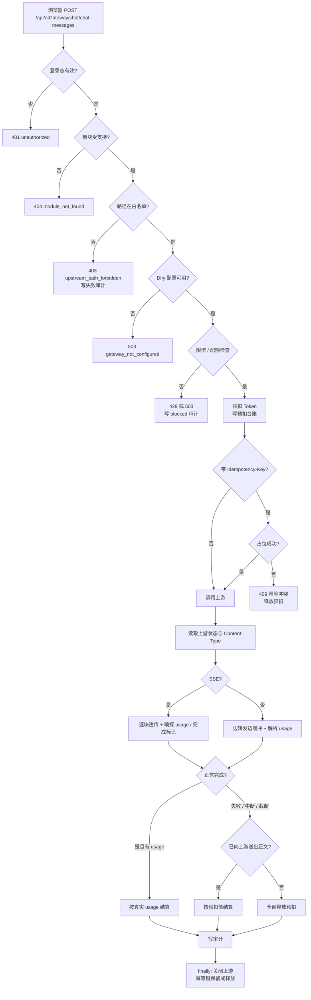
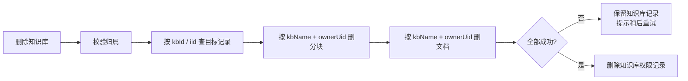

# 学习文档：仓库卫生与 AI 网关可靠性（Stage 0 + Stage 1）

> 本文对应第二轮升级的 Stage 0（公开仓库脱敏与基线卫生）与 Stage 1（网关 P0 与数据完整性）。
> 只讲**已经落地并测试通过**的行为，不描述尚未实现的能力。
> 文中不含数据库口令、Redis 口令、模型密钥、账号口令或真实姓名。

---

## 1. 本阶段解决了什么问题

| 编号 | 问题 | 修复 | 业务价值 |
| --- | --- | --- | --- |
| S0-1 | 公开仓库残留维护者姓名、演示口令提示 | 改为维护组与「口令以本地种子为准」 | 避免个人信息与凭据线索进入公开历史 |
| S0-2 | 本机编辑器配置被 Git 跟踪 | 取消跟踪，文件保留在本地 | 不把个人设置推给协作者 |
| S0-3 | 公开克隆无法独立编译后端，但 README 未说明 | README 明确私有框架/离线仓库不入库 | 降低外部使用者的无效尝试 |
| S1-1 | 网关把 Dify 整棵 API 树暴露给任意登录用户 | 增加「模块 + 方法 + 路径」白名单 | 收窄权限边界，防止借服务端密钥越权访问 |
| S1-2 | 写请求超时重试会重复计费 / 重复建数据 | `Idempotency-Key` 短期占位 | 把「重试」与「重复执行」分开 |
| S1-3 | 进程被强杀时预扣额度无人退还 | Redis 预扣台账 + 定时回收 | 额度不会莫名少一截 |
| S1-4 | 跨零点完成的长请求退不回第一天的额度 | 结算使用预扣时记下的 key | 修正午夜边界 |
| S1-5 | 「看到半截回答再点停止」可以免费 | 有正文输出即按预扣值计费 | 堵住靠中断白拿的漏洞 |
| S1-6 | 上游提前断流被当成正常结束，结算 0 | 识别 SSE 完成标记，缺失即判截断 | 真实消耗能被计费 |
| S1-7 | 删除文档先删主记录，可能留下可检索的孤儿分块 | 先删分块、后删文档；删知识库级联 | 检索结果不返回已删除文档 |
| S1-8 | 历史孤儿分块无清理手段 | 提供可重复执行的 SQL 脚本 | 存量数据可修复 |

---

## 2. 业务流程图

### 2.1 一次网关调用（以站内对话为例）



### 2.2 知识库删除（无数据库事务）



顺序是刻意设计的：先删子数据再删主记录。中途失败时主记录还在，用户可以从界面重试；
反过来先删主记录，失败后本地文档和分块就再也无法从界面定位。

---

## 3. 前端原则

本阶段后端改动为主，但网关行为会直接改变前端的错误处理方式。

### 3.1 永远不持有上游密钥

- 浏览器只请求同源 `/ai/api/aiGateway/**`，Dify 地址与密钥只存在于服务端。
- 前端不要尝试「直连 Dify 兜底」；直连模式是另一条经过配置的产品能力，不是网关失败后的降级。
- `user` 字段由后端按登录身份注入，前端传了也会被覆盖。

### 3.2 按错误码分支，不按文案猜

| HTTP | code | 前端动作 |
| --- | --- | --- |
| 403 | `upstream_path_forbidden` | 提示「该功能未开放」，不要重试 |
| 404 | `module_not_found` / `endpoint_not_found` | 记录并提示，通常是版本不匹配 |
| 409 | `idempotency_conflict` | 视为「上一次已处理」，不要再次提交 |
| 429 | `quota_exceeded` / `rate_limited` | 展示服务端文案；限流可退避重试 |
| 503 | `guard_unavailable` / `idempotency_unavailable` | 服务暂不可用，指数退避；不要提示「额度用完」 |
| 502 | `upstream_error` | 上游故障，可重试但要评估重复计费 |

### 3.3 重试策略

- **读请求**（GET）可以安全重试。
- **写请求**只有在带了 `Idempotency-Key` 时才重试；同一个逻辑操作复用同一个键，不要每次重试重新生成。
- 网络错误 / 超时 → 同键重试。
- 收到 409 → 停止重试，按「已成功」处理。
- 收到 4xx（除 409）→ 不重试。
- 用户点「停止」用 `AbortController.abort()`；前端展示「已停止」，并知道服务端可能按预扣值计费。

### 3.4 SSE 展示

- 先处理 `event: kb_sources`，再处理模型正文；来源顺序就是注入顺序。
- 不要在「停止」后把半截回答当完整回答保存。
- 错误事件可能藏在 HTTP 200 的流里，必须看事件内容而不是只看状态码。

---

## 4. 后端原则

### 4.1 收口，而不是转发

网关的职责是「只开放产品需要的上游能力」，不是「把上游 API 原样代理」。
因此路径白名单是**默认拒绝**：新增前端接口必须同步登记，否则 403。
这比只挡 `..` 更强，因为攻击面不是路径穿越，而是「合法路径但产品从未打算开放」。

### 4.2 治理 fail-closed

限流与配额是花钱的控制点。Redis 或配额表读不到时返回 503，而不是「读不到就当没限制」。
本项目的登录态本身依赖 Redis，Redis 故障时请求本来也进不来，因此放行并不能真正保住可用性，
只会静默失去治理能力。

### 4.3 预扣 + 结算，而不是「先调用再记账」

并发请求会在「检查额度」和「完成后计费」之间一起击穿额度。
预扣把窗口压缩到一次 Redis 自增：先占额度，结束后按真实 usage 多退少补；
失败则全额释放。

### 4.4 无事务的一致性靠「顺序 + 可重试 + 补偿」

项目没有引入事务管理器。删除类操作按以下原则保证最终一致：

1. 先删子数据，再删主数据；
2. 子数据删除失败时保留主数据，让操作可重试；
3. 提供存量清理脚本，处理历史残留；
4. 所有删除条件都带归属字段，避免同名资源误删。

### 4.5 计费只认真实发生

| 场景 | 是否计费 | 原因 |
| --- | --- | --- |
| 上游 4xx / 5xx | 否 | 用户没有拿到结果 |
| HTTP 200，但响应体是错误对象 | 否 | 上游明确表示失败 |
| SSE 一个字节都没送出就断开 | 否 | 上游可能刚开始，用户没有获得内容 |
| SSE 已送出正文后客户端断开 | 是，按预扣值 | 上游真实生成过，usage 拿不到 |
| SSE 已送出正文后上游连接中断 | 是，按预扣值 | 同上，且不是用户责任 |
| SSE 正常结束且有 usage | 是，按真实 usage | 最准确 |
| SSE 正常结束但没有 usage | 否 | 供应商未提供可核实的用量，保持既有口径 |

---

## 5. API 调用流程（关键顺序）

`AiGatewayService.doProxyEntry` 的顺序不能随意调整：

1. 网关开关；
2. 登录用户；
3. 模块是否支持；
4. 路径合法性（`..`、`%2e`）；
5. **路径白名单**；
6. Dify 配置解析；
7. 限流 + 配额检查；
8. 上传大小预检；
9. **预扣 Token**；
10. **幂等占位**（进入 `doProxy` 后、调用上游前）；
11. 调用上游；
12. 透传响应、解析 usage / 完成标记；
13. 计费判断；
14. 写审计；
15. `finally`：结算预扣、保留/释放幂等键、关闭上游。

为什么幂等占位在预扣之后？因为预扣失败（额度不足）时请求根本不会执行，没必要占用幂等键。
为什么幂等占位在上游之前？因为一旦上游收到请求，重复执行就可能已经产生费用或数据。

---

## 6. 数据库与 Redis 设计

### 6.1 关系表

**`aicalllogbean`（调用审计）**

| 字段 | 用途 |
| --- | --- |
| `userId` / `module` / `endpoint` / `method` | 谁、在哪个模块、调了什么 |
| `status` | `success` / `failed` / `blocked` / `aborted` |
| `httpStatus` | 上游真实状态（中断时也尽量记录真实值） |
| `promptTokens` / `completionTokens` / `totalTokens` | 用量；按预扣值计费时等于实际扣掉的额度 |
| `costCents` | 按模型单价折算的成本（分） |
| `requestId` | 全链路请求 ID |
| `firstTokenMs` | 首 token 延迟 |
| `latencyMs` / `clientIp` / `errorMessage` | 排障信息 |

**`aiuserquotabean`（每日配额）**

- `userId` 为用户 uid；部门共享池使用 `unit:{gid}` 作为 `userId`。
- `dailyTokenQuota` 为该池每日上限；0 表示不限。

**`kbdocbean` / `kbchunkbean`（本地 RAG）**

- 文档 `iid` 是分块 `docIid` 的引用目标。
- 删除顺序必须是「分块 → 文档」，否则中途失败会留下仍可检索的孤儿分块。
- 知识库删除按 `kbName + ownerUid` 收窄，避免同名知识库误删他人文档。

### 6.2 Redis key（不含任何密钥）

| Key | 类型 | 作用 | TTL |
| --- | --- | --- | --- |
| `ai:gateway:rate:{uid}:{yyyyMMddHHmm}` | String | 每分钟限流 | 120 秒 |
| `ai:gateway:tokens:{uid}:{yyyyMMdd}` | String | 用户/部门池当日用量 | 2 天 |
| `ai:gateway:reservation:index` | ZSet | 未结算预扣的时间索引 | 随成员清理 |
| `ai:gateway:reservation:{uuid}` | Hash | 单笔预扣台账 | 2 小时 |
| `ai:gateway:idem:{uid}:{module}:{key}` | String | 写请求幂等占位 | 10 分钟 |

### 6.3 迁移方案

本次代码改动**没有新增表或列**，无需 DDL 迁移。存量数据修复是独立脚本：

```bash
# 1. 先备份
pg_dump -Fc <数据库名> > backup_before_kbchunk_cleanup.dump

# 2. 执行 scripts/sql/cleanup-orphan-kbchunks.sql
#    脚本内先 SELECT 预检，再在事务中 DELETE，最后复核应为 0
```

脚本只删除「`docIid` 为空」或「`docIid` 找不到对应文档」的分块。
它**不会**根据 `kbName` 缺失去删文档，因为名称与上游数据集的对应关系由业务维护，
仅凭名称判断会误删正在使用的本地文档。

---

## 7. 核心代码讲解

### 7.1 `DifyEndpointPolicy`

文件：`backend/AIProject/app-business/app-business-service/src/main/java/com/aiproject/ai/service/gateway/DifyEndpointPolicy.java`

- `isAllowed(module, method, endpoint)`：按模块分派到 `allowsChat` / `allowsFile`。
- `splitAndValidate`：
  - 拒绝 `\`、`%`、`?`、`#`；
  - 拒绝空段、`.`、`..`、超长段；
  - 段内只允许字母、数字、`-`、`_`。
- 好处：不需要先解码再判断，避免「解码一次」和「解码两次」的理解差异。
- 代价：新增接口必须登记；这是有意的摩擦，防止能力被悄悄放大。

### 7.2 `AiIdempotencyGuard`

文件：`.../gateway/AiIdempotencyGuard.java`

生命周期：

1. `acquire`：GET/HEAD/OPTIONS 或没带键 → 不介入；
2. 键格式非法 → 400；未登录 → 401；Redis 不可用 → 503；
3. `setIfAbsent(key, "1", 10min)` 成功 → 返回 `Lease`；失败 → 409；
4. 请求成功或已产生实际效果 → `complete`（续期，重复请求继续 409）；
5. 请求没有产生效果 → `release`（允许同键重试）。

为什么不做「结果缓存」：对话响应可能是大段 SSE，缓存响应体会带来内存与一致性问题。
这里只保证「不重复执行」，409 已经足以让客户端知道上一次处理过。

### 7.3 `AiGatewayGuard` 的预扣台账

文件：`.../gateway/AiGatewayGuard.java`

- `reserve`：
  - 用户池、部门池分别自增；
  - 任一超额则回滚两个池；
  - 成功后写台账 Hash，并加入 ZSet 索引。
- `settle`：
  - 先用 `AtomicBoolean` 保证同一进程只结算一次；
  - 再通过 Lua 把台账状态从 `active` 改为 `settled`；
  - 只有认领成功才调整计数，避免多进程重复退款。
- 跨零点：结算使用 `Reservation` 里保存的 `userKey` / `unitKey`，不按结算时间重新拼日期。
- `reapExpiredReservations`：每 10 分钟扫描超过 30 分钟仍未结算的台账，原子认领后反向调整。

为什么「先认领再调整」：如果先调整再认领，进程在两步之间崩溃会导致重复退款；
先认领最多导致「少退一次」，两者相权取少退。

### 7.4 `AiGatewayService` 的计费判断

文件：`.../gateway/AiGatewayService.java`

- `shouldBillPartialOutput`：只有「上游已受理、已送出正文字节、且不是空中断」才按预扣值计费。
- `truncatedStream`：SSE 没有完成标记、没有 usage、但已经送出正文 → 判定上游提前断流。
- 审计写入放在计费判断之后：按预扣值计费时，审计里的 `totalTokens` 必须等于真正扣掉的额度。
- `finally`：
  - 结算预扣；
  - 上游已受理则保留幂等键，否则释放；
  - 关闭上游连接。

### 7.5 `AiGatewayUsageParser` 的完成标记

文件：`.../gateway/AiGatewayUsageParser.java`

`streamCompleted` 在以下情况置为 `true`：

- `data: [DONE]`；
- Dify `message_end` / `workflow_finished`；
- Agent `response.completed` / `response.failed`；
- OpenAI `finish_reason` 非空；
- `error` 事件（已失败，但流确实结束了）。

没有完成标记的流不能当作成功：否则上游提前断开时，用户等于免费获得了半截回答。

### 7.6 删除顺序

- `KbRagHolder.deleteDoc`：先按 `docIid + lastuser` 删除分块，再按 `iid + lastuser` 删除文档。
- `KnowledgeBaseBeanHolder.delete`：先查目标记录，按 `kbName + ownerUid` 级联分块和文档，全部成功后才删知识库记录。

---

## 8. 异常处理清单

| 异常 | 处理 | 用户看到 |
| --- | --- | --- |
| 路径穿越 | 400 `invalid_endpoint` | 非法路径 |
| 白名单外接口 | 403 `upstream_path_forbidden` | 功能未开放 |
| Dify 未配置 | 503 `gateway_not_configured` | 联系管理员配置 |
| 限流超限 | 429 `rate_limited` | 请稍后再试 |
| 每日额度用尽 | 429 `quota_exceeded` | 今日额度已用完 |
| Redis / 配额表不可用 | 503 `guard_unavailable` | 服务暂不可用 |
| 幂等键格式非法 | 400 `invalid_idempotency_key` | 请求头不合法 |
| 幂等键重复 | 409 `idempotency_conflict` | 请勿重复提交 |
| 幂等服务不可用 | 503 `idempotency_unavailable` | 服务暂不可用 |
| 上游 HTTP 失败 | 502 `upstream_error` | AI 服务调用失败 |
| 客户端主动断开 | 不向容器抛异常，记 `aborted` | 前端显示「已停止」 |
| 上游提前断流 | 记 `failed`，按预扣值计费 | 回答可能不完整 |
| 知识库级联删除失败 | 保留知识库记录 | 请稍后重试 |

---

## 9. 验收标准与验证方式

| 验收项 | 标准 | 验证方式 |
| --- | --- | --- |
| 路径白名单 | 前端使用的端点全部放行；未登记端点 403 且不打上游 | `DifyEndpointPolicyTest`、`AiGatewayServiceTest` |
| 白名单覆盖 | 前端 `src/api` 中出现的 Dify 路径均在测试中登记 | 代码检索 + 正例测试 |
| 幂等 | 无键行为不变；重复键 409；Redis 故障 503；失败释放 | `AiIdempotencyGuardTest`、`AiGatewayServiceTest` |
| 预扣台账 | 预扣写台账；结算原子认领；回收只退一次 | `AiGatewayGuardTest` |
| 跨零点 | 结算使用预扣时的 key | `AiGatewayGuardTest` |
| 中断计费 | 零字节释放；有正文按预扣值；HTTP ≥400 不计费 | `AiGatewayServiceTest` |
| 截断计费 | 缺少完成标记且已有正文 → failed + 按预扣值 | `AiGatewayUsageParserTest`、`AiGatewayServiceTest` |
| 删除一致性 | 分块先删；归属收窄；失败保留主记录 | `KbRagHolderTest`、`KnowledgeBaseBeanHolderTest` |
| 存量修复 | SQL 可重复执行，预检/复核为 0 | `scripts/sql/cleanup-orphan-kbchunks.sql` |
| 无回退 | 后端全量测试、前端类型检查/单测/组件测试/E2E/构建均通过 | 本地命令执行 |
| 脱敏 | 仓库产物无密钥痕迹 | `npm run check:secrets` |

已执行命令（在工作区根目录或对应模块目录）：

```bash
# 后端全量测试（JDK 8 + 离线 Maven 仓库）
cd backend/AIProject
mvn -s ../../hd_redis/ai-maven/conf/settings.xml \
    -Dmaven.repo.local=../../hd_redis/ai-maven/pro -o test

# 前端
cd frontend
npm run typecheck
npm test
npm run test:component
npm run test:e2e
npm run build
npm run check:secrets
```

---

## 10. 面试问答

### Q1：为什么网关要做路径白名单，只挡 `..` 不够吗？

只挡穿越解决的是「读到不该读的文件路径」，但这里的风险是「合法路径、产品没打算开放」。
服务端持有 Dify 应用/数据集密钥，如果不做白名单，任何登录用户都能调用工作流、租户设置、
模型供应商等接口。白名单是默认拒绝，把能力边界写进代码和测试。

### Q2：为什么要预扣 Token，不能等请求结束再扣吗？

检查和扣费之间有时间窗。并发请求都能通过检查，最后一起超额。
预扣把窗口压缩到一次 Redis 自增，结束后按真实 usage 多退少补。

### Q3：长请求跨零点，预扣额度退不回来怎么办？

结算时不要重新按当前日期拼 key，而是使用预扣时保存的 key。
这是一个很小的实现细节，但错了会导致第一天的额度永久占用、第二天的额度被误扣。

### Q4：进程被 `kill -9`，`finally` 没执行，预扣怎么办？

写一份预扣台账（Hash + ZSet 索引），定时任务扫描超过阈值仍未结算的记录，
用 Lua 原子认领后反向调整。只退不扣，重复执行由状态机兜住。

### Q5：为什么台账要「先认领再调整计数」？

调整计数不是原子的，进程可能在「调整」和「标记已处理」之间崩溃。
先认领（active → settled）可以保证最多只有一个进程执行调整；
代价是崩溃时可能少退一次，这比重复退款（额度凭空变多）更容易接受。

### Q6：幂等键为什么不缓存响应？

对话响应可能是大段 SSE，缓存成本高、回放语义复杂。
这里只需要保证「同一个操作不执行两次」，所以做短期占位：
第一次放行，成功后续期，重复请求 409；失败则释放，允许同键重试。

### Q7：客户端点「停止」和上游超时，计费为什么不同？

两者都要看「是否已经有正文送出」。
一个字节都没送出：用户没拿到内容，全额释放；
已经送出正文：上游真实生成过，SSE 的 usage 又只在最后一帧，拿不到准确值，因此按预扣值结算。
区别只在审计状态：客户端断开记 `aborted`，上游失败记 `failed`。

### Q8：怎么区分「正常结束但没给 usage」和「上游提前断流」？

看流里有没有完成标记：[DONE]、message_end、workflow_finished、finish_reason。
正常结束但没有 usage：按既有口径不计费；
有正文但没有完成标记：判定截断，按预扣值计费。
只判断「有没有 usage」会把这两种情况混为一谈。

### Q9：项目没有事务，删除知识库怎么保证一致性？

先删子数据、再删主数据；子数据失败时保留主数据，让用户可重试；
删除条件带归属字段，避免同名资源误删；
历史残留用可重复执行的 SQL 清理。
这不是强一致，但在没有事务管理器的前提下是可预期、可恢复的最终一致。

### Q10：为什么治理组件故障要 fail-closed？

限流和配额是成本控制点。Redis 挂了就放行，等于一次抖动期间额度控制完全失效。
而且本项目的登录态本来就存 Redis，Redis 挂了请求通常也进不来；
「为保可用性而放行」保护的东西其实已经不存在了。

### Q11：并发请求怎么避免重复计费？

两条线：
请求前用预扣占额度，请求后用真实 usage 结算并释放差额；
写请求用幂等键占位，重复请求在到达上游之前就被 409 挡住。
前者解决「并发击穿额度」，后者解决「客户端重试重复执行」。

### Q12：前端遇到 409、429、503 分别应该怎么做？

409 表示上一次已经处理过，停止重试并按成功处理；
429 是额度或频率问题，展示服务端文案，限流可退避；
503 是治理依赖不可用，指数退避，不要误导用户「额度用完」。
错误码要稳定，文案可以变。

---

## 11. 下一阶段

Stage 2 是 RAG 评估工作台。开始前需要确认：

- 评估指标口径（Recall@K、Precision@K、MRR、NDCG）与现有 `RagEvaluator` 是否一致；
- 评估语料与真实知识库的隔离方式；
- 结果落库与前端展示的验收标准。

在确认之前不改代码。
