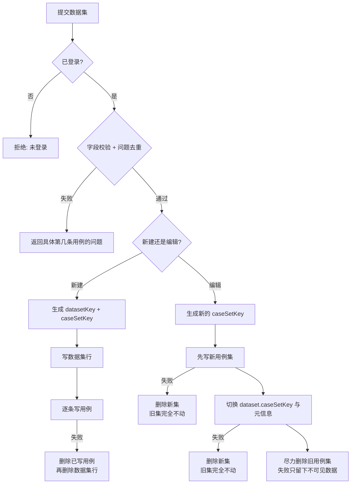
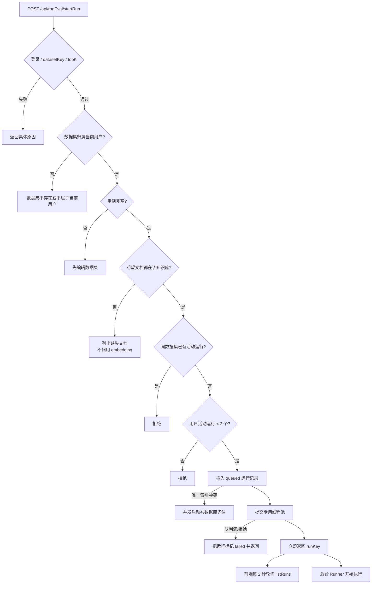
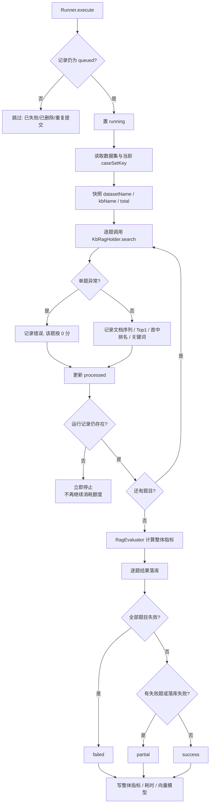
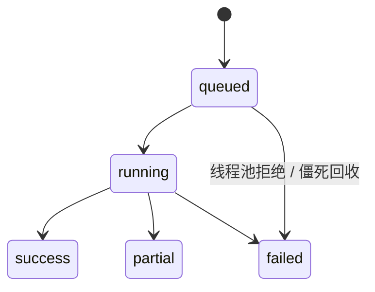

# 学习文档：RAG 评估工作台（Stage 2）

> 本文对应第二轮升级的 Stage 2：把已有的检索评估算法做成可持久化、可异步执行、
> 可对比历史的工作台。
>
> 只讲**已经落地并测试通过**的行为，不描述尚未实现的能力。
> 文中不含数据库口令、Redis 口令、模型密钥、账号口令或真实姓名。

---

## 1. 本阶段解决了什么问题

Stage 1 之前，检索质量只能靠仓库里的评估脚本跑一次、看一份控制台输出。
指标算法（`RagEvaluator`）和黄金集测试已经存在，但缺的是「产品内可用的闭环」：

| 编号 | 问题 | 本阶段做法 | 业务价值 |
| --- | --- | --- | --- |
| S2-1 | 评估只能跑脚本，结果不落库，无法对比两次改动 | 数据集、用例、运行、逐题结果四张表 | 「改完到底有没有变好」有据可查 |
| S2-2 | 前端没有入口，评估是研发专属动作 | 新增「知识库中心 → RAG 评估」页面 | 产品/测试也能维护黄金集 |
| S2-3 | 几十道题的检索请求会超过 HTTP 超时 | 接口只建运行记录并提交线程池，前端轮询进度 | 请求快速返回，进度真实可见 |
| S2-4 | 编辑用例集中途失败可能留下「一半新、一半旧」 | 用例集写时复制（caseSetKey 版本切换） | 失败时旧数据仍完整可用 |
| S2-5 | 期望文档名写错，要等付费 embedding 跑完才看到一堆 0 分 | 启动前校验文档是否已上传 | 错误在花钱之前暴露 |
| S2-6 | 同一数据集被重复点击启动，浪费额度且「最新一次」语义不清 | 活动运行唯一索引 + 应用层前置校验 | 同一数据集同时只有一轮 |
| S2-7 | 单题向量服务抖动会让整轮评估没有结果 | 每题独立 try/catch，失败题按 0 分并标记 | 其余题目的结果仍然可用（`partial`） |
| S2-8 | 服务重启后运行记录卡在 `running`，该数据集再也发不起评估 | 定时回收超过 30 分钟的活动运行 | 不会永久占住唯一索引 |
| S2-9 | 运行中被删除的记录仍可能继续消耗额度 | 每处理一题都检查记录是否存在 | 删除即停 |

一个关键约束：**指标算法没有重写**。`RagEvaluator` 及其黄金集测试在 Stage 2 之前
就存在，本阶段只做持久化编排、异步执行和前端工作台，保证「产品内一套口径、
CI 脚本同一套口径」。

---

## 2. 业务流程图

### 2.1 新建 / 编辑数据集（无数据库事务）



顺序是刻意设计的：**先让新版本落稳，再切换指针，最后清理旧版本**。
中途任何一步失败，用户看到的仍是完整可用的旧用例集。

### 2.2 发起一轮评估



### 2.3 后台执行与状态机





`queued` 与 `running` 是活动状态，其余是终态。
只有 `success` 与 `partial` 可以作为下一次运行的对比基线。

---

## 3. 前端原则

### 3.1 只展示真实进度

- 进度条的分母是运行记录里的 `total`，分子是后端实际处理完的题数 `processed`。
- 没有「假动画进度」，也没有先用前端估算值再对齐。
- 任务处于 `queued` / `running` 时才启动轮询；进入终态后立即停止。
- 离开页面时清理定时器，避免组件卸载后仍持续请求。

### 3.2 轮询的生命周期

```ts
// 仅活动状态启动定时器
if (hasActiveRun.value) {
  if (pollTimer === null) {
    pollTimer = window.setInterval(poll, 2000)
  }
} else {
  stopPolling()
}
```

- `onUnmounted` 里 `stopPolling()`。
- 轮询失败**不弹错误提示**：下一次轮询会自动重试，网络抖动不应该打断用户。
- 只有手动刷新、首次加载失败才提示。
- 切换数据集时先停轮询、清空详情，再并行加载新详情与运行历史。

### 3.3 指标展示口径

- 指标统一保留 **4 位小数**：`formatMetric`，避免 `0.6` 与 `0.60` 混用。
- 与基线对比用 **百分点（pp）**：`(value - base) * 100`，而不是相对百分比。
  - 0.60 → 0.65 是 `+5.0pp`，不是 `+8.3%`。
- 差值绝对值小于 0.05pp 显示「持平」，避免浮点误差造成的 `+0.0pp`。
- 没有基线显示「首次运行」。
- 关键词命中率用百分比展示，但底层仍是 0-1 的比例。

### 3.4 HNSP 请求包格式

后端按**方法参数名**映射请求体，DTO 参数必须包在 `data` 字段里：

```ts
startRun: (datasetKey: string, topK: number) =>
  axios.post('/ai/api/ragEval/startRun', { data: { datasetKey, topK } }),
```

浏览器冒烟测试会直接断言请求体等于 `{ data: { datasetKey, topK } }`，
防止以后有人「顺手」改成裸对象后只有联调时才暴露。

### 3.5 CSV 黄金集导入

- 文件上限 **2MB**，读取为 UTF-8 文本。
- 表头支持中英文别名：
  - 问题：`question` / `问题`
  - 期望文档：`expected_doc` / `期望文档` / `标准文档`
  - 关键词：`expected_keywords` / `keywords` / `关键词`
  - 题型：`category` / `题型` / `分类`
- 支持 BOM、引号包裹的逗号、转义双引号（`""`）。
- 表头缺列或某行缺问题/期望文档时**整体拒绝**，并指出第几行：
  宁可让用户改 CSV，也不要把整列问题静默导成空字符串。
- 导入时保留编辑器中已填写但未保存的非空用例，替换空白行。

### 3.6 前端校验是体验，不是安全边界

前端会做必填、重复问题、长度上限等校验，但后端 `normalize` 会再完整校验一次。
长度上限、用例数、关键词数都以服务端为准。

### 3.7 样式与图标约束

- 页面只使用现有设计 token / CSS 变量，不新增硬编码色值。
- 图标按组件局部导入，不依赖 `main.ts` 的全局注册；
  这样 jsdom 组件测试与真实浏览器行为一致。

---

## 4. 后端原则

### 4.1 指标只保留一套实现

`RagEvalRunner` 不自己算指标，只把每题的文档序列交给 `RagEvaluator`：

```java
RagEvaluator.EvalReport report = RagEvaluator.evaluate(evalCases, topK);
```

这样评估工作台、黄金集测试、未来可能增加的 CI 门禁共用同一份公式，
不会出现「页面上 0.81、脚本里 0.79」的口径分裂。

### 4.2 归属隔离放在 Holder，而不是 Controller

所有查询与修改条件都带 `lastuser = 当前用户`：

```java
RagEvalDatasetBean where = new RagEvalDatasetBean();
where.setDatasetKey(datasetKey);
where.setLastuser(uid);
```

- 数据集与运行记录都是用户私有资产。
- 没有管理员越权入口；管理员要评估也只能建自己的数据集。
- Controller 只做参数透传，避免「某个入口忘了校验」。

### 4.3 无事务环境下的写时复制

项目没有引入事务管理器。编辑数据集采用：

1. 生成新的 `caseSetKey`；
2. 把新用例全部写入新版本；
3. 更新数据集行，把 `caseSetKey` 指向新版本；
4. 尽力删除旧版本。

任何一步失败都只删除新版本，旧版本指针未被改动。
删除旧版本失败也不影响正确性：它只是不再被任何数据集引用，属于不可见的历史数据。

### 4.4 先做便宜且确定的校验，再花钱

`startRun` 的顺序是：

1. 参数与归属；
2. 用例非空；
3. 期望文档是否都存在于该知识库；
4. 活动运行数量；
5. 才创建运行记录并提交线程池。

向量检索按题计费/计额度。文档名写错是最常见的配置错误，
把它挡在 embedding 之前，能避免「跑完 50 题才发现全是 0 分」。

### 4.5 后台任务必须有终态

任何未捕获异常都要落到运行记录上：

- `execute` 外层兜底 → `failed`；
- 单题异常 → 该题 0 分，整轮变 `partial`；
- 全部题目失败 → `failed`；
- 线程池拒绝 → 立即把 queued 改成 failed，而不是让前端永久等待；
- 服务重启 → 定时任务回收超过 30 分钟的活动运行。

如果记录停在 `running`，不仅前端一直转圈，活动运行唯一索引还会挡住该数据集
后续所有评估。

### 4.6 运行开始时做快照

- 运行记录保存 `datasetName`、`kbName`、`total`；
- 逐题结果保存问题、期望文档、关键词、题型；
- 评估过程中编辑数据集不会改写正在跑的这一轮；
- 运行记录即使后来数据集改名，历史仍能解释当时的语境。

### 4.7 文档级评估口径

检索返回的是分块，但指标按**文档**计算：

- 同一文档的多个分块映射到同一个文档 ID；
- Recall 看期望文档是否出现在 top-k；
- Precision / NDCG 对同一文档去重（取最靠前的位置）；
- 关键词命中则要求「期望文档的**同一条命中分块**里包含全部关键词」。

为什么关键词不跨分块累计：跨分块命中无法证明模型拿到的是一个完整答案段落，
可能只是两个不相关片段拼出了关键词。

### 4.8 有界队列，不做「无限排队」

线程池：核心 1、最大 2、队列 20、`AbortPolicy`。

一次评估最多 200 题，如果队列无界，用户会以为任务已排队，
实际可能几十分钟后才开始跑；有界队列 + 立即失败更诚实。

---

## 5. API 调用流程

所有接口均为 `POST`，统一返回 HNSP `Result` 外壳：

```json
{ "resp_code": 0, "resp_msg": "ok", "datas": {} }
```

| 接口 | 作用 | 关键返回 |
| --- | --- | --- |
| `/api/ragEval/listDatasets` | 当前用户的数据集列表 | `List<RagEvalDatasetBean>` |
| `/api/ragEval/getDataset` | 数据集详情 + 当前生效用例 | `{ dataset, cases }` |
| `/api/ragEval/createDataset` | 新建数据集 | `datasetKey` |
| `/api/ragEval/updateDataset` | 整体替换当前用例集 | `true` |
| `/api/ragEval/deleteDataset` | 删除数据集与全部运行历史 | `true` |
| `/api/ragEval/startRun` | 启动异步评估 | `runKey` |
| `/api/ragEval/listRuns` | 运行历史，可按数据集过滤 | `List<RagEvalRunBean>` |
| `/api/ragEval/getRun` | 整体指标 + 逐题结果 + 对比基线 | `{ run, results, baseline }` |
| `/api/ragEval/deleteRun` | 删除一次运行及其逐题结果 | `true` |

### 5.1 启动评估

请求：

```json
{
  "data": {
    "datasetKey": "0f0c...",
    "topK": 5
  }
}
```

返回：

```json
{
  "resp_code": 0,
  "resp_msg": "评估已启动，共 12 条用例",
  "datas": "8b1e..."
}
```

### 5.2 查询运行详情

请求：

```json
{ "data": { "runKey": "8b1e..." } }
```

返回结构：

```json
{
  "run": {
    "status": "success",
    "total": 12,
    "processed": 12,
    "recall": 0.9167,
    "precision": 0.5833,
    "mrr": 0.875,
    "ndcg": 0.8421,
    "keywordHitRate": 0.75,
    "missCount": 1,
    "keywordEvaluatedCount": 8,
    "embeddingModel": "...",
    "durationMs": 5230
  },
  "results": [
    {
      "caseIndex": 0,
      "question": "...",
      "expectedDoc": "...",
      "retrievedDocs": ["..."],
      "topDoc": "...",
      "firstHitRank": 1,
      "recall": 1,
      "precision": 0.5,
      "reciprocalRank": 1,
      "ndcg": 1,
      "keywordHit": true,
      "keywordEvaluated": true
    }
  ],
  "baseline": { "runKey": "...", "status": "success", "recall": 0.8333 }
}
```

`baseline` 的选取规则：

1. 同一数据集的更早运行（`iid` 更小）；
2. 状态为 `success` 或 `partial`；
3. 取最近的一条。

`failed` 运行不参与对比：它没有可用指标，拿来当基线只会制造噪声。

---

## 6. 数据库设计

### 6.1 四张表

四张表都带框架公共字段：`iid`（自增主键）、`lastuser`（归属）、`createtime`、
`updatetime`、`enable`、`app`。对外只暴露 UUID 业务键，不暴露自增 `iid`。

**`ragevaldatasetbean`（数据集）**

| 字段 | 用途 |
| --- | --- |
| `datasetKey` | 稳定业务键，唯一索引 |
| `name` | 数据集名称；`(lastuser, name)` 唯一 |
| `kbName` | 评估语料所在知识库 |
| `description` | 评估范围 / 语料版本 / 标注口径 |
| `caseCount` | 当前生效用例数（冗余，列表页不查明细） |
| `caseSetKey` | 当前生效的用例集版本 |

**`ragevalcasebean`（用例）**

| 字段 | 用途 |
| --- | --- |
| `datasetKey` | 所属数据集 |
| `caseSetKey` | 所属版本 |
| `question` | 问题 |
| `expectedDoc` | 期望命中的文档名 |
| `expectedKeywords` | 关键词 JSON 数组 |
| `category` | 题型（默认「未分类」） |

`(datasetKey, caseSetKey)` 索引让「读取当前版本」只扫属于该版本的行。

**`ragevalrunbean`（运行汇总）**

| 字段 | 用途 |
| --- | --- |
| `runKey` | 稳定业务键，唯一索引 |
| `datasetKey` / `datasetName` / `kbName` | 数据集标识 + 运行开始时的快照 |
| `topK` | 本轮截断位置 |
| `status` | `queued/running/success/partial/failed` |
| `total` / `processed` | 真实进度 |
| `recall` / `precision` / `mrr` / `ndcg` | 整体指标 |
| `keywordHitRate` / `keywordEvaluatedCount` | 关键词命中率与参与统计的题数 |
| `missCount` | 完全漏召的题数 |
| `embeddingModel` | 本轮实际使用的向量模型快照 |
| `errorMessage` | 失败或部分失败原因（截断到 1000 字符） |
| `startedAt` / `finishedAt` / `durationMs` | 时间与耗时 |

**`ragevalcaseresultbean`（逐题结果）**

保存题目与期望的快照，以及 `retrievedDocs`（JSON 数组）、`topDoc`、`firstHitRank`、
四项指标、关键词命中标记、单题耗时和错误信息。

### 6.2 索引

| 索引 | 作用 |
| --- | --- |
| `ragevaldataset_key`（唯一） | 按业务键定位数据集 |
| `ragevaldataset_owner_name`（唯一） | 同一用户不能重名 |
| `ragevalcase_dataset_set` | 读取某个版本的用例 |
| `ragevalcase_user` | 按归属过滤 |
| `ragevalrun_key`（唯一） | 按业务键定位运行 |
| `ragevalrun_user_dataset` | 列表页按用户 + 数据集倒序 |
| `ragevalrun_status_time` | 扫描活动 / 僵死运行 |
| `ragevalrun_active`（部分唯一） | 同一用户对同一数据集最多一个活动运行 |
| `ragevalresult_run` | 按运行读取逐题结果 |
| `ragevalresult_user` | 按归属过滤 |

活动运行唯一索引是**数据库层的最后一道闸门**：

```sql
CREATE UNIQUE INDEX idx_ragevalrun_active
    ON ragevalrunbean ("lastuser", "datasetKey")
    WHERE "status" IN ('queued', 'running');
```

应用层的「先查再插」在并发下仍有窗口，唯一索引负责兜底；
插入冲突时接口返回「已有正在进行的评估」。

### 6.3 迁移方案

两条路径，DDL 必须保持一致：

1. **应用启动自动迁移**：`TableSchemaInitializer.ensureRagEvalTables()`，
   全部 `CREATE TABLE IF NOT EXISTS` / `CREATE INDEX IF NOT EXISTS`，可重复执行。
2. **手工 / 其它环境迁移**：`scripts/sql/rag-eval-schema.sql`，
   结构与应用启动时完全一致，方便 DBA 在不重启应用时执行。

脚本末尾附了「编辑用例集时旧版本清理失败」的维护查询（默认注释，不自动执行）：

```sql
-- 只删除 dataset.caseSetKey 已经不再指向的旧版本
-- 正在使用的用例不会命中
```

本次是**纯新增表**，不修改已有表结构，不影响存量数据。

---

## 7. 核心代码讲解

### 7.1 `RagEvalHolder`

文件：`backend/AIProject/app-business/app-business-service/src/main/java/com/aiproject/ai/service/holde/RagEvalHolder.java`

职责：校验、归属隔离、持久化编排、异步任务提交。指标与检索都不在这里。

关键常量：

| 常量 | 值 | 目的 |
| --- | --- | --- |
| `MAX_CASES` | 200 | 单次评估上限 |
| `MAX_ACTIVE_RUNS_PER_USER` | 2 | 单用户活动任务上限 |
| `DEFAULT_TOP_K` | 5 | 未传 topK 时的默认值 |

`normalize` 会：

- 去首尾空白；
- 名称 / 知识库 / 说明 / 问题 / 文档名 / 关键词 / 题型逐项校验长度；
- 关键词去空、去重，保持首次出现顺序；
- 题型为空时填「未分类」；
- 问题重复直接拒绝，并指出重复内容。

`createDataset` 在用例写入失败时会回收刚插入的数据集行，
避免留下一个「用例数为 N、实际一条都没有」的空壳。

`updateDataset` 的四步顺序见 4.3；旧用例集删除失败只记 `warn`，
因为新版本已经生效，旧数据不可见，不影响本次保存。

`deleteDataset`：

1. 先检查是否还有活动运行，有则拒绝；
2. 逐条删除运行结果与运行记录；
3. 删除用例；
4. 最后删除数据集行。

仍然是「先子后主」：中途失败时数据集还在，用户可以从页面重试。

`startRun` 在插入 `queued` 记录后提交线程池；如果线程池拒绝，
会把该记录标记为 `failed` 并返回错误，而不是留下一个永远不会执行的 `queued`。

### 7.2 `RagEvalRunner`

文件：`backend/AIProject/app-business/app-business-service/src/main/java/com/aiproject/ai/service/rag/RagEvalRunner.java`

- `execute` 外层兜底所有未捕获异常。
- `doExecute` 只在记录仍为 `queued` 时执行，避免与僵死回收、重复提交竞争。
- 每题独立 `evaluateCase`，失败只影响该题。
- 每次更新 `processed` 都检查 `updateRun` 的返回值；
  记录被删除时立即返回，不再继续检索。
- 全部题目处理完后统一调用 `RagEvaluator.evaluate`。
- 最终状态：

| 条件 | 状态 |
| --- | --- |
| 全部题目检索异常 | `failed` |
| 部分题目异常 | `partial` |
| 逐题结果有落库失败 | `partial` |
| 全部成功且全部落库 | `success` |

- `@Scheduled(fixedDelay = 5 分钟, initialDelay = 2 分钟)` 扫描
  `queued/running` 且 `startedAt` 早于 30 分钟前的记录，标记 `failed`。
  这个任务只影响「确实卡住」的运行，不会碰正在正常执行的任务。

### 7.3 `RagEvaluator`

文件：`backend/AIProject/app-business/app-business-service/src/main/java/com/aiproject/ai/service/rag/RagEvaluator.java`

指标口径（全部为文档级、二值相关）：

| 指标 | 计算 |
| --- | --- |
| Recall@k | 相关文档被 top-k 覆盖的数量 `/` 相关文档总数；无相关文档时返回 1 |
| Precision@k | `topK` 中相关文档去重后数量 `/ min(k, 实际返回数)` |
| RR | 第一条相关文档排名的倒数；未命中为 0 |
| MRR | 所有题 RR 的平均 |
| NDCG@k | `DCG / IDCG`，`DCG = Σ rel_i / log2(i+1)` |

两个容易错的地方：

1. **Precision 的分母**不是固定的 k，而是 `min(k, retrieved.size())`。
   只检索出 2 条时，不应该因为「没凑满 5 条」被判低分。
2. **同一文档出现多次只计一次**。文档级评估下 top-k 会混着同一文档的多个分块，
   不去重会让 Precision 虚高、DCG 超过 IDCG，NDCG 甚至大于 1。
   这是第一次真实跑分（NDCG 出现 1.39）暴露的问题，合成单测覆盖不到。

为什么不用 RAGAS 那套生成侧指标：那些指标需要 LLM-as-judge，每次评估都花钱、
结果不稳定，不适合放进 CI。检索侧指标是确定性的，能在每次提交时跑。
生成侧指标（faithfulness / answer relevancy）更适合人工月度抽检。

### 7.4 `RagEvalKeywordCodec`

关键词与文档列表都以 JSON 文本存储。解析时做了兼容：

- 正常 JSON 数组 → 直接使用；
- 不是 JSON 且不是以 `[` 开头的纯文本 → 按空白切分。

这样手工导入的旧格式关键词不会静默丢失。

### 7.5 专用线程池 `RagEvalExecutorConfig`

- 核心 1 / 最大 2 / 队列 20；
- `AbortPolicy`：队列满时立即抛异常，由 Holder 转成「队列繁忙」；
- 线程名前缀 `rag-eval-`，排障时能从线程栈直接认出来。

评估是「大量串行 embedding + 检索」的 IO 型任务，不能占用 Web 请求线程；
但也不适合无限并发，否则会同时打爆向量服务。

### 7.6 前端 `useIndex`

文件：`frontend/src/views/RagEvalView/index.ts`

- `loadDatasets` 自动选中第一个数据集（或保留当前选择），再并行加载详情与运行历史。
- `syncPolling` / `stopPolling` 根据是否存在活动运行启停 2 秒定时器。
- `poll` 用 `pollBusy` 防止上一轮未返回时叠加请求；
  只有当 `datasetKey` 未变化时才写入结果，避免切换数据集后旧响应覆盖新页面。
- `startRun` 成功后刷新运行历史，并用返回的 `runKey` 直接打开详情。
- `listen` 不到 SSE：评估是「低频状态变化」，轮询更简单，断线自动恢复，
  不需要维护长连接与重连状态机。

### 7.7 CSV 解析

文件：`frontend/src/views/RagEvalView/csv.ts`

手写状态机而不是引库：

- 需求只有「逗号分隔 + 引号转义 + BOM + 换行」；
- 引库会增加打包体积与依赖面；
- 手写后可以用纯函数测试覆盖边界，包括引号内的逗号、转义双引号、空行。

---

## 8. 异常处理清单

| 异常 | 后端处理 | 用户看到 |
| --- | --- | --- |
| 未登录 | 直接拒绝，不发查询 | 未登录或登录已过期 |
| 数据集不存在 / 不属于当前用户 | 查询条件带 `lastuser`，查不到即拒绝 | 数据集不存在或不属于当前用户 |
| 名称重复 | `(lastuser, name)` 唯一索引 + 前置查询 | 数据集名称已存在 |
| 用例字段非法 | `normalize` 指出第几条、哪个字段 | 具体校验信息 |
| 问题重复 | 构造 `HashSet` 检测 | 存在重复问题 |
| 用例写入失败（新建） | 回收用例与数据集行 | 用例保存失败，请重试 |
| 用例写入失败（编辑） | 删除新版本，旧版本不动 | 原数据集未改动 |
| 期望文档不存在 | 启动前一次性列出缺失文档 | 缺失文档清单 |
| 同数据集重复启动 | 应用层检查 + 部分唯一索引 | 已有正在进行的评估 |
| 用户活动任务超过 2 个 | 启动前计数 | 请等待当前任务完成 |
| 线程池队列满 | 记录标记 `failed` | 评估任务队列繁忙 |
| 单题检索异常 | 该题 0 分，整轮 `partial` | 详情里显示失败原因 |
| 全部题目失败 | 整轮 `failed` | 全部用例检索失败 |
| 逐题结果落库失败 | 整轮 `partial` | N 条逐题结果保存失败 |
| 运行中被删除 | 每题更新进度时检测，立即停止 | 记录消失，不再消耗额度 |
| 服务重启 / 线程异常退出 | 30 分钟后定时回收为 `failed` | 任务未完成，请重试 |
| 轮询请求失败 | 前端静默重试 | 无打扰 |
| 启动评估请求失败 | 前端提示并恢复按钮 | 启动评估失败，请稍后重试 |
| 删除数据集/运行失败 | 后端返回具体原因 | 删除失败，请刷新后重试 |

---

## 9. 验收标准与验证结果

| 验收项 | 标准 | 验证方式 |
| --- | --- | --- |
| 指标口径唯一 | 工作台与黄金集测试共用 `RagEvaluator` | `RagEvaluatorTest`、`RagEvalRunnerTest` |
| 指标正确性 | Recall / Precision / MRR / NDCG 与手算一致 | `RagEvalRunnerTest` 指标集成用例 |
| 重复分块 | Precision 与 NDCG 对同一文档去重 | `RagEvalRunnerTest` 去重用例 |
| 归属隔离 | 他人数据集/运行不可读、不可改、不可删 | `RagEvalHolderTest`（17 个用例） |
| 写时复制 | 新用例写入失败时旧集完整保留 | `RagEvalHolderTest` |
| 级联删除 | 运行结果 → 运行 → 用例 → 数据集 | `RagEvalHolderTest` |
| 启动前校验 | 缺失文档在 embedding 之前失败 | `RagEvalHolderTest` |
| 并发闸门 | 同数据集活动运行、单用户 2 个上限 | `RagEvalHolderTest` |
| 队列拒绝 | 提交失败时运行记录变 `failed` | `RagEvalHolderTest` |
| 部分失败 | 一题失败 → `partial`；全部失败 → `failed` | `RagEvalRunnerTest` |
| 运行删除 | 处理中发现记录被删立即停止 | `RagEvalRunnerTest` |
| 僵死回收 | 只回收超过 30 分钟的活动运行 | `RagEvalRunnerTest` |
| 关键词口径 | 全部关键词必须在期望文档的同一分块内 | `RagEvalRunnerTest` |
| 前端逻辑 | CSV 解析、校验、轮询、指标展示 | 5 个 CSV 单测 + 9 个组件测试 |
| 浏览器冒烟 | 页面真实启动、详情对比基线、请求包格式 | 1 个 Playwright 用例 |
| 迁移 | 自动 DDL 可重复执行；手工脚本结构一致 | `TableSchemaInitializer`、`scripts/sql/rag-eval-schema.sql` |
| 无回退 | 后端全量测试、前端全部检查通过 | 见下方命令与结果 |
| 脱敏 | 产物中无密钥痕迹 | `npm run check:secrets` |

### 9.1 已执行命令

```bash
# 后端全量测试（JDK 8 + 离线 Maven 仓库）
cd backend/AIProject
mvn -s ../../hd_redis/ai-maven/conf/settings.xml \
    -Dmaven.repo.local=../../hd_redis/ai-maven/pro -o test

# 前端
cd frontend
npm run typecheck
npm test
npm run test:component
npm run test:e2e
npm run build
npm run check:secrets
npm run check:icons
npm run check:styles
npm run check:markdown
```

### 9.2 实际结果

| 检查 | 结果 |
| --- | --- |
| 后端全量 | **396 个测试全部通过**（app-common 7、permission 71、service 292、start 26） |
| Stage 2 新增后端测试 | **27 个全部通过**（Holder 17 + Runner 10） |
| 前端类型检查 | 通过 |
| 前端逻辑单测 | **212 个全部通过**（含 CSV 5 个） |
| 前端组件测试 | **225 个全部通过**（含 RAG 评估 9 个） |
| Playwright 浏览器冒烟 | **14 个全部通过**（含 RAG 评估 1 个） |
| 生产构建 | 通过 |
| 密钥扫描 | 通过：产物中未发现密钥痕迹 |
| 图标检查 | 57 个使用中的图标全部可解析 |
| 样式检查 | 2102 处硬编码色值，与基线持平（本阶段未新增） |
| Markdown 回归检查 | 10 项通过 |

### 9.3 已知边界

- 评估的是**检索侧**指标，不评价生成答案的忠实度；后者适合人工抽检。
- 指标按**文档级**计算，同一文档的多个分块会被视为同一个结果。
- 关键词匹配区分大小写，且要求全部关键词出现在同一分块内。
- 同一数据集同一时间只允许一轮评估；单用户最多 2 轮并发。
- 单数据集最多 200 条用例，topK 允许 1-20。
- 服务重启导致的僵死运行最多会占用 30 分钟，之后自动回收。
- 项目没有事务管理器；跨表一致性依赖「写时复制 + 先子后主 + 可重试」。

---

## 10. 面试问答

### Q1：为什么评估结果要落库，脚本跑完看输出不行吗？

脚本输出没有版本、没有基线、没有逐题明细，也没法和产品同学共享。
落库后可以回答三个问题：这次比上次好还是差、哪几道题退化了、当时的语料和参数是什么。
没有基线的优化只能叫「感觉变好了」。

### Q2：为什么不用 RAGAS 那套 LLM-as-judge 指标？

那类指标每次评估都要调用模型，成本高且结果不稳定（同一份数据跑两次可能不同），
无法作为 CI 回归门禁。检索侧指标是确定性的、可手算复核的，适合每次提交都跑。
生成侧指标更适合月度人工抽检，两者定位不同。

### Q3：为什么是文档级评估，不直接评估分块？

用户感知的是「有没有找到那份文档」，不是「命中了第 37 个分块」。
文档级口径更稳定，也不会因为分块策略调整（chunk size 变化）导致指标不可比。
代价是同一文档的多个分块会重复出现在 top-k，需要在 Precision / NDCG 里去重。

### Q4：NDCG 为什么会算出大于 1？怎么修的？

文档级评估下 top-k 可能包含同一文档的多个分块，
如果每个分块都累加 DCG，而 IDCG 按「相关文档数」计算，分子就会超过分母。
修复方式是同一文档只取最靠前的位置计一次。这个 bug 是真实跑分暴露的，
合成单测全是唯一 ID，覆盖不到。

### Q5：没有事务，编辑用例集怎么避免「一半新一半旧」？

写时复制：每次编辑生成新的 `caseSetKey`，先把新用例全部写入，
成功后再把数据集行的指针切过去。任何一步失败都只清理新版本，旧版本指针没动。
旧版本删除失败也不会影响正确性，只是留下不可见数据。

### Q6：为什么启动前要校验期望文档存在？

向量检索按题调用，涉及真实额度。文档名写错是最常见的配置错误，
如果不提前校验，用户要等几十题跑完才看到一片 0 分。
把校验放在 embedding 之前，是「先做便宜且确定的检查」原则。

### Q7：为什么用异步 + 轮询，而不是 SSE 或 WebSocket？

评估的状态变化频率很低（每完成一题才变一次），不需要长连接。
轮询实现简单、断线自动恢复、服务重启后前端也能继续看到最新状态；
代价是有一点延迟，2 秒完全够用。引入 WebSocket 会增加连接管理、
重连、多实例广播等复杂度，收益不成比例。

### Q8：单题失败为什么要继续跑，而不是整轮失败？

向量服务抖动、单题超时是局部问题，不应该让另外几十题的有效结果一起作废。
失败题按 0 分计入指标，并在逐题明细里显示原因；整轮标记 `partial`。
只有全部题目都失败才是 `failed`，因为那时没有任何可用结论。

### Q9：活动运行唯一索引和定时回收分别解决什么？

唯一索引解决并发启动：应用层「先查再插」有窗口，数据库约束是最后一道闸门。
定时回收解决僵死：进程被强杀或线程异常退出后，记录会停在 `queued/running`，
不清理会永久占住唯一索引，该数据集再也发不起评估。

### Q10：为什么对外用 UUID 业务键，不暴露自增 iid？

自增 ID 容易泄露数据量，也方便被枚举；UUID 不承载这些信息。
更重要的是，业务键在跨环境迁移、导入导出时更稳定。
`iid` 只用于数据库内部排序（例如选择「更早的一次运行」作为基线）。

### Q11：CSV 解析为什么手写，不引第三方库？

需求边界很窄：逗号分隔、引号转义、BOM、换行。
引库会增加打包体积和依赖面，而手写状态机可以用纯函数测试覆盖所有边界。
真正复杂的是「表头别名 + 缺列报错 + 行号提示」，这部分无论用不用库都要写。

### Q12：前端轮询怎么避免竞态和内存泄漏？

三个措施：组件卸载时清理定时器；用 `pollBusy` 防止请求叠加；
每次响应写入前检查请求发起时的 `datasetKey` 是否仍是当前选择。
切换数据集时先停轮询、清空详情，再加载新数据。

### Q13：关键词命中为什么要求「同一分块内全部出现」？

跨分块累计无法证明模型拿到的是一个完整答案段落。
例如「600」在 A 分块、「住宿」在 B 分块，拼起来看似命中，
但模型实际读到的可能是两个不相关片段。同一分块内全部命中更接近真实可用性。

### Q14：怎么保证用户 A 看不到用户 B 的评估数据？

所有查询和修改的 SQL 条件都带 `lastuser = uid`，包括按业务键定位、
列表、删除、运行详情和逐题结果。Controller 不提供「按 iid 查询」这类绕过入口。
单元测试通过捕获传给 Mapper 的条件 Bean 来验证隔离发生在 SQL 层，
而不是靠返回后过滤。

---

## 11. 下一阶段

Stage 2 完成后，第二轮升级还剩下 P1 的文档处理、Agent 工作台、
模型评估与路由，以及 P2 产品体验。

在选择下一阶段前需要确认：

- 现有文档上传/解析链路已经覆盖到什么程度，避免重复实现；
- Agent 工作台是补执行链路还是补可视化编排；
- 模型评估与现有 RAG 评估能否复用同一套运行/基线模型；
- 每项改动对应的真实业务闭环和验收标准。

在确认之前不改代码。
