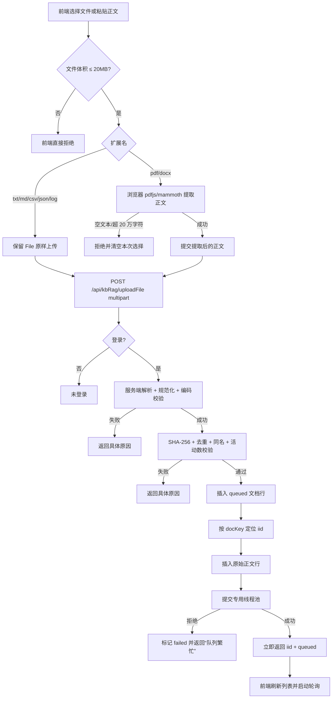
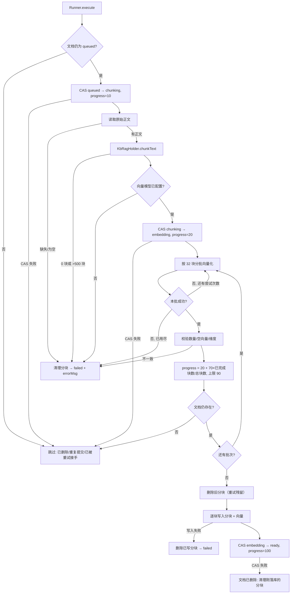
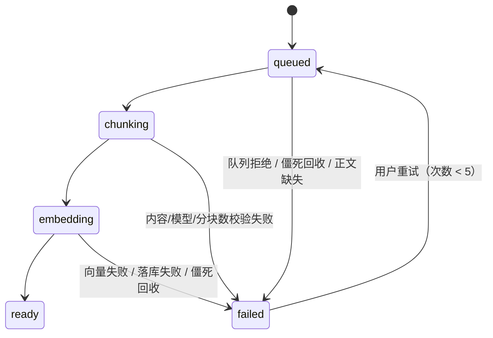
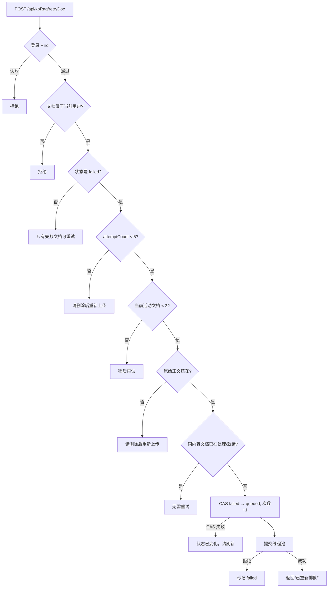
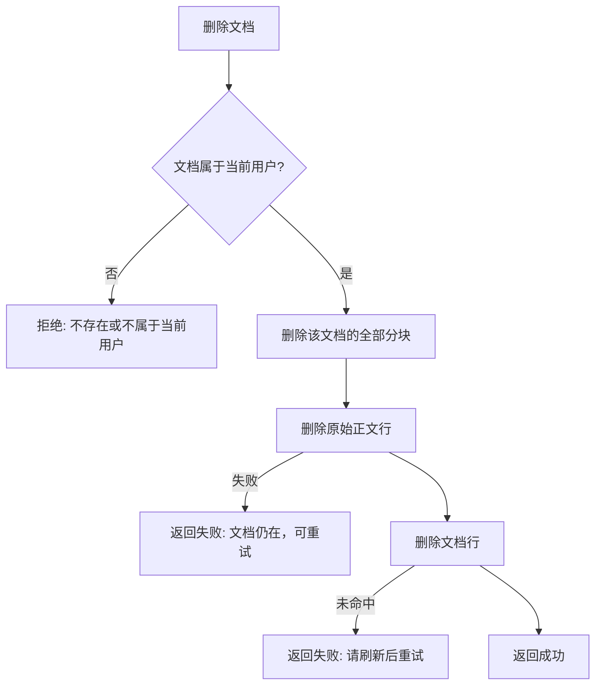

# 学习文档：文档处理流水线（Stage 3）

> 本文对应第二轮升级的 Stage 3：把「上传即同步向量化」改成
> `queued → chunking → embedding → ready / failed` 的异步流水线，
> 支持真实进度、失败重试、内容去重、删除级联与僵死任务回收。
>
> 只讲**已经落地并测试通过**的行为，不描述尚未实现的能力。
> 文中不含数据库口令、Redis 口令、模型密钥、账号口令或真实姓名。

---

## 1. 本阶段解决了什么问题

Stage 3 之前，`uploadDoc` 是一个同步接口：HTTP 请求里完成分块、调用向量模型、
逐个写分块。文档一大，请求就长时间占着 Web 线程；前端只能转圈等待，
超时后用户不知道到底成功没有。

| 编号 | 问题 | 本阶段做法 | 业务价值 |
| --- | --- | --- | --- |
| S3-1 | 大文档上传请求长时间不返回，容易触发网关/浏览器超时 | 接口只做解析、校验、建任务，耗时工作交给专用线程池 | 上传请求快速返回，连接不被长任务占住 |
| S3-2 | 前端无法知道处理到哪一步 | 文档表记录 `status/progress`，前端 2 秒轮询 | 进度是真实进度，不是假动画 |
| S3-3 | 向量服务抖动导致整篇失败，用户只能重传 | 分批向量化，每批最多重试 2 次；失败记录可重试 | 小故障不浪费整篇文档 |
| S3-4 | 上传重复内容浪费向量额度 | 正文 SHA-256 + 同库部分唯一索引 | 重复上传在花钱之前被拦截 |
| S3-5 | 处理失败后没有入口，只能删除重建 | 只允许 `failed` 文档重试，且限制次数 | 失败可恢复，同时防止无限重试 |
| S3-6 | 文档删除后原始正文仍留在库里 | 新增正文表，删除文档/知识库时级联清理 | 不留孤儿数据，不继续占去重索引 |
| S3-7 | 进程重启后文档永远停在「处理中」 | 定时回收超过 30 分钟的活动任务 | 不会永久卡死，也不会占住唯一索引 |
| S3-8 | 失败时留下「一半分块可检索、一半缺失」 | 向量全部算完才落分块；失败先清分块再标记 | 检索结果不会半新半旧 |
| S3-9 | 前端把 GBK 文本按 UTF-8 读取后提交乱码 | 文本文件原样上传，服务端做编码探测 | 编码只解析一次，避免双重解码 |
| S3-10 | PDF/DOCX 解析库体积大，后端再引一套不划算 | 浏览器用现有 pdfjs/mammoth 提取正文，走同一接口 | 不增加后端依赖，后续流程完全一致 |

一个关键约束：**分块算法没有重写**。`KbRagHolder.chunkText` 在 Stage 3 之前
就存在，异步 Runner 直接复用它，保证「旧同步入口、新异步入口、评估脚本」
看到的是同一套分块口径。

---

## 2. 业务流程图

### 2.1 上传：同步做轻活，异步做重活



为什么先插文档、再插正文：正文表用 `docIid` 关联文档，必须先拿到文档 iid。
HNSP 的 `install` 不回填主键，所以用随机 `docKey` 反查 iid，而不是按名称猜。

### 2.2 后台执行与状态机





`queued / chunking / embedding` 是活动状态；`ready / failed` 是终态。
只有 `ready` 的文档会留下可被检索的分块。

### 2.3 失败重试



重试不是「再插一条新文档」，而是把原记录重新排队。这样：
- 文档列表不会出现多条同名同内容的失败记录；
- 原始正文、名称、知识库归属都保持不变；
- `attemptCount` 能真实反映尝试次数。

### 2.4 删除级联



删除知识库时同理：按 `kbName + ownerUid` 依次清理分块、原始正文、文档，
最后才删知识库权限记录。中间失败时主记录仍在，用户可以重试。

---

## 3. 前端原则

### 3.1 进度必须来自服务端

- 进度条分子来自后端 `progress`，分母不是前端估算。
- `progressOf` 只做 `0..100` 裁剪；`ready` 直接显示 100。
- 没有「先跑一个假动画再对齐」的逻辑。
- 状态文案由 `statusLabel` 集中映射：排队中 / 分块中 / 向量化中 / 就绪 / 失败 / 未知。
- 失败行的 `errorMsg` 放在 tooltip 中，避免长错误撑坏表格。

### 3.2 轮询的生命周期

```ts
function schedulePoll() {
  if (pollTimer || !hasActiveDocs()) return
  pollTimer = setTimeout(async () => {
    pollTimer = null
    await loadDocs({ silent: true })
    schedulePoll()
  }, POLL_INTERVAL_MS)
}
```

三个细节：

1. **用 `setTimeout` 自调度，不用 `setInterval`**：上一次请求结束后才安排下一次，
   慢网络下不会出现请求堆叠。
2. **只在有活动文档时轮询**：全部 `ready/failed` 后立即停止，不留空转请求。
3. **`onBeforeUnmount` 标记已卸载并清理定时器**：离开页面后，即使上一轮请求
   迟到返回，也不会重新启动下一轮。

轮询请求是**静默**的：不显示表格 loading，不弹错误提示。网络抖动时下一次轮询
会自动重试，不应该打断用户。只有首次加载、手动上传/重试/删除失败才提示。

### 3.3 文件解析的两条路径

| 类型 | 谁解析 | 提交内容 | 原因 |
| --- | --- | --- | --- |
| txt / md / markdown / csv / json / log | 服务端 | 原始 `File` | 服务端统一做 UTF-8 严格解码 → GBK 兜底；浏览器只按 UTF-8 读会把 GBK 读成乱码 |
| pdf / docx | 浏览器 | 提取后的 `content` 文本 | 复用现有 pdfjs / mammoth，后端不重复引入解析库 |

- PDF/DOCX 解析器全部**动态 import**：只有真的选择对应格式才加载，避免首屏包体变大。
- 连续选择文件时用自增 token 只接受最后一次解析结果，慢解析不会覆盖新选择。
- 浏览器提取后校验：空文本（扫描件/纯图片 PDF）直接拒绝；超过 20 万字符直接拒绝，
  **不做静默截断**。截断入库会让后续评估结果悄悄失真。
- 前端限制是体验，后端会重新校验同样的限制。前端拦截不能当作安全边界。

### 3.4 文件与粘贴正文互斥

上传弹窗允许两种输入：选择文件，或直接粘贴正文。

- 选择文件时清空上一份正文；粘贴正文时放弃已选文件。
- 这不是「二选一」的 UI 装饰，而是为了避免一个真实问题：
  用户先粘贴了 A 文档，又选了 B 文件，B 解析失败后如果正文没清空，
  提交时会把 A 的正文当成 B 的内容入库。
- 只清空本次自动填入的文档名；用户手工改过的名称保留。

### 3.5 失败可见、可重试

- 只有 `failed` 行显示「重试」按钮，避免对处理中的文档重复提交。
- 重试成功立即刷新列表并重新启动轮询，不用等下一个 2 秒周期。
- 重试失败（次数上限、队列繁忙、内容重复）直接展示后端原因。

### 3.6 multipart 与 HNSP 参数格式

项目 axios 实例默认 `Content-Type: application/json`。上传 `FormData` 时必须显式改回
`multipart/form-data`：

```ts
const uploadRequest = (form: FormData) =>
  axios.post('/ai/api/kbRag/uploadFile', form, {
    headers: { 'Content-Type': 'multipart/form-data' },
  })
```

浏览器会自动补上 `boundary`；如果保留默认 JSON 头，Spring 不会把请求识别为 multipart。
E2E 用例专门断言了请求头里同时包含 `multipart/form-data` 与 `boundary=`。

普通 JSON 接口仍然遵守 HNSP 的「按方法参数名取字段」约定，例如重试：

```ts
retryDoc: (iid: number) => axios.post('/ai/api/kbRag/retryDoc', { data: { iid } })
```

### 3.7 原始 File 不放进 reactive

```ts
// Vue 的 Proxy 会包裹原生对象，个别浏览器下读文件会失效
let pendingFile: File | null = null
```

`pendingFile` 保存在 composable 闭包里，只有展示用的文件名、类型、体积放进
`reactive` 状态。这既避免 Proxy 包裹原生对象，也避免大文件对象被响应式系统追踪。

### 3.8 样式与图标约束

- 新增图标 `Plus`、`Search` 按组件单独导入，不引入全量图标包。
- 样式沿用页面现有 class 与 CSS 变量；新增的进度条、错误省略样式写在 `index.less`。
- 组件测试覆盖状态标签、进度百分比、失败原因与重试按钮，避免只测「能渲染」。

---

## 4. 后端原则

### 4.1 接口只做轻量、确定的工作

上传接口同步完成：

1. 解析文件 / 接收浏览器提取的文本；
2. 编码、长度、二进制特征校验；
3. SHA-256、去重、同名、活动数校验；
4. 插入 `queued` 文档与原始正文；
5. 提交线程池。

分块、向量化、逐块落库全部在后台线程执行。这样 HTTP 线程只承担毫秒级到百毫秒级工作，
不会因为一次 embedding 调用占住 Tomcat 连接。

### 4.2 正常状态只由 Runner 推进，并用 CAS 防并发

普通流程中，状态迁移只发生在 `KbDocRunner`：

```java
private boolean transition(String uid, Long docIid, String expectedStatus, KbDocBean update) {
    KbDocBean where = docWhere(uid, docIid);
    where.setStatus(expectedStatus);
    return docMapper.update(update, where) > 0;
}
```

`where` 同时包含 `iid + lastuser + 期望状态`，等价于一次 CAS：

- 文档被删除 → 更新 0 行 → Runner 停止，不再消耗向量额度；
- 另一个重试任务已经接手 → 状态不是 `queued` → 更新 0 行 → 当前任务退出；
- 重复提交 → 同上。

接口层只做两件事：创建 `queued` 记录、把 `failed` 重新置为 `queued`。
队列拒绝和僵死回收也会写 `failed`，但都是明确的异常收尾，不是正常推进。

### 4.3 有界线程池 + 每用户活动上限

`KbDocExecutorConfig`：

| 参数 | 值 | 原因 |
| --- | --- | --- |
| corePoolSize | 1 | 常态只跑一个文档任务 |
| maxPoolSize | 2 | 与评估任务共用向量服务，避免同时打爆上游 |
| queueCapacity | 20 | 有界队列，满了明确拒绝 |
| 拒绝策略 | `AbortPolicy` | 不静默丢任务，返回「队列繁忙」让用户重试 |

Holder 另外限制**单用户同时最多 3 篇活动文档**。线程池是全局资源，
如果只靠队列，一个用户连续上传就能把 20 个位置占满，其他用户一直排队。
每用户上限把公平性放在更靠前的位置。

### 4.4 去重、同名与活动数：便宜校验放在花钱之前

上传顺序是刻意的：

1. 先算 `SHA-256`；
2. 查同用户、同知识库、同哈希的活动/就绪文档；
3. 查同用户、同知识库的同名文档；
4. 查活动文档数；
5. 最后才插入并提交向量化。

这些查询都比一次 embedding 便宜。先拦截重复内容，能直接避免为同一篇文档
重复支付向量额度。

并发上传同一篇正文时，「先查后插」会双双通过。最终由 PostgreSQL 部分唯一索引兜底：

```sql
CREATE UNIQUE INDEX idx_kbdoc_dedupe
    ON kbdocbean ("lastuser", "kbName", "contentHash")
    WHERE "contentHash" IS NOT NULL
      AND "status" IN ('queued', 'chunking', 'embedding', 'ready');
```

- 条件里排除 `failed`：失败文档不能阻止用户重新上传同一篇内容；
- `contentHash IS NOT NULL`：兼容 Stage 3 之前写入的旧文档，它们不参与去重；
- 插入冲突时 Holder 会再查一次重复，返回明确提示，而不是把数据库异常抛给前端。

### 4.5 向量全部算完，才落分块

Runner 先在内存里收集整篇文档的向量，全部批次成功后才写分块。

- 失败时不会留下「前 32 块可检索、后面缺失」的半成品；
- 重试语义干净：要么没有分块，要么整篇替换；
- 500 块 × 1024 维约 4MB，单机并发 2 个任务的内存代价可控。

落分块前会先删除该文档的旧分块。正常首传时删除是空操作；重试时能清掉上一次
可能残留的脏数据。分块写入失败会触发 `fail()`：先删分块，再标记失败。

### 4.6 分批 + 有限重试 + 真实进度

```java
private static final int EMBED_BATCH_SIZE = 32;
private static final int BATCH_ATTEMPTS = 2;
private static final long BATCH_RETRY_DELAY_MS = 200L;
```

- 一次请求 32 块：大文档一次性发给向量服务容易触发请求体上限或超时；
- 每批最多 2 次尝试：能扛住一次瞬时抖动，又不会无限重试放大故障；
- 每批成功后写一次进度：`20 + floor(70 × 已完成块数 / 总块数)`，上限 90；
- 全部落库后写 100。进度严格来自实际完成的批次数。

每批返回后还做三项校验：数量是否等于本批块数、向量是否为空、维度是否与首块一致。
任何一项不满足都终止并标记失败，避免把错误维度的向量写进检索索引。

### 4.7 没有事务，用顺序 + 补偿保证可恢复

项目没有引入 `@Transactional`，这里靠**顺序**和**补偿**：

| 场景 | 顺序 | 失败后的状态 |
| --- | --- | --- |
| 上传插文档后插正文失败 | 文档 → 正文 | 删除刚插入的文档行，不留下空壳 |
| 分块写到一半失败 | 先算完向量 → 再落分块 | 删除已写分块，文档标记 failed |
| 删除文档 | 分块 → 正文 → 文档 | 中途失败留下主记录，用户可重试删除 |
| 删除知识库 | 分块 → 正文 → 文档 → 权限记录 | 中途失败知识库仍在，可重试 |

共同原则：**先删“可被检索到的数据”，最后删“主记录”**。反过来会出现
「列表里没有、检索却能命中」的孤儿数据，用户无法从界面定位和清理。

### 4.8 僵死任务回收

进程重启、线程被异常终止时，文档会停在 `queued/chunking/embedding`。
`recoverStaleDocs` 每 5 分钟扫描一次（应用启动 2 分钟后开始）：

- 只处理 `startedAt < now - 30 分钟` 的活动任务；
- 先用 `iid + lastuser + 观察到的活动状态` 做 CAS，把状态改为 `failed`；
- CAS 成功后才删除可能写了一半的分块；CAS 失败说明任务刚好完成/已被处理，不动分块；
- 错误文案是「处理超时（超过 30 分钟未完成），请重试」。

为什么是「先 CAS 再清理」：回收扫描到更新之间存在时间窗。如果 Runner 恰好在这段时间
完成并置 `ready`，先删分块会删掉一篇已就绪文档的索引；先做带状态的 CAS，就不会
覆盖已经完成的任务。CAS 成功后，仍在运行的 Runner 下一次状态更新会失败并自行停止。

### 4.9 编码与二进制检测

`KbDocTextParser` 做四件事：

1. **BOM 识别**：UTF-8 BOM、UTF-16 LE/BE；
2. **严格解码**：先 UTF-8（`CodingErrorAction.REPORT`），失败再试 GBK；
3. **规范化**：去 BOM、`\r\n`/`\r` 统一成 `\n`、去首尾空白；
4. **内容校验**：空文本、超过 20 万字符、含 NUL、控制字符占比超过 1% 都拒绝。

顺序不能反：GBK 几乎不会报错，先试 GBK 会把 UTF-8 中文解成乱码。

长度超限选择**拒绝**而不是截断。截断后入库的文档看起来正常，但检索和评估会
悄悄少掉后半篇内容，这是更难排查的错。

### 4.10 保留旧同步入口

`/api/kbRag/uploadDoc` 仍然存在，用于兼容旧调用方；产品前端已全部切到
`/uploadFile` 异步流水线。保留它不意味着两套分块逻辑：旧入口复用同一个
`KbRagHolder.chunkText`，区别只在执行方式（同步 vs 异步）。

---

## 5. API 调用流程

### 5.1 上传文件 / 正文

```
POST /ai/api/kbRag/uploadFile
Content-Type: multipart/form-data
```

| 字段 | 必填 | 说明 |
| --- | --- | --- |
| `file` | 二选一 | txt/md/csv/json/log 原始文件 |
| `content` | 二选一 | 浏览器已提取的 PDF/DOCX 正文 |
| `name` | 否 | 展示名称；为空时用文件名 |
| `kbName` | 否 | 知识库名；为空时用「默认知识库」 |
| `fileType` | 否 | 浏览器解析时的原始类型，仅用于展示与归因 |
| `fileName` | 否 | 浏览器解析时的原始文件名 |
| `sizeBytes` | 否 | 原始文件字节数，仅用于展示与 20MB 复核 |

成功响应（HTTP 200，`resp_code = 0`）：

```json
{
  "resp_code": 0,
  "resp_msg": "文档已受理，正在后台处理",
  "datas": {
    "iid": 9,
    "name": "部署手册.md",
    "kbName": "默认知识库",
    "status": "queued",
    "progress": 0,
    "attemptCount": 1
  }
}
```

失败响应同样是 HTTP 200，`resp_code` 非 0，`resp_msg` 是可直接展示的原因。
前端不做二次猜测，直接展示后端文案。

### 5.2 查询文档列表

```
POST /ai/api/kbRag/listDocs
```

无请求体，返回当前登录用户的文档元信息，**不返回正文、向量、正文哈希与内部定位键**。
前端根据 `status` 判断是否继续轮询，根据 `progress` 渲染进度。

### 5.3 重试失败文档

```
POST /ai/api/kbRag/retryDoc
{ "data": { "iid": 9 } }
```

HNSP 按方法参数名取字段，所以请求体包一层 `data`。返回成功只代表
「已重新排队」，不代表处理成功；前端刷新列表后继续看 `status/progress`。

### 5.4 删除文档

```
POST /ai/api/kbRag/deleteDoc
{ "data": { "iid": 9 } }
```

后端按 `iid + lastuser` 校验归属，依次删除分块、原始正文、文档行。
返回文案会带上清理的分块数（如果大于 0）。

---

## 6. 数据库设计

### 6.1 `kbdocbean` 新增字段

| 字段 | 类型 | 作用 |
| --- | --- | --- |
| `docKey` | varchar(64) | 随机业务键；`install` 不回填主键时用于反查 iid |
| `contentHash` | varchar(64) | 正文 SHA-256，用于同库去重 |
| `fileType` | varchar(16) | txt/md/pdf/docx 等 |
| `sizeBytes` | int8 | 原始文件字节数 |
| `progress` | int4 | 0-100，处理进度 |
| `errorMsg` | text | 失败原因，仅 failed 有值 |
| `attemptCount` | int4 | 已尝试次数（含首次） |
| `startedAt` | int8 | 开始/排队时间，僵死回收依据 |
| `finishedAt` | int8 | 结束时间 |
| `embeddingModel` | varchar(128) | 生成向量的模型名 |

### 6.2 `kbdoccontentbean` 原始正文表

| 字段 | 类型 | 说明 |
| --- | --- | --- |
| `iid` | bigserial PK | 自增主键 |
| `docIid` | int8 | 关联 `kbdocbean.iid` |
| `kbName` | varchar(255) | 知识库名，删除知识库时按此清理 |
| `content` | text | 规范化后的完整正文 |
| `contentHash` | varchar(64) | 与文档行一致的 SHA-256 |
| `lastuser` | varchar(255) | 归属用户 |
| 其余 | - | 与项目基类一致的时间/启用字段 |

为什么单独存表：

- `listDocs` 不需要返回几十万字的正文，避免每次列表请求搬运大字段；
- 重试需要原始正文，正文不能只存在内存或浏览器里；
- 删除时可以按 `docIid` 精确清理，不与分块表混在一起。

### 6.3 索引

| 索引 | 类型 | 作用 |
| --- | --- | --- |
| `idx_kbdoc_key` | 唯一 | 按业务键定位文档 |
| `idx_kbdoc_user_kb_status` | 普通 | 列表、活动数统计、状态筛选 |
| `idx_kbdoc_user_hash` | 普通 | 去重查询 |
| `idx_kbdoc_dedupe` | 部分唯一 | 并发上传同一正文的最终闸门 |
| `idx_kbdoccontent_doc` | 唯一 | 一篇文档一条正文 |
| `idx_kbdoccontent_user_kb` | 普通 | 删除知识库时按用户+库清理 |

### 6.4 迁移方案

项目没有 Flyway/Liquibase，采用两条一致的幂等 DDL：

1. 应用启动时 `TableSchemaInitializer.ensureKbDocPipeline()` 自动执行；
2. `scripts/sql/kb-doc-pipeline-schema.sql` 供不重启应用或 DBA 手工迁移。

所有语句都是 `ADD COLUMN IF NOT EXISTS` / `CREATE TABLE IF NOT EXISTS` /
`CREATE INDEX IF NOT EXISTS`，可以重复执行，不删除任何旧列。

- 存量文档的新列为 `NULL`，含义是「旧同步入口写入、不参与去重」；
- 不需要回填正文：旧文档没有原始正文，不显示重试按钮；
- 回滚方式：停止使用新列/新表即可；如需物理回滚，先备份再手工 `DROP`。
  脚本不自动 `DROP`，避免误删新入口已写入的正文。
- 如果目标环境已经存在「同用户 + 同库 + 同 contentHash」的重复活动/就绪文档，
  部分唯一索引会创建失败。初始化器只记录 warn、不阻断启动，此时必须先清理
  重复数据，再重启或手工创建索引，否则并发去重闸门缺失。

---

## 7. 核心代码讲解

### 7.1 `KbDocPipelineHolder`

职责：上传入口、重试入口、去重与并发闸门。

上传的核心顺序：

```java
String hash = KbDocTextParser.sha256(parsed.getContent());
if (findDuplicate(uid, targetKb, hash, null) != null) return Result.failed(...);
if (findSameName(uid, targetKb, displayName) != null) return Result.failed(...);
if (countActive(uid) >= MAX_ACTIVE_DOCS_PER_USER) return Result.failed(...);
```

随后插入文档、按 `docKey` 定位 iid、插入正文、提交线程池：

```java
Long docIid = findIidByDocKey(uid, docKey);
...
contentMapper.install(sourceBean);
...
kbDocExecutor.execute(() -> runner.execute(docIid, uid));
```

线程池拒绝时不是简单返回错误，而是把文档标记为 `failed`：

```java
catch (Exception e) {
    markQueueRejected(uid, docIid);
    return Result.failed(null, "文档处理队列繁忙，请稍后重试");
}
```

否则文档会永久停在 `queued`，用户看到「处理中」却永远不会完成。

重试入口的并发控制用 CAS：

```java
KbDocBean where = new KbDocBean();
where.setIid(docIid);
where.setLastuser(uid);
where.setStatus(KbDocStatus.FAILED);
if (docMapper.update(update, where) <= 0) {
    return Result.failed(false, "文档状态已变化，请刷新后重试");
}
```

两个请求同时点重试，只有一个能把 `failed` 改成 `queued`，另一个会收到明确提示。

### 7.2 `KbDocRunner`

职责：状态机推进、分批向量化、分块落库、失败补偿、僵死回收。

入口统一兜底：

```java
public void execute(Long docIid, String uid) {
    try {
        doExecute(docIid, uid);
    } catch (Exception e) {
        fail(uid, docIid, "处理异常：" + truncate(e.getMessage()));
    }
}
```

后台线程没有 HTTP 请求上下文，任何未捕获异常都不会有人替它收尾。
这个兜底保证文档最终一定进入 `failed`，而不是永久停在处理中。

失败收尾：

```java
private void fail(String uid, Long docIid, String message) {
    deleteChunks(uid, docIid);
    KbDocBean update = new KbDocBean();
    update.setStatus(KbDocStatus.FAILED);
    update.setErrorMsg(truncate(message));
    update.setFinishedAt(System.currentTimeMillis());
    docMapper.update(update, docWhere(uid, docIid));
}
```

`truncate` 把错误压成单行并限制 1000 字符：数据库的 `errorMsg` 是给用户看的，
不应该塞入整段堆栈；完整堆栈写日志。

### 7.3 `KbDocTextParser`

职责：把上传字节变成「可入库的规范化文本」，或给出明确拒绝原因。

```java
public static ParsedText parseFile(String fileName, byte[] bytes) {
    if (bytes == null || bytes.length == 0) throw ...
    if (bytes.length > MAX_FILE_BYTES) throw ...
    String type = fileType(fileName);
    if (!isServerParseable(type)) throw ...
    String text = normalizeAndValidate(decode(bytes));
    return new ParsedText(text, normalizeType(type), bytes.length);
}
```

浏览器提取的正文走 `parseClientText`：不信任前端传来的文件类型和体积，
仍会校验类型白名单、正文长度和二进制特征。`sizeBytes` 只用于展示和 20MB 复核，
为空时用正文 UTF-8 字节数代替。

### 7.4 `KbDocStatus`

状态常量与判断集中在一个类里，避免各处硬编码字符串：

```java
public static boolean isActive(String status) {
    return QUEUED.equals(status) || CHUNKING.equals(status) || EMBEDDING.equals(status);
}
```

前端也维护一份同名状态集合（`ACTIVE_STATUSES`）。这是前后端协议的一部分：
新增状态时必须两边同步，否则轮询或按钮显示会不一致。

### 7.5 `KbDocExecutorConfig`

```java
executor.setCorePoolSize(1);
executor.setMaxPoolSize(2);
executor.setQueueCapacity(20);
executor.setRejectedExecutionHandler(new ThreadPoolExecutor.AbortPolicy());
```

为什么不用无界队列：无界队列会让上传接口「看起来已受理」，实际任务可能排队
几十分钟才执行，用户无法区分「排队长」和「卡死」。有界队列 + 明确拒绝，
让系统在过载时给出可行动的反馈。

### 7.6 前端 `useIndex`

这一阶段前端最核心的三段逻辑：

1. **轮询调度**：`schedulePoll()` 只在有活动文档时存在定时器，请求完成后自调度；
2. **文件分流**：服务端解析类保留 `File`，PDF/DOCX 先提取文本；
3. **输入互斥**：`clearSelectedFile()` 在换文件/粘贴正文时清理另一侧输入。

```ts
function hasActiveDocs(): boolean {
  return state.docs.some((doc) => ACTIVE_STATUSES.has(doc.status))
}

function schedulePoll() {
  if (pollTimer || !hasActiveDocs()) return
  pollTimer = setTimeout(async () => {
    pollTimer = null
    await loadDocs({ silent: true })
    schedulePoll()
  }, POLL_INTERVAL_MS)
}
```

上传成功后先 `await loadDocs()` 再 `schedulePoll()`：让用户马上看到新文档，
而不是等 2 秒后的第一次轮询。

### 7.7 删除级联

`KbRagHolder.deleteDoc`：

```java
List<KbDocBean> docs = kbDocBeanMapper.select(null, where);
if (docs == null || docs.isEmpty()) return Result.failed(false, ...);

kbChunkBeanMapper.delete(chunkWhere);      // 先删可检索的数据
kbDocContentBeanMapper.delete(contentWhere); // 再删原始正文
kbDocBeanMapper.delete(where);              // 最后删主记录
```

`KnowledgeBaseBeanHolder.delete` 按知识库清理时顺序相同，只是条件换成
`kbName + ownerUid`。所有删除条件都带归属，避免同名知识库误删他人文档。

---

## 8. 异常处理清单

| 场景 | 系统行为 | 用户看到 |
| --- | --- | --- |
| 未登录 / 登录过期 | 所有入口先校验 uid | 未登录或登录已过期 |
| 文件为空 / 正文为空 | 服务端拒绝 | 请选择文件或提供文档正文 |
| 文件超过 20MB | 前后端都拒绝 | 文件过大，单篇最多 20MB |
| 扩展名不支持 | 服务端白名单拒绝 | 服务端暂不支持解析 .xxx 文件 |
| 内容像二进制（含 NUL） | 解析器拒绝 | 文件包含二进制内容，无法作为文本处理 |
| 控制字符超过 1% | 解析器拒绝 | 文件包含大量不可见控制字符 |
| 编码无法识别 | UTF-8、GBK 都严格失败 | 无法识别文件编码，请另存为 UTF-8 |
| 正文超过 20 万字符 | 服务端拒绝，不截断 | 超过单篇上限，请拆分后再上传 |
| 未配置向量模型 | Runner 在调用前失败 | 请启用 OpenAI 直连并填写 embedModel |
| 同库同内容已存在 | SHA-256 + 唯一索引拦截 | 已存在相同内容的文档「xxx」 |
| 同库同名已存在 | 同名校验拦截 | 同名文档已存在，请删除或改名 |
| 单用户活动文档 ≥ 3 | Holder 拒绝 | 已有 3 篇文档在处理中 |
| 线程池队列满 | 标记 failed 并返回 | 文档处理队列繁忙，请稍后重试 |
| 单批向量化失败 | 每批重试 2 次，仍失败则整篇 failed | 向量化失败（第 x/y 批） |
| 向量数量/维度不一致 | 终止并标记 failed | 返回数量不一致 / 维度不一致 |
| 分块落库失败 | 删除已写分块后标记 failed | 分块保存失败，已回滚 |
| 处理中删除文档 | CAS 失败，Runner 停止 | 列表中文档消失，不再消耗额度 |
| 处理中进程重启 | 30 分钟后僵死回收 | 处理超时，请重试 |
| 重试非 failed 文档 | Holder 拒绝 | 只有处理失败的文档可以重试 |
| 重试次数 ≥ 5 | Holder 拒绝 | 已重试 5 次，请删除后重新上传 |
| 重试时内容已重复 | 去重校验拒绝 | 相同内容的文档已在处理或就绪 |
| 删除时正文清理失败 | 返回失败，主记录保留 | 删除失败：清理文档正文时出错 |
| 轮询请求网络抖动 | 静默忽略，下轮自动重试 | 无打扰 |
| PDF 无可提取文本 | 浏览器拒绝并清空选择 | 可能是扫描件/纯图片 PDF |

---

## 9. 验收标准与验证结果

### 9.1 验收标准

| 编号 | 验收项 | 判定方式 |
| --- | --- | --- |
| AC-1 | 文本文件上传后快速返回 `queued`，列表出现文档 | 组件测试 + E2E |
| AC-2 | 处理中每 2 秒轮询，进入终态后停止 | 组件测试（fake timers） |
| AC-3 | 进度来自后端 `progress`，`ready` 显示 100 | 组件测试 + 代码审查 |
| AC-4 | PDF/DOCX 浏览器提取，空文本与超长文本被拒绝 | 单元测试 + 组件测试 |
| AC-5 | 失败文档展示原因，可重试；非 failed 不可重试 | 单元测试 + 组件测试 |
| AC-6 | 同内容、同名、活动数上限均由服务端校验 | 后端单元测试 |
| AC-7 | 分块落库失败会回滚，不留下半篇可检索内容 | 后端单元测试 |
| AC-8 | 进程僵死 30 分钟后回收为 failed | 后端单元测试 |
| AC-9 | 删除文档/知识库同时清理分块与原始正文 | 后端单元测试（含顺序断言） |
| AC-10 | 迁移可重复执行，不删除旧列 | 代码审查 + SQL 脚本 |
| AC-11 | 原有测试不回退，前端构建与静态检查通过 | 全量测试 + 构建 |

### 9.2 已执行命令

后端（离线 Maven，JDK 8）：

```bash
cd backend/AIProject
JAVA_HOME="<JDK 8 路径>" mvn -s <settings.xml> -Dmaven.repo.local=<本地仓库> -o test
```

前端：

```bash
cd frontend
npm run test              # 逻辑测试
npm run test:component    # 组件测试
npm run test:e2e          # Playwright 浏览器冒烟
npm run typecheck
npm run build
npm run check:secrets
npm run check:icons
npm run check:styles
npm run check:markdown
npm run check:bundle
```

### 9.3 实际结果

| 项目 | 结果 |
| --- | --- |
| 后端 service 模块 | 328 个测试，0 失败 |
| 后端 app-start 模块 | 26 个测试，0 失败 |
| Stage 3 新增后端测试 | 35 个新用例（Holder 14 + Runner 10 + 解析器 11） |
| 既有测试补充 | 删除级联顺序、正文清理、列表/上传响应不暴露内部字段 |
| 前端逻辑测试 | 212 个测试通过 |
| 前端组件测试 | 13 个知识检索用例通过（全量 230 个） |
| E2E | 15 个通过，含新增文档流水线用例 |
| 类型检查 / 构建 | 通过 |
| 脱敏、图标、样式、Markdown、包体检查 | 全部通过 |

Stage 3 新增的测试文件：

- `KbDocPipelineHolderTest`：上传成功、PDF 正文、类型/体积/空内容拒绝、去重、
  同名、活动上限、队列拒绝、重试成功与 6 类重试拒绝。
- `KbDocRunnerTest`：70 块分 32/32/6 三批、进度与最终状态、向量失败重试、
  数量/维度不一致、落库失败回滚、处理中删除、非 queued 跳过、正文缺失、
  超过 500 块、僵死回收只处理超时任务、先 CAS 再清理、任务刚就绪时不动分块。
- `KbDocTextParserTest`：纯文本、BOM、CRLF、UTF-8/GBK、二进制、控制字符、
  超长、类型白名单、SHA-256。
- 前端组件测试：首屏、轮询启停、卸载后迟到响应、上传/失败、重试、删除、
  超限与不支持类型、换文件清空旧正文。
- E2E：文件选择 → multipart 上传 → 轮询 queued → ready → 表格显示分块数，
  并断言 `Content-Type` 含 `boundary=`、页面无运行时错误。

### 9.4 已知边界

- **队列是进程内的**：当前部署是单实例，线程池与僵死回收都在应用进程内；
  多实例部署需要共享队列/分布式锁，否则两个实例可能同时处理同一文档。
  CAS 状态迁移能保证至少不会重复落库，但会浪费一次向量调用。
- **僵死回收单轮每状态最多 500 条**：超过 500 条时本轮处理不完，下一轮继续。
  当前规模下足够，数据量上来后应改为分页循环或按时间批量更新。
- **清理分块依赖数据库可用**：失败路径会先尝试删除分块；如果删除语句本身失败，
  只能记录日志并把文档标记为 failed，极端情况下会留下孤儿分块，需要人工对账清理。
  当前没有后台对账任务，这是已知边界。
- **没有 OCR**：扫描件/纯图片 PDF 提取不到文本，会被明确拒绝，不会假装成功。
- **PDF/DOCX 提取质量依赖现有前端库**：复杂表格、多栏排版可能被拍平，
  这是浏览器解析的固有限制，不是流水线问题。
- **E2E 使用 mock 后端**：浏览器链路验证的是前端行为与 multipart 格式；
  真实向量调用由后端单元测试覆盖（mock EmbeddingClient），未在自动化测试中
  消耗真实额度。
- **轮询只在页面打开时进行**：用户关闭页面后后台仍会处理，下次打开列表
  直接看到最终状态。
- **旧同步入口仍保留**：`/uploadDoc` 未删除，产品前端已不使用；保留是为了
  兼容旧调用方，不代表推荐用法。

---

## 10. 面试问答

### Q1：为什么把文档处理改成异步，不直接在上传接口里做完？

同步接口的执行时间等于「解析 + 分块 + 所有 embedding + 所有落库」。
文档一大，HTTP 连接就被占住，网关和浏览器都可能超时；而且超时后用户不知道
后台到底成功没有，重传又可能产生重复数据。

异步化后接口只做轻量、确定的校验和建任务，耗时工作交给有界线程池。
前端通过 `status/progress` 轮询真实进度，失败还能重试。

### Q2：为什么用轮询，不用 SSE 或 WebSocket？

这是取舍，不是「轮询一定更好」：

- 文档处理通常几十秒到几分钟，2 秒轮询的实时性足够；
- 轮询是无状态请求，天然适配现有鉴权、网关和部署方式；
- SSE/WebSocket 需要额外维护连接、心跳、断线重连和跨实例广播，
  对当前单实例、低频任务来说复杂度不划算。

如果以后要做「多用户实时看板」或秒级进度，再考虑 SSE。

### Q3：怎么保证同一篇文档不会被两个线程同时处理？

状态迁移用 CAS：`where` 条件包含 `iid + lastuser + 期望状态`。
两个线程同时从 `queued` 出发，只有一个能把状态改成 `chunking`，
另一个更新 0 行后直接退出。重试入口同理，只有 `failed → queued` 能成功一次。

### Q4：为什么向量全部算完才写分块，不边算边写？

边算边写一旦中途失败，会留下「前几批可检索、后面缺失」的半篇文档。
用户检索时可能命中残缺内容，评估指标也会失真。

全部算完再写，失败时要么没有分块，要么整篇替换。代价是内存里要暂存
整篇向量（500 块约 4MB），在单机并发 2 的约束下可以接受。

### Q5：为什么每批 32 块，每批只重试 2 次？

32 是一个折中：请求体不会太大，失败重试的代价也不会太高。
一次请求全部块容易触发上游请求体上限或超时；每批 1 块又会产生太多网络往返。

重试 2 次能扛住一次瞬时抖动（网络闪断、上游短暂 5xx），
又不会在持续故障时无限放大调用量。持续失败就整篇 `failed`，把决定权交给用户。

### Q6：没有数据库事务，怎么保证不会留下脏数据？

靠三件事：

1. **顺序**：先写主记录再写从属数据；删除时先删可检索数据，最后删主记录；
2. **补偿**：从属写入失败时删除已写部分，文档标记 `failed`；
3. **幂等状态**：重试前先清旧分块，重复执行不会叠加数据。

这套方案不能提供事务的原子性，但能保证「失败后状态可解释、可恢复」。
真正要求强一致的场景才需要事务或分布式事务。

### Q7：并发上传同一篇内容，先查后插会双双通过，怎么处理？

应用层先查一次是为了给出友好提示、避免大多数重复请求进入写路径；
但并发时确实会双双通过。最终由 PostgreSQL 部分唯一索引兜底：

```sql
UNIQUE ("lastuser", "kbName", "contentHash")
WHERE "contentHash" IS NOT NULL
  AND "status" IN ('queued', 'chunking', 'embedding', 'ready')
```

插入冲突时 Holder 再查一次重复并返回明确文案，而不是把数据库异常抛给前端。
条件里排除 `failed`，是为了让失败文档不阻塞用户重新上传。

### Q8：为什么要单独建原始正文表，不直接存在文档表？

- 文档列表是高频请求，不应该每次都搬运几十万字的正文；
- 正文只在处理、重试、删除时需要，独立表可以按需读取；
- 删除时可以按 `docIid` 精确清理，职责更清晰；
- 正文表加唯一索引，保证一篇文档只有一条正文。

### Q9：进程重启后文档卡在处理中怎么办？

`recoverStaleDocs` 每 5 分钟扫描 `queued/chunking/embedding` 中
`startedAt` 超过 30 分钟的记录：先删除可能写了一半的分块，再标记 `failed`。
用户看到「处理超时，请重试」，可以点重试或删除重传。

30 分钟是保守值：正常文档远小于这个时间，留足余量避免误杀仍在处理的大文档。

### Q10：为什么 txt 原样上传，PDF/DOCX 却要在浏览器解析？

txt/md 这类文本文件最重要的是**编码正确**。浏览器 `FileReader` 默认按 UTF-8 读，
遇到 GBK 会读出乱码；服务端有 UTF-8 严格解码 + GBK 兜底，原样上传只解码一次。

PDF/DOCX 是二进制格式，服务端要解析就得引入 pdfjs/mammoth 的 Java 等价物，
体积和维护成本都不低；而前端已经有这两个库，提取后提交纯文本即可。
两条路径最终都进入同一个 `uploadFile` 接口、同一套分块与向量化逻辑。

### Q11：前端如何避免「假进度」？

进度值只来自后端 `progress`，前端不做估算：

- 后端在 `chunking` 写 10，进入 `embedding` 写 20；
- 每完成一批写 `20 + 70 × 已完成块数 / 总块数`，上限 90；
- 分块全部落库并置 `ready` 时写 100。

前端只做 `0..100` 裁剪和状态文案映射。没有定时器自增，也没有「先跑到 90
再等接口」的假象。

### Q12：轮询怎么避免请求堆叠和内存泄漏？

用 `setTimeout` 自调度，而不是 `setInterval`：

- 上一次请求完成后才安排下一次，慢网络下不会堆叠；
- 只在 `hasActiveDocs()` 为真时安排定时器；
- 进入终态立即 `stopPolling()`；
- `onBeforeUnmount(stopPolling)`，组件卸载时清理。

轮询失败不弹错，下一轮自动重试；只有用户主动操作失败才提示。

### Q13：重试为什么只允许 failed，还要限制 5 次？

只允许 `failed` 是状态约束：处理中重试会造成重复任务，`ready` 重试没有意义。

限制 5 次是成本约束：每次重试都可能调用付费向量服务。如果失败原因是配置错误
或文档本身有问题，无限重试只会持续烧额度。到上限后提示删除重传，
让用户先修正输入。

### Q14：前后端都有限制，为什么说前端限制不算安全边界？

前端代码运行在用户浏览器里，可以被修改、绕过，甚至直接调接口。
前端校验的价值是**即时反馈**，减少无效请求；真正的约束必须在服务端：

- 文件体积、字符数、类型白名单在 `KbDocTextParser` 重新校验；
- 去重、同名、活动数在 Holder 重新查询；
- 归属在每条 SQL 的 `where` 里带 `lastuser`。

### Q15：删除文档时为什么先删分块和正文，最后删文档行？

如果先删文档行，后续分块/正文删除失败，就会留下「列表里看不到、检索却能命中」
的孤儿数据，用户无法从界面定位和清理。

先删可检索数据、最后删主记录，中途失败时用户还能看到文档并重试删除。
删除知识库同理，最后才删权限记录。

### Q16：这个方案在多实例部署下有什么问题？

线程池和僵死回收都在单进程内：

- 两个实例都可能收到同一文档的任务（如果任务分发没有协调）；
- CAS 能保证只有一个实例把状态推进成功，另一个会退出，不会重复落库；
- 但失败实例已经消耗的向量调用无法退回。

要支持多实例，需要把任务放入共享队列（如 Redis Stream / MQ），
并用分布式锁或数据库行锁协调；或者按文档归属做分片路由。

### Q17：为什么 `pendingFile` 不放在 `reactive` 里？

`File` 是浏览器原生对象，Vue 的响应式 Proxy 会包裹它。个别浏览器/环境下
读取被 Proxy 包裹的 `File` 会失败。展示需要的文件名、类型、体积放进状态即可，
原始 `File` 放在闭包里，提交时直接使用。

### Q18：如果用户上传到一半关闭页面，文档会怎样？

上传请求已经到达后端，任务已经入队，后台会继续处理。
用户下次打开页面，`listDocs` 会返回最终状态；处理中的文档会继续轮询。
不需要前端保持连接，也不依赖页面生命周期。

---

## 11. 下一阶段

Stage 3 把「文档从上传到可检索」的链路做成了可观测、可恢复的流水线。
下一阶段（Stage 4）转向模型调用侧：模型健康检查、价格与路由、
失败回退与熔断，让平台在上游模型不稳定时仍能给出可解释的降级行为。

继续遵守三条底线：

1. 所有功能接真实接口，不用假数据；
2. 不破坏已有功能，原有测试必须继续通过；
3. 数据库变更必须提供可重复执行的迁移方案。
