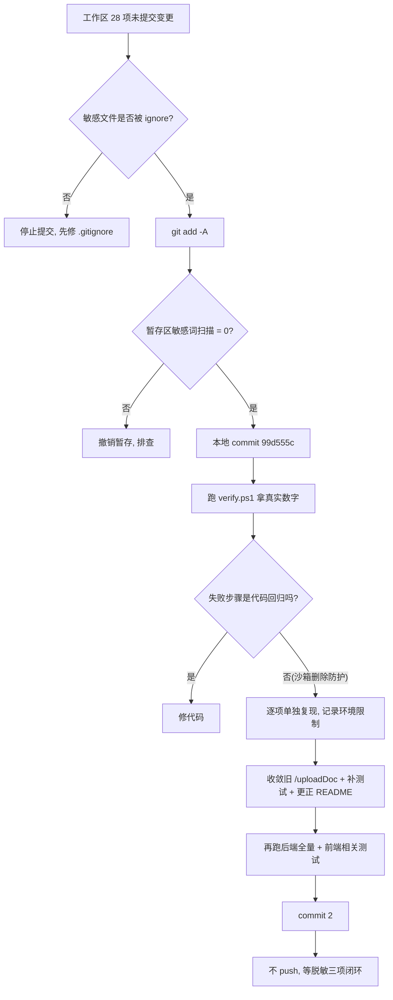
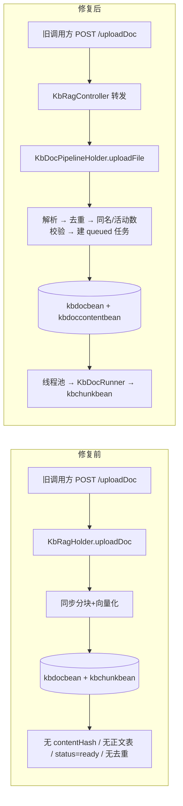

# 学习文档：第二轮 · 阶段 0 · 基线收尾与旧入口收敛

> 本阶段对应第二轮升级的第 0 步：**先保住已有成果，再谈新功能**。
> 沿用 Stage2 / Stage3 的十节模板；其中「前端实现原理」「数据库设计」两节会明确写「本阶段无改动及原因」，不硬凑内容。
> 文中不含数据库口令、Redis 口令、模型密钥、账号口令或真实姓名。

---

## 1. 本阶段解决了什么问题

| 编号 | 问题 | 做法 | 业务价值 |
|---|---|---|---|
| S0-1 | Stage3 文档处理流水线的 28 个文件只存在工作区，`git diff --cached` 为空 | 本地 `git add -A` + `git commit`（`99d555c`），**只 commit 不 push** | 换机器 / 切分支 / CI 不再丢失整套实现与两份文档 |
| S0-2 | 旧 `POST /api/kbRag/uploadDoc` 直接写库，绕过新流水线全部闸门 | Controller 层内部转发到 `KbDocPipelineHolder.uploadFile(...)`，标记 `@Deprecated` | 旧调用方仍可用，但不再产生「黑户文档」 |
| S0-3 | README 有 6 处描述与代码不符 | 逐条更正，并写入本次实测数字 | 面试时讲的数字与仓库对得上 |
| S0-4 | 「测试全绿」一直是文档自述，没人真跑过 | 本地跑 `verify.ps1` + 逐项单独复现，拿到真实数字并标注环境限制 | 从「感觉没坏」变成「有证据」 |

**一个刻意不做的事**：没有 push 到公开仓库。原因在 §9 与第 10 节——脱敏三项动作还没闭环。

---

## 2. 业务流程图

### 2.1 本阶段做了什么（提交与验证）



### 2.2 旧入口收敛前后



**关键**：修复后的旧入口与新 `/uploadFile` 走的是**同一个 Holder**，所以去重、状态、正文、向量模型标识、失败重试全部自动一致，检索层一行都不用改。

---

## 3. 前端实现原理

**本阶段无前端改动。** 这一点本身就是结论：

- `frontend/src/api/kbRag.ts` 只暴露 `uploadFile(file, meta)` 与 `uploadContent(params)`，两者都 POST `/ai/api/kbRag/uploadFile`；全仓 grep 不到任何调用 `/uploadDoc` 的前端代码。
- 因此旧接口是「零调用方的兼容残留」，转发它不会改变任何页面行为，前端测试也不需要改。
- 前端唯一变化是：文档类型分流（`SERVER_PARSE_TYPES` = txt/md/markdown/csv/json/log 原样上传，`CLIENT_PARSE_TYPES` = pdf/docx 由 pdfjs / mammoth 提取正文）——这是 Stage3 已有的能力，本阶段只是把它写进 README。

**面试可以这么讲**：「改后端接口前先查调用方，发现前端早就不用了，所以选择转发而不是下线，既堵住数据面漏洞又不破坏兼容。」

---

## 4. 后端实现原理

### 4.1 为什么旧入口是漏洞

`KbRagHolder.uploadDoc` 是 Stage3 之前的同步实现，它：

1. 直接 `install` 一个 `KbDocBean`，只设 `status="ready"`；
2. **不写** `docKey` / `contentHash` / `progress` / `attemptCount` / `startedAt` / `finishedAt` / `embeddingModel`；
3. **不写** `kbdoccontentbean`（原始正文表）；
4. **不做** `findDuplicate` / `findSameName` / `countActive` 校验。

后果链：`contentHash=NULL` → 不满足部分唯一索引 `idx_kbdoc_dedupe` 的 `IS NOT NULL` 条件 → 可以无限重复上传同名同内容文档；没有正文表 → `retry` 无法执行；没有 `embeddingModel` → 换向量模型后这些分块不会被 `modelMismatch` 跳过，旧向量继续参与检索，质量悄悄下降。

### 4.2 修复策略：在 Controller 层转发，不动 Holder

只改 `KbRagController.uploadDoc` 一个方法：把请求参数映射成 `KbDocPipelineHolder.uploadFile(uid, file, content, name, kbName, fileType, fileName, sizeBytes)` 的入参：

| 旧 DTO 字段 | 新流水线入参 | 说明 |
|---|---|---|
| `uid` | `uid` | `@LoginUserId` 注入，不接受前端传 uid |
| — | `file = null` | 旧接口只有正文字符串，没有二进制文件 |
| `content` | `content` | 走 `parseClientText` 分支 |
| `name` | `name` 与 `fileName` | `fileName` 供解析器推断扩展名 |
| `kbName` | `kbName` | 空则由 Holder 填「默认知识库」 |
| — | `fileType = null` | `KbDocTextParser` 会从 `fileName` 推断，推断不出回退 `txt` |
| — | `sizeBytes = null` | 解析器按正文 UTF-8 字节数计算 |

`KbRagHolder.uploadDoc` **保留不删**（现有 `KbRagHolderTest` 还在测它），只加 `@Deprecated` 与注释，说明它不再是业务入口。

### 4.3 语义变化（唯一的兼容注意点）

旧接口返回「同步 ready」，转发后返回「受理 queued」。因为实际调用方为 0，这个变化没有破坏任何功能；但如果将来有外部脚本依赖旧语义，应改为轮询 `listDocs` 的 `status/progress`。这一条已写进 Swagger `notes` 与方法注释。

---

## 5. 接口调用过程

```
旧调用方
  └─ POST /ai/api/kbRag/uploadDoc
       body: { "name": "制度.txt", "kbName": "默认知识库", "content": "..." }
       │
       ▼
  KbRagController.uploadDoc(@LoginUserId uid, KbDocUpload data)
       │  data == null → Result.failed("请求参数不能为空")   ← 空体不再 500
       ▼
  KbDocPipelineHolder.uploadFile(uid, null, content, name, kbName, null, name, null)
       │
       ├─ KbDocTextParser.parseClientText(...)  → 规范化 / BOM / 编码 / 长度 / 二进制校验
       ├─ sha256(规范化正文)  →  findDuplicate / findSameName / countActive
       ├─ install kbdocbean (queued, progress=0, docKey, contentHash, attemptCount=1)
       ├─ install kbdoccontentbean (原始正文，供失败重试免重传)
       └─ kbDocExecutor.execute(() -> runner.execute(docIid, uid))
       │
       ▼
  KbDocRunner: chunking → embedding(32 块一批，批内重试 2 次) → 落 kbchunkbean → ready
       │
       ▼
  前端 listDocs 每 2 秒轮询 status / progress（真实进度，不是假动画）
```

**响应形状**仍是 HNSP `Result`：`{resp_code, resp_msg, datas}`，`datas` 是不含 `docKey/contentHash` 的公开副本（`toPublicView`），内部字段不外泄。

---

## 6. 数据库设计

**本阶段无 DDL 变更**，也没有新增表或列。原因是修复只改了「请求走哪条路」，数据结构完全复用 Stage3 已有的三张表：

| 表 | 关键字段 | 本阶段关系 |
|---|---|---|
| `kbdocbean` | `docKey`、`contentHash`、`status`、`progress`、`attemptCount`、`embeddingModel`、`fileType`、`sizeBytes`、`errorMsg` | 旧入口转发后开始正确写入这些列 |
| `kbdoccontentbean` | `docIid`、`content` (text)、`contentHash` | 旧入口转发后开始写原始正文，失败重试可用 |
| `kbchunkbean` | `docIid`、`content` (text)、`embedding` (text)、`embeddingModel`、`embeddingDim` | 由 Runner 写入，本阶段未改 |

相关的两个已有索引（Stage3 建立，本阶段不动）：
- `idx_kbdoc_dedupe`：`("lastuser","kbName","contentHash")` 的**部分唯一索引**，条件 `contentHash IS NOT NULL AND status IN ('queued','chunking','embedding','ready')`——这正是旧入口能绕过的原因（`contentHash` 为 NULL）。
- `idx_kbdoccontent_doc`：`docIid` 唯一。

> 迁移机制回顾（后续阶段会用到）：项目**没有 Flyway/Liquibase**。结构是
> ① Bean 上 `@SqlBean/@SqlColumn` 由框架自动建表；
> ② `TableSchemaInitializer`（`ApplicationListener<ApplicationReadyEvent>`）用
>    `CREATE TABLE IF NOT EXISTS` / `ALTER TABLE ... ADD COLUMN IF NOT EXISTS` / `CREATE INDEX IF NOT EXISTS` 补；
> ③ `scripts/sql/*.sql` 存一份等价的手工脚本，**两边必须同步**。
> 注意 `CREATE TABLE IF NOT EXISTS` 对已存在的表**不会补列**，加列必须显式写 `ALTER`；驼峰列名必须加双引号。

---

## 7. 核心代码解释

### 7.1 转发本身（`KbRagController.java`）

```java
@Deprecated
@PostMapping("/uploadDoc")
public Result<KbDocBean> uploadDoc(@LoginUserId String uid,
                                   @RequestBody(required = false) KbDocUpload data) {
    if (data == null) {
        return Result.failed(null, "请求参数不能为空");
    }
    // fileType / sizeBytes 留空，由 KbDocTextParser 从文件名推断类型、按正文长度计算体积
    return kbDocPipelineHolder.uploadFile(uid, null, data.getContent(),
            data.getName(), data.getKbName(), null, data.getName(), null);
}
```

三处值得注意：

1. **`@RequestBody(required = false)`**：旧版空请求体会直接 500，现在走明确的参数错误。
2. **`verify(legacy, never())` 锁死行为**：新增的 `KbRagControllerTest` 断言「绝不再调用 `KbRagHolder.uploadDoc`」，防止以后有人改回去。
3. **`fileType/sizeBytes` 传 null 而不是硬编码**：`parseClientText` 会先按 `fileType`、再按 `fileName` 扩展名、最后回退 `txt`；体积按正文 UTF-8 字节数算。少写两个常量，少一处口径漂移。

### 7.2 为什么「转发」比「下线」好

| 方案 | 兼容 | 去重 | 正文表 | 检索层 |
|---|---|---|---|---|
| 直接下线（返回「请用 uploadFile」） | ❌ 旧调用方 404/失败 | — | — | 存量黑户文档仍在 |
| 在旧 Holder 里补齐所有字段 | ✅ | 需自己实现一遍 | 需自己写 | 需处理旧数据 |
| **Controller 转发（本阶段）** | ✅ | 复用现成 | 复用现成 | **一行不用改** |

### 7.3 新增测试（`KbRagControllerTest.java`）

```java
verify(pipeline).uploadFile(eq(UID), isNull(), eq("差旅报销制度"), eq("制度.txt"),
        eq("默认知识库"), isNull(), eq("制度.txt"), isNull());
verify(legacy, never()).uploadDoc(any(), any());
```

两条用例：① 参数映射正确且状态变为 `queued`；② 空 body 被拒且两个 Holder 都没被调用。纯 Mockito，不需要 Spring 上下文，跑得很快。

---

## 8. 异常处理机制

| 位置 | 异常/边界 | 处理 |
|---|---|---|
| Controller | `data == null`（空体） | 返回 `resp_code != 0` + 中文提示，不触碰任何 Holder |
| Controller | 未登录 | `@LoginUserId` 注入 + `LoginAuthInterceptor` fail-closed 默认拒绝 |
| `KbDocTextParser` | 空内容 / 超 20 万字符 / 二进制特征 / 控制字符过多 | `IllegalArgumentException` → Holder 转成可读中文原因，**超限直接拒绝不静默截断** |
| Holder | 同内容重复 / 同名 / 活动数超 3 | 落库前拦截，返回具体文档名或数量 |
| Holder | `install` 并发冲突 | 捕获后重查一次重复，命中则给友好提示（唯一索引兜底） |
| Holder | 线程池拒绝 | `markQueueRejected` 把文档置 `failed`，不会永远停在「处理中」 |
| Runner | 单批向量失败 | 批内重试 2 次；整体失败先清分块再标 `failed` + `errorMsg` |
| Runner | 30 分钟未推进 | `@Scheduled` 僵死回收，避免永久占住去重索引 |
| 删除 | 分块/正文清理失败 | 主记录保留，用户可从界面重试（先删子、后删主） |

**设计原则**：项目没有 `@Transactional`，一致性靠「顺序 + 补偿 + 可重试」；任何失败都要让状态机停在**用户看得见、能操作**的终态，而不是静默半成品。

---

## 9. 验收标准与验证结果

### 9.1 验收标准

| 编号 | 标准 | 判定方式 |
|---|---|---|
| AC-1 | Stage3 全部实现与文档入库，`git status` 干净 | `git log` / `git status` |
| AC-2 | 暂存区不含任何真实凭据或个人信息 | `git diff --cached` 敏感词扫描 + `git check-ignore` |
| AC-3 | 旧 `/uploadDoc` 不再写黑户文档 | `KbRagControllerTest` 两条用例 |
| AC-4 | 原有测试不回退 | 后端 `mvn -o test` 全绿 |
| AC-5 | README 数字与实测一致 | 逐项复现后写回 |
| AC-6 | **不 push** | `git rev-list --left-right --count master...github/master` |

### 9.2 实测结果（2026-11-05，JDK 8 Dragonwell 8 / Node 22.22.2）

| 项目 | 结果 |
|---|---|
| 提交 | `99d555c`（28 文件 / +4604 −77），暂存区敏感词 0 命中，敏感文件全部被 `.gitignore` 排除 |
| 后端全量 | **BUILD SUCCESS，434 项 / 40 份报告，0 失败 / 0 错误 / 0 跳过**（app-common 7、permission 71、service **330**（含新增 2 项）、app-start 26） |
| 前端逻辑单测 | 18 文件 / **212 项**，exit=0 |
| 前端组件测试 | 26 文件 / **230 项**，exit=0 |
| 浏览器冒烟 | **15 项** passed，exit=0 |
| 流式回归 / Markdown 回归 | 14 项 / 10 项通过 |
| 类型检查 / 图标 / 色值棘轮 / 构建 / 体积预算 / 密钥扫描 / RAG 自检 | 全部通过 |
| `verify.ps1` 13 步 | 10 步通过、3 步失败，**均为环境限制** |

### 9.3 关于那 3 个失败（必须讲清楚，不能冒充全绿）

`scripts/verify.ps1` 在本次受限执行环境下报了 3 个失败：

1. **前端单测 / 组件测试**：用例本身 `162 passed`、`220 passed`，但 Vitest 报 unhandled errors 导致退出码非 0；
2. **前端生产构建**：`EPERM: operation not permitted` + `node-safe-delete-shim.cjs:243 checkBulkDeleteGuard`；
3. **浏览器冒烟**（单独复跑时）：`SAFE_DELETE_BULK_CONFIRM_REQUIRED`（Playwright 要清 `test-results` 里 569 个文件，超过 50 阈值）。

**逐一单独复现后全部 exit=0**：`npm run test`、`npm run test:component`、`npm run build`、`npm run test:e2e`（先把旧 `test-results` **移动**到 `/tmp`，不是删除）。
所以结论是「**沙箱的批量删除防护导致脚本失败，不是代码回归**」，而不是「测试全绿」。这个区别在面试里很重要。

### 9.4 已知边界 / 未完成

- **没有 push**：本地 `master` 相对 `github/master` 领先 5 个提交（原 4 个脱敏提交 + 本次 1 个）。远端 tip 仍含历史遗留的真实人名。
- **公开推送三项动作未闭环**：逐 ref 复验历史 → 只推 `master`（禁止 `push --all`、禁止推 `backup/pre-ip-cleanup-20261102`）→ 轮换本地 `.env.local` 的 Dify 密钥并复验远端 / GitHub 服务端 GC。
- `KbRagHolder.uploadDoc` 保留为死代码（仅供既有单测），后续若确认无外部调用方可连同其测试一起删除。
- 本阶段**没有**做报告 §8 里第 1~6 阶段的任何新功能。

---

## 10. 面试问题及参考答案

**Q1：为什么要先提交再改代码，而不是改完一起提交？**
A：Stage3 的 28 个文件连 `git add` 都没做，属于「只存在本机」的状态——换机器、切分支、CI 拉取都会整套丢失。先提交是把成果变成可回溯的基线，之后的修复才有干净的 diff 和回滚点。这也符合「先止血，再治本」。

**Q2：发现一个老接口有数据面漏洞，第一反应应该是什么？**
A：先查调用方。我 grep 了 `frontend/src`，确认产品前端早已只调 `/uploadFile`，旧 `/uploadDoc` 是零调用方兼容残留。于是选择「内部转发到新流水线」而不是「下线」或「在旧实现里补字段」：既堵住漏洞，又保留兼容，还不用改检索层，改动只有 Controller 一个方法 + 两条测试。

**Q3：旧接口到底漏了什么？为什么叫「黑户文档」？**
A：它不写 `contentHash`、不写 `docKey`、不写原始正文、不写状态与向量模型标识，也不做去重。因为去重是部分唯一索引 `WHERE contentHash IS NOT NULL AND status IN (...)`，`contentHash` 为 NULL 就不受约束，可以无限重复上传；没有正文表就不能重试；没有 `embeddingModel`，换向量模型后旧向量不会被跳过，检索质量在无声中下降。

**Q4：CI 只跑前端，你怎么保证后端没退化？**
A：后端依赖私有 HNSP 框架 jar，不能进公开仓库，所以 GitHub Actions 里 `mvn test` job 是注释状态。唯一的后端门禁是本机 `scripts/verify.ps1`，它带 `-s` 指定离线 settings、`-o` 离线模式，并且有 Surefire 报告闸门（一份报告都没生成就判失败，防止测试被静默跳过却 BUILD SUCCESS）。本次实测 434 项全过。

**Q5：如果 verify.ps1 报了 3 个失败，你会怎么汇报？**
A：先区分「用例失败」和「脚本退出码非零」。这次 Vitest 显示 162/162、220/220 全 passed，构建报的是 `EPERM` + `node-safe-delete-shim` 的批量删除防护，Playwright 报 `SAFE_DELETE_BULK_CONFIRM_REQUIRED`。把四项单独复现后都是 exit=0，所以如实写「脚本因环境限制失败、用例无回归」，并把规避方式（E2E 前把旧 `test-results` 移到临时目录）写进 README，**不写成「全绿」**。

**Q6：为什么这次不 push 到 GitHub？**
A：脱敏只做了一半。本地 HEAD 文件树是干净的，但本地还有 4 个脱敏提交没推，远端 tip 仍是旧状态且含历史遗留的真实姓名；本地还有一个保留清理前完整历史的备份分支。`commit` 是本地操作、安全；`push` 是公开动作，必须先把「逐 ref 复验 → 只推 master → 轮换密钥并复验远端」三步闭环，否则会把旧状态再次暴露。

---

> 本阶段改动文件（真实路径）：
> - `backend/AIProject/app-business/app-business-service/src/main/java/com/aiproject/ai/service/controller/KbRagController.java`
> - `backend/AIProject/app-business/app-business-service/src/main/java/com/aiproject/ai/service/holde/KbRagHolder.java`
> - 新增 `backend/AIProject/app-business/app-business-service/src/test/java/com/aiproject/ai/service/controller/KbRagControllerTest.java`
> - `README.md` 与本文档
>
> 无前端改动、无 DDL 变更、无 push。
