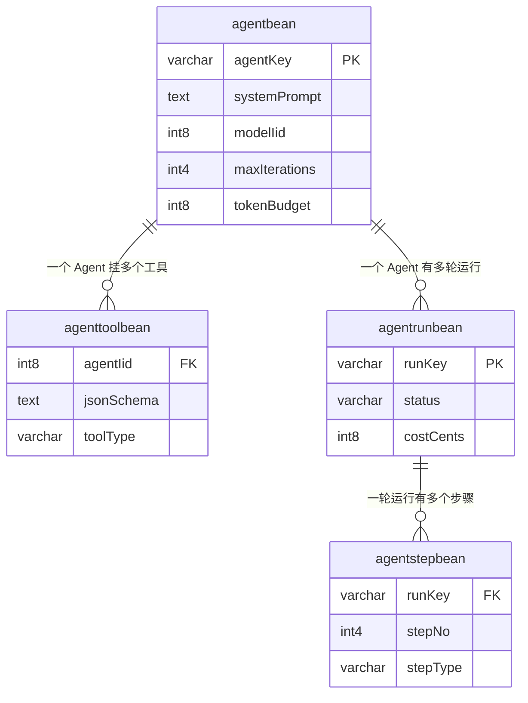

# 学习文档：Agent 工作台 · 子阶段 1 · 数据层与四件套

> 对应第二轮升级阶段 1 的第 1 次交付：**先把「创建」这一半做扎实**（配置、工具、运行记录的结构与权限），
> 执行循环、工具调用、SSE 步骤事件、前端页面留给后续子阶段。
>
> 沿用 Stage2 / Stage3 / 阶段 0 的十节模板；无前端改动的节会写明原因。
> 文中不含数据库口令、Redis 口令、模型密钥、账号口令或真实姓名。

---

## 1. 本阶段解决了什么问题

| 编号 | 问题 | 做法 | 业务价值 |
|---|---|---|---|
| S1-1 | Agent 工作台 9/10 能力为零，连表都没有 | 新建 4 张表 + 4 个 Bean/Mapper + 3 组 Holder/Controller | 「创建 → 执行 → 追踪 → 分析」闭环的地基 |
| S1-2 | 新建接口最容易漏的是归属校验 | 所有查询/修改条件强制带 `lastuser=当前用户`，写操作覆盖前端传入的归属 | 用户 A 看不到也改不了用户 B 的 Agent |
| S1-3 | HNSP 的 `update(data, where)` 若缺条件会命中整表 | `update`/`delete` 拒绝空 iid，且用「只允许修改的字段」构造 patch | 堵住批量误改/误删 |
| S1-4 | 模型生成的工具参数不能裸奔 | 工具必须带 `jsonSchema`，工具类型走白名单 | 为后续执行器的参数校验留出钩子 |
| S1-5 | 运行记录拆表才不会拖垮列表页 | 配置/工具/运行汇总/步骤明细四张表，各自建索引 | 列表只查汇总，点开详情才读步骤 |

**刻意没做的事**：没改 `AssistantBeanController`。审查时怀疑它的双 `@RequestBody` 有问题，
但复核发现前端 `assistantApi.update` 发的正是 `{data, where}`，与两个参数名一致，
且 HNSP 有 `MultiRequestBodyArgumentResolver` 支持这种写法——**没有运行时证据就不能改**，
否则可能把能用的「编辑助手」改坏。这条降级为「待运行时验证」。

---

## 2. 业务流程图

### 2.1 四张表的关系



### 2.2 一次「新建 Agent」的请求

```mermaid
flowchart TD
    A[POST /ai/api/agentBean/create<br/>{data:{name,systemPrompt,...}}] --> B[LoginAuthInterceptor<br/>未登录直接拒绝]
    B --> C[AgentBeanController.create]
    C --> D[AgentConfigHolder.create]
    D --> E{uid 为空?}
    E -- 是 --> E1[未登录或登录已过期]
    E -- 否 --> F{name 为空 / 超长 / Prompt 超长?}
    F -- 是 --> F1[返回具体原因, 不落库]
    F -- 否 --> G[服务端生成 agentKey<br/>强制 lastuser=uid<br/>清空前端 iid]
    G --> H[填默认值<br/>maxIterations=8 / tokenBudget=20000<br/>permissionType=only_me]
    H --> I[configMapper.install]
    I --> J[返回 AgentBean]
```

---

## 3. 前端实现原理

**本子阶段无前端改动。** 原因：这一轮只交付后端数据结构与接口，
前端工作台页面（配置表单 / 工具列表 / 运行时间线）属于子阶段 4。

提前定好的前端契约（后续实现必须遵守）：

- 路径前缀 `/ai/api/`（网关 context-path `/ai`），后端 `@RequestMapping("/api/...")`。
- 请求体按 HNSP 约定包一层：`axios.post('/ai/api/agentBean/create', { data: {...} })`。
- `delete` / `update` 的 `iid` 放在 `data` 里，后端据此构造带归属的 where 条件。
- 运行详情 `detail` 返回 `{run, steps[]}`，`steps` 已按 `stepNo` 升序排好，前端可直接顺序渲染时间线。

---

## 4. 后端实现原理

### 4.1 四件套（沿用 HNSP 既有范式）

| 层 | 新增文件 | 职责 |
|---|---|---|
| Bean | `AgentBean` / `AgentToolBean` / `AgentRunBean` / `AgentStepBean` | `@SqlBean` + `@SqlColumn`，长文本一律 `method="text"` |
| Mapper | 4 个 `*BeanMapper.java` | `@HnMapper(classes=..., tablename=...)` 空接口 |
| Holder | `AgentConfigHolder` / `AgentToolHolder` / `AgentRunHolder` | 参数校验、归属隔离、持久化编排 |
| Controller | `AgentBeanController` / `AgentToolBeanController` / `AgentRunBeanController` | 只转交 + 空体保护，**不做权限判断** |

### 4.2 三条不能破的权限规则

1. **`@LoginUserId` 注入 uid**，不接受前端传 uid；平台拦截器 `LoginAuthInterceptor` 默认拒绝未登录请求（新接口不在匿名白名单里）。
2. **所有 where 带 `lastuser`**：`list` / `detail` / `update` / `delete` 的条件都带当前 uid；`update` 前还会先按 `(iid, lastuser)` 查一次，查不到就返回「不存在或不属于当前用户」。
3. **写操作强制覆盖归属**：`create` 里 `data.setLastuser(uid)` 并把前端传来的 `iid` 清空、`agentKey` 重新生成；`update` 只用「允许改的字段」构造 patch，`agentKey` / `iid` 绝不进 SET 子句。

### 4.3 为什么 `update` 要单独造一个 patch

`mapper.update(data, where)` 把 `data` 里的非空字段写进 SET。如果直接把请求体传进去，
前端只要多塞一个 `agentKey` 或 `iid`，就可能改掉业务键甚至主键。
所以 `AgentConfigHolder.update` 显式 new 一个 `AgentBean patch`，逐个 set 允许修改的字段，
再拼 `(iid, lastuser)` 的 where。工具更新同理。

---

## 5. 接口调用过程

| 接口（POST） | 入参 `{"data":{...}}` | 出参 `datas` |
|---|---|---|
| `/ai/api/agentBean/list` | 无 | `AgentBean[]` |
| `/ai/api/agentBean/create` | `name, systemPrompt, description, modelIid, maxIterations, tokenBudget, toolTimeoutMs, permissionType, roleiids, unitsnos` | `AgentBean`（含 `agentKey`） |
| `/ai/api/agentBean/update` | 同上 + `iid` | `boolean` |
| `/ai/api/agentBean/delete` | `iid` | `boolean` |
| `/ai/api/agentToolBean/list` | `agentIid` | `AgentToolBean[]` |
| `/ai/api/agentToolBean/save` | `agentIid, name, jsonSchema, toolType, endpoint, timeoutMs, maxRetries, roleiids, unitsnos`（带 `iid` 为修改） | `AgentToolBean` |
| `/ai/api/agentToolBean/delete` | `iid` | `boolean` |
| `/ai/api/agentRunBean/list` | `agentIid?`（可选） | `AgentRunBean[]` |
| `/ai/api/agentRunBean/detail` | `runKey` | `{run, steps[]}` |

响应统一是 HNSP `Result`：`{resp_code, resp_msg, datas}`；失败时 `resp_msg` 是可直接展示的中文原因。

**本子阶段没有运行/步骤的写接口**——写入由子阶段 2 的执行循环负责，先把「读」的归属隔离做对。

---

## 6. 数据库设计

### 6.1 四张表

| 表 | 主要字段 | 索引 |
|---|---|---|
| `agentbean` | `agentKey`, `name`, `description`(text), `systemPrompt`(text), `modelIid`, `maxIterations`, `tokenBudget`, `toolTimeoutMs`, `roleiids`/`unitsnos`(text), `permissionType` | `idx_agent_key` 唯一；`idx_agent_owner(lastuser, iid)` |
| `agenttoolbean` | `agentIid`, `name`, `description`(text), `jsonSchema`(text), `toolType`, `endpoint`(text), `timeoutMs`, `maxRetries`, `roleiids`/`unitsnos`(text) | `idx_agenttool_agent(agentIid, lastuser)` |
| `agentrunbean` | `runKey`, `agentIid`, `status`, `question`(text), `iterations`, `promptTokens`, `completionTokens`, `totalTokens`, `costCents`, `errorMessage`(text), `requestId`, `startedAt`, `finishedAt`, `durationMs` | `idx_agentrun_key` 唯一；`idx_agentrun_user_agent`；**`idx_agentrun_active` 部分唯一** |
| `agentstepbean` | `runKey`, `runIid`, `stepNo`, `iteration`, `stepType`, `toolName`, `toolArgs`/`toolResult`(text), `status`, Token/成本/耗时/错误、`requestId`, `callLogIid` | `idx_agentstep_run_step(runKey, stepNo)` 唯一 |

`idx_agentrun_active`：
```sql
CREATE UNIQUE INDEX IF NOT EXISTS idx_agentrun_active
    ON agentrunbean ("agentIid", "lastuser")
    WHERE "status" IN ('queued', 'running');
```
和 RAG 评估工作台的 `idx_ragevalrun_active` 同一套思路——**用数据库兜住并发**，
同一用户的同一 Agent 同时只能有一轮活动运行。

所有表都带框架列 `"iid" bigserial PRIMARY KEY, "lastuser", "createtime", "updatetime", "enable", "app"`。

### 6.2 迁移：双写 + 幂等

- `TableSchemaInitializer.ensureAgentTables()` 注册进 `onApplicationEvent`，用 `CREATE TABLE IF NOT EXISTS` / `CREATE INDEX IF NOT EXISTS`。
- `scripts/sql/agent-schema.sql` 是等价的手工脚本（`BEGIN; ... COMMIT;`），两份必须同步。
- **驼峰列名全部双引号**：PG 会把未加引号的 `agentKey` 折叠成 `agentkey`，与框架生成的 `"agentKey"` 变成两列（项目在 `assistantbean` 上踩过这个坑）。
- 纯新增，不改任何既有表；回滚 = 停止使用这四张表，物理回滚需先备份再手工 `DROP`，脚本不自动删。
- **没有 `ALTER` 补丁**：这四张表是全新的，所以不需要「已存在的表要显式 ALTER 补列」。将来给它们加字段时必须补 `ALTER TABLE ... ADD COLUMN IF NOT EXISTS`，不能只改 `CREATE TABLE`。

### 6.3 后续子阶段会加的两列（本阶段不做）

`aicalllogbean` 加 `"runKey"` / `"stepNo"` + 索引，让每次模型调用挂到某轮运行上，
从而复用 `ModelPriceResolver` 与治理看板算成本。脚本末尾已用注释写好，没执行。

---

## 7. 核心代码解释

### 7.1 创建时「不信任前端」

```java
data.setIid(null);
data.setAgentKey(UUID.randomUUID().toString().replace("-", ""));
data.setName(name);
data.setLastuser(uid);
```

`install` 不回填自增 iid，所以业务键必须由服务端生成；`lastuser` 是归属的唯一依据，
绝不能让前端指定。默认值（`maxIterations=8`、`tokenBudget=20000`、`permissionType=only_me`）
既是产品默认，也是后续执行护栏的上限来源。

### 7.2 更新时的 patch

```java
AgentBean patch = new AgentBean();
patch.setName(...); patch.setSystemPrompt(...); patch.setModelIid(...);
// 不 set agentKey / iid / createtime
AgentBean where = new AgentBean();
where.setIid(data.getIid());
where.setLastuser(uid);
configMapper.update(patch, where);
```

`where` 同时带主键与归属，即使知道别人的 iid 也改不动。

### 7.3 工具的 Schema 必填

```java
if (AgentConfigHolder.blank(data.getJsonSchema())) {
    return Result.failed(null, "工具参数 Schema 不能为空");
}
if (!TOOL_TYPES.contains(toolType)) {
    return Result.failed(null, "不支持的工具类型：" + toolType);
}
if (!agentOwned(uid, data.getAgentIid())) {
    return Result.failed(null, "Agent 不存在或不属于当前用户");
}
```

三道校验对应三类风险：模型瞎传参数、注册任意类型工具、给别人家的 Agent 挂工具。

### 7.4 详情按步号排序

```java
Collections.sort(steps, (a, b) -> Integer.compare(
    a.getStepNo() == null ? 0 : a.getStepNo(),
    b.getStepNo() == null ? 0 : b.getStepNo()));
```
Java 8 写法（不用 `Comparator.comparing` 也行，但这里显式处理 null 更直观）。
前端拿到数组直接顺序渲染，不用再排一次。

---

## 8. 异常处理机制

| 位置 | 边界 | 处理 |
|---|---|---|
| 平台拦截器 | 未登录 | `LoginAuthInterceptor` fail-closed 默认拒绝（新接口不在匿名白名单） |
| Holder | `uid` 为空 | 每个入口第一行返回「未登录或登录已过期」 |
| Controller | 空请求体 | `@RequestBody(required=false)` + `data == null` 保护，不抛 NPE |
| Holder | `update`/`delete` 缺 iid | 明确拒绝，防止空条件命中整表 |
| Holder | 越权 | 先查 `(iid, lastuser)`，查不到返回「不存在或不属于当前用户」，不区分「不存在」与「无权限」以免泄露信息 |
| Holder | 名称/说明/Prompt/Schema 超长 | 落库前拒绝，不在数据库里撞 `varchar` 限制 |
| Holder | 未知工具类型 | 白名单拒绝 |
| `AgentRunHolder.detail` | 步骤查询返回 null | 兜成空数组，详情仍能正常返回 |
| DDL | 重复执行 / 表已存在 | `IF NOT EXISTS`；`execute()` 吞异常只记 warn，不阻断启动 |

**没有 `@Transactional`**（项目统一不用）：本阶段每张表都是单行操作，不涉及跨表一致性；
后续执行循环写 run + step + callLog 时才需要「顺序 + 补偿」设计。

---

## 9. 验收标准与验证结果

### 9.1 验收标准

| 编号 | 标准 | 判定 |
|---|---|---|
| AC-1 | 4 张表 + 4 个 Bean/Mapper + 3 组 Holder/Controller 落地 | 代码审查 |
| AC-2 | 所有权的读写都带 `lastuser`，越权被拒 | `AgentConfigHolderTest` / `AgentToolHolderTest` / `AgentRunHolderTest` |
| AC-3 | `update`/`delete` 拒绝空 iid | 单测 |
| AC-4 | 工具 Schema 必填、类型白名单 | 单测 |
| AC-5 | DDL 双写且幂等 | `TableSchemaInitializer` 与 `scripts/sql/agent-schema.sql` 逐条对照 |
| AC-6 | 原有测试不回退 | `mvn -o test` 全绿 |

### 9.2 实测结果（2026-11-05）

```
mvn -s <离线 settings> -Dmaven.repo.local=<离线仓库> -o test   （JDK 8 Dragonwell 8）
BUILD SUCCESS
app-common 7 + permission 71 + app-business-service 355 + app-start 26
= 459 项，0 失败 / 0 错误 / 0 跳过
```

其中 service 模块从 330 增至 **355**，新增 25 项：
`AgentConfigHolderTest` 9 项、`AgentToolHolderTest` 9 项、`AgentRunHolderTest` 7 项。

**本子阶段未改前端**，因此没有重跑前端测试；上一次（阶段 0）的实测基线是逻辑 212 / 组件 230 / E2E 15。

### 9.3 已知边界（诚实标注）

- **DDL 未在真实 PostgreSQL 上执行验收**：单测用 Mapper mock，覆盖不到建表。部署前需在存量库副本上跑一次 `scripts/sql/agent-schema.sql`，并确认应用启动时 `ensureAgentTables()` 的日志没有 warn（该类的 `execute()` 失败只记 warn、不阻断启动）。
- **`permissionType` / 数值护栏尚未做枚举与范围校验**：目前 `permissionType` 只给默认值，非法值未拒绝；`maxIterations` / `tokenBudget` 也未限制上限。子阶段 2 真正执行前必须补上，否则前端传一个超大 `tokenBudget` 会绕开预算护栏。
- **`endpoint` 未做 SSRF 白名单**：数据层只存字符串，执行器（子阶段 2）必须校验目标地址，且响应体不能回显内网地址。
- **工具权限字段只存不用**：`roleiids` / `unitsnos` 已入库，但「执行前二次校验」在子阶段 3 实现。
- **`AssistantBeanController` 双 `@RequestBody` 未改**：见 §1，待运行时验证。
- 仍然**只 commit，不 push**；脱敏三项动作未闭环。

---

## 10. 面试问题及参考答案

**Q1：为什么 Agent 工作台先做数据层，不做执行循环？**
A：因为执行循环要同时改 `AiGatewayService` 的请求体、SSE 解析、计费和幂等，是全项目风险最高的一段。先把表结构、归属隔离和接口契约定死并单测覆盖，执行循环就只是在稳定的数据面上写编排；反过来先写循环，一旦表结构要改，编排和迁移会一起返工。这也是「一次只交付一个可验收子阶段」。

**Q2：你怎么防止用户 A 改到用户 B 的 Agent？**
A：三层。① `@LoginUserId` 由服务端注入，不接受前端 uid；② 所有查询/修改的 where 都带 `lastuser=uid`，`update` 前还先按 `(iid, lastuser)` 查一次确认归属；③ 写操作强制覆盖 `lastuser`，并用「只允许修改的字段」构造 patch，前端传的 `iid`/`agentKey` 不会进 SET。单测里用 `ArgumentCaptor` 直接断言 where 和 patch 的内容。

**Q3：`update(data, where)` 为什么要单独 new 一个 patch 对象？**
A：框架的 update 把 `data` 的非空字段拼进 SET。若直接把请求体传进去，前端多塞一个 `agentKey` 就能改业务键，塞 `iid` 甚至可能改主键。patch 只放白名单字段，where 同时带主键和归属，这是最小改动里最稳的做法。

**Q4：为什么运行和步骤要拆成两张表？**
A：运行汇总一行，列表页要能按用户/Agent 分页查历史；步骤一轮可能产生几十行、还带工具入参与结果正文。合成一张表会迫使列表页把步骤正文一起拖出来。拆开后列表只查 `agentrunbean`，点详情才按 `runKey` 查 `agentstepbean`。

**Q5：`idx_agentrun_active` 这个部分唯一索引解决什么？**
A：同一用户的同一 Agent 同时只能有一轮 `queued/running` 的运行。纯应用层「先查再插」在并发下会双双通过，用数据库的部分唯一索引兜底最可靠；RAG 评估工作台的 `idx_ragevalrun_active` 是同一套思路。后续还要配一个定时任务回收僵死运行，避免索引被永久占住。

**Q6：这轮还有什么没做完，你怎么向面试官说清楚？**
A：明确说「这是子阶段 1」。还没做：执行循环与 tool_calls 解析、SSE 步骤事件、前端工作台页面、成本按 runKey 归集、工具执行前权限校验、SSRF 白名单与数值护栏；DDL 也还没在真库验收。把它们列成下一阶段的验收项，比说「Agent 做完了」更可信。

---

> 本子阶段新增/改动文件：
> - `backend/.../service/bean/{AgentBean,AgentToolBean,AgentRunBean,AgentStepBean}.java`
> - `backend/.../service/mapper/{AgentBeanMapper,AgentToolBeanMapper,AgentRunBeanMapper,AgentStepBeanMapper}.java`
> - `backend/.../service/holde/{AgentConfigHolder,AgentToolHolder,AgentRunHolder}.java`
> - `backend/.../service/controller/{AgentBeanController,AgentToolBeanController,AgentRunBeanController}.java`
> - `backend/.../service/agent/dto/AgentRunDetail.java`
> - `backend/.../app-start/config/TableSchemaInitializer.java`（新增 `ensureAgentTables()`）
> - `scripts/sql/agent-schema.sql`、3 个 Holder 测试、本文档
>
> 无前端改动、未改任何既有表、未 push。
