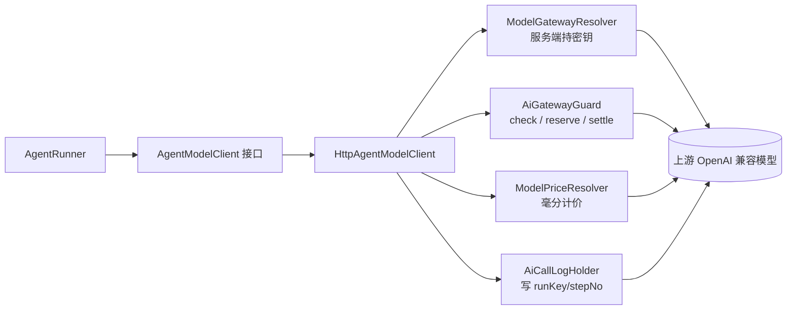

# 学习文档：Agent 工作台 · 子阶段 2 · 执行循环与治理复用

> 这一轮把「创建 → 执行 → 追踪 → 分析」里最难的**执行**补上了：
> 模型返回 tool_calls → 执行工具 → 以 `role=tool` 回灌 → 再问一轮，直到给出最终回答或命中护栏。
>
> 沿用前十节的模板。**本轮做了一次范围收敛**：SSE 步骤事件与前端工作台页面移到子阶段 3，
> 理由是先把编排与治理闭环做对并单测覆盖，流式只是同一批步骤事件的另一种下发方式。
> 文中不含数据库口令、Redis 口令、模型密钥、账号口令或真实姓名。

---

## 1. 本阶段解决了什么问题

| 编号 | 问题 | 做法 | 业务价值 |
|---|---|---|---|
| S2-1 | 子阶段 1 留下了「配置能存、但跑不起来」 | 新增 `AgentRunner` 执行编排器 | Agent 第一次真正能执行 |
| S2-2 | 直接 new 一个 HTTP 打上游会绕开限流/配额/审计/计价 | `HttpAgentModelClient` 逐项复用 `AiGatewayGuard` / `ModelGatewayResolver` / `ModelPriceResolver` / `AiCallLogHolder` | 不给 Agent 开治理后门 |
| S2-3 | 失控循环会一直烧 Token | 四类终止条件：最大迭代、Token 预算、总超时、重复工具调用 | 成本与线程都有上界 |
| S2-4 | 工具执行最容易变成 SSRF / 任意命令 | 只开放 `kb_search`（复用真实混合检索）与 `builtin`；`http` 直接拒绝 | 先不开危险的口子 |
| S2-5 | 上一轮已知边界：可见性枚举与数值护栏缺失 | `permissionType` 白名单 + `maxIterations`/`tokenBudget`/`toolTimeoutMs` 范围校验 | 前端传超大值绕不开编排护栏 |
| S2-6 | 成本要能按「某次运行」归集 | `aicalllogbean` 加 `runKey`/`stepNo`，审计日志带上运行标识 | 复用治理看板，不另起计价表 |

**一个刻意的设计取舍**：模型调用抽成 `AgentModelClient` 接口。编排逻辑因此可以完全脱离 HTTP 做单测；
真实实现仍走网关治理组件，**不是用假数据冒充执行**。

---

## 2. 业务流程图

### 2.1 一次 Agent 运行

```mermaid
flowchart TD
    A[POST /ai/api/agentBean/run<br/>{data:{agentKey,question}}] --> B[登录态 + Agent 归属校验]
    B --> C{有模型? 问题非空?}
    C -- 否 --> C1[直接返回具体原因]
    C -- 是 --> D[start: 落 agentrunbean running]
    D --> E[读工具定义 → 组装 OpenAI tools]
    E --> F[组 messages: system + user]
    F --> G{迭代 ≤ maxIterations?<br/>总耗时 ≤ 120s?}
    G -- 否 --> G1[终止: 迭代上限 / 总超时]
    G -- 是 --> H[AgentModelClient.call]
    H --> I[guard.check + reserve 预扣]
    I --> J[非流式 chat/completions]
    J --> K[解析 message / tool_calls / usage]
    K --> L[按真实 usage settle + 写审计]
    L --> M[落 llm 步骤]
    M --> N{累计 Token ≥ 预算?}
    N -- 是 --> N1[终止: Token 预算]
    N -- 否 --> O{有 tool_calls?}
    O -- 否 --> O1[落 finish 步骤 → succeeded]
    O -- 是 --> P{与上一轮签名相同?}
    P -- 是 --> P1[终止: 重复工具调用]
    P -- 否 --> Q[assistant 消息入列]
    Q --> R[逐个执行工具 → 落 tool_result 步骤]
    R --> S[role=tool 消息回灌]
    S --> G
    O1 & G1 & N1 & P1 --> T[finish: 汇总 Token/成本/耗时/回答/失败原因]
    T --> U[返回 {run, steps[]}]
```

### 2.2 治理链路（为什么不绕过网关）



---

## 3. 前端实现原理

**本子阶段仍无前端改动。** 前端现在能用的契约是同步的：

```
POST /ai/api/agentBean/run
{ "data": { "agentKey": "...", "question": "怎么报销" } }
→ { resp_code, resp_msg, datas: { run: {...}, steps: [...] } }
```

`steps[]` 已按 `stepNo` 升序，字段含 `stepType`（`llm`/`tool_result`/`error`/`finish`）、
`toolName`、`toolArgs`、`toolResult`、`status`、`latencyMs`、`costCents`。
前端工作台（子阶段 3）拿到数组即可直接画时间线，不需要再排序或补算。

`run.answer` 是最终回答；`run.status` 为 `succeeded`/`failed`，失败原因在 `run.errorMessage`。

---

## 4. 后端实现原理

### 4.1 新增的四层

| 文件 | 职责 |
|---|---|
| `agent/AgentModelClient.java` + `AgentInvocation` / `ModelReply` / `AgentCallException` | 编排与模型调用之间的契约 |
| `agent/HttpAgentModelClient.java` | 真实非流式调用 + 网关治理接线 |
| `agent/AgentToolExecutor.java` | 工具执行（kb_search / builtin；http 拒绝） |
| `agent/AgentRunner.java` | 循环、终止条件、步骤落库、汇总收尾 |

Holder 侧补了三个「供编排调用」的写入方法：`AgentRunHolder.start/addStep/finish`
与 `AgentToolHolder.listForRun`（仍带归属校验）。Controller 侧加了 `POST /api/agentBean/run`。

### 4.2 为什么用非流式

Agent 编排需要拿到**完整的** `choices[0].message`（尤其是 `tool_calls` 数组）才能决定下一步；
流式响应要把分片的 `delta.tool_calls` 聚合起来，复杂且容易出错。
所以这一轮用 `stream=false`，把精力放在循环与治理上；流式步骤事件是子阶段 3 的增强，
不改变这里的编排语义。

### 4.3 护栏（补上一轮的欠账）

`AgentConfigHolder.validateSettings`：
- `permissionType` 必须是 `public` / `only_me` / `partial_invisible`；
- `maxIterations` 1~20、`tokenBudget` 1~1,000,000、`toolTimeoutMs` 1,000~120,000 ms。

这些不是展示用的建议值，而是 `AgentRunner` 真正会读的上限。
写错可见性会让资源在权限解析里被 fail-closed 判成「不可见」，用户只看到 Agent 凭空消失。

---

## 5. 接口调用过程

| 接口 | 入参 | 出参 |
|---|---|---|
| `POST /ai/api/agentBean/run` | `{data:{agentKey, question}}` | `{run, steps[]}`（`run` 含 `answer`/`status`/Token/成本/耗时/`errorMessage`） |

内部一次完整调用（以「问报销制度」为例）：

1. `configHolder.findByKey(uid, agentKey)` — 带归属；
2. `toolHolder.listForRun(uid, agentIid)` — 工具定义 → OpenAI `tools` 数组；
3. `runHolder.start(...)` — 落 `running` 记录；
4. 每轮 `modelClient.call(invocation)`：
   - `guard.check(uid, "models")` 限流/配额；
   - `guard.reserve(uid, "models")` 预扣；
   - POST `{baseUrl}/chat/completions`，`stream=false`，`Authorization: Bearer <服务端密钥>`；
   - 解析 message / tool_calls / usage；
   - `priceResolver.resolve(upstreamModel).costCents(prompt, completion)` 算成本；
   - `callLogHolder.record(...)` 写审计（**带 `runKey` / `stepNo`**）；
   - `finally: guard.settle(reservation, 成功 ? totalTokens : 0)`；
5. 每轮落 `llm` 步骤，每个工具落 `tool_result` 步骤，结束落 `finish` 或 `error` 步骤；
6. `runHolder.finish(...)` 收尾，**放在 finally 里**，异常也不会留下永远 running 的记录；
7. `runHolder.detail(uid, runKey)` 返回汇总 + 步骤。

---

## 6. 数据库设计

### 6.1 本轮新增/变更的列

| 表 | 变更 | 迁移语句 |
|---|---|---|
| `agentrunbean` | 新增 `answer` text（最终回答） | `ALTER TABLE agentrunbean ADD COLUMN IF NOT EXISTS "answer" text` |
| `aicalllogbean` | 新增 `runKey` varchar(64)、`stepNo` int4 | 两条 `ALTER TABLE ... ADD COLUMN IF NOT EXISTS` |
| `aicalllogbean` | 新增索引 | `CREATE INDEX IF NOT EXISTS idx_aicalllog_runkey ON aicalllogbean ("runKey")` |

⚠️ **已存在的表必须写 `ALTER`**：`CREATE TABLE IF NOT EXISTS` 对已存在的表不会补列。
`agentrunbean` 是上一子阶段刚建的，如果部署过一次，这次的 `answer` 列同样要靠 ALTER 补丁补上——
所以 Java 初始化器和 `scripts/sql/agent-schema.sql` 里都同时写了补丁，两份保持同步。

### 6.2 为什么审计日志挂 runKey 而不是新建成本表

`aicalllogbean` 已有 tokens / costCents / latencyMs / requestId 与治理看板聚合。
加两列就能按 `runKey` 求和，复用 `ModelPriceResolver` 的毫分口径，
避免「Agent 一套成本、网关另一套成本」——审查报告里点名的「毫分/分口径不一致」正是这类双实现造成的。

### 6.3 回滚

纯加法。逻辑回滚 = 停止使用新列；物理回滚需先备份再手工 `DROP COLUMN`，脚本不自动删。
DDL 仍由 `TableSchemaInitializer.ensureAgentTables()`（启动时幂等）+ `scripts/sql/agent-schema.sql`（DBA 手工）双写。

---

## 7. 核心代码解释

### 7.1 循环终止条件（四个都要有）

```java
for (int iteration = 1; iteration <= maxIterations; iteration++) {
    if (System.currentTimeMillis() - startedAt > MAX_TOTAL_MS) { error = "执行总超时"; break; }
    ...
    ModelReply reply = modelClient.call(invocation);
    // 累加 usage 后立即判断预算，别再白跑一批工具
    if (promptSum + completionSum >= tokenBudget) { error = "Token 预算已耗尽"; break; }
    if (reply.getToolCalls().isEmpty()) { status = "succeeded"; ... break; }
    if (signature(reply.getToolCalls()).equals(lastSignature)) {
        error = "检测到重复工具调用，已终止循环"; break;
    }
}
```

### 7.2 工具结果回灌

```java
messages.add(assistantMessage(reply));           // 保留 tool_calls
for (ModelReply.ToolCall call : reply.getToolCalls()) {
    String result = toolExecutor.execute(uid, tool, call.getArguments());
    messages.add(toolMessage(call.getId(), result));   // role=tool + tool_call_id
}
```
顺序不能反：OpenAI 协议要求 assistant(tool_calls) 在前、若干 tool 消息在后。
**工具失败不直接终止**，而是把「工具执行失败：原因」作为 tool 结果回灌，让模型有机会换参数重试——
这比整轮重试更省，也不会重复计费。

### 7.3 治理接线（失败也要结算）

```java
Reservation reservation = guard.reserve(uid, "models");
try {
    ... 调用上游 ...
    guard.settle(reservation, totalTokens);   // 实际写在 finally
} finally {
    guard.settle(reservation, succeeded ? actualTokens : 0L);
}
```
失败时 `settle(0)` 全额释放预扣；审计日志在成功和失败两条路径都会写。

### 7.4 工具白名单

```java
if ("kb_search".equals(type)) return searchKnowledge(uid, arguments);
if ("builtin".equals(type))   return "当前时间：" + ...;
if ("http".equals(type))      throw new AgentCallException("HTTP 工具尚未配置目标地址白名单，暂不可用");
```
工具参数与结果都截断到 2000 字符，避免把大段知识库正文写进步骤表。

---

## 8. 异常处理机制

| 位置 | 边界 | 处理 |
|---|---|---|
| 编排入口 | 未登录 / Agent 不存在 / 问题为空 / 未选模型 | 返回可读中文原因，**不创建运行记录** |
| 模型调用 | 上游非 200 / 网络异常 / 响应解析失败 | `AgentCallException` → 落 `error` 步骤 → `failed` 收尾 |
| 治理 | `guard.check` 拒绝（限流/配额/依赖不可用） | 直接抛，不发起 HTTP、不 settle |
| 治理 | 预扣后任意异常 | `finally` 里 `settle(0)` 全额释放 |
| 工具 | 参数不是合法 JSON / 缺 query / 未注册 / http 未开放 | 转成 tool 结果回灌，模型可纠正 |
| 循环 | 迭代上限 / 预算 / 总超时 / 重复调用 | 落 `error` 步骤并给明确原因 |
| 落库 | `runHolder.finish` 在 `finally` 中 | 任何路径都不会留下永远 `running` 的记录 |
| DDL | 重复执行 / 列已存在 | `IF NOT EXISTS` + `ADD COLUMN IF NOT EXISTS` |

**一处真实的调试收获**：第一次跑测试时「最大迭代」和「Token 预算」两个用例失败了。
读 surefire 报告发现不是编排错，而是我的测试预期写错——重复工具检测在第 2 轮就生效、
预算检查原本放在下一轮开始才触发。顺手把预算改成「拿到 usage 后立即判断」，
少跑一批无意义的工具，测试预期也随之修正。**断言失败时先读实际调用参数，别急着改生产代码。**

---

## 9. 验收标准与验证结果

### 9.1 验收标准

| 编号 | 标准 | 判定 |
|---|---|---|
| AC-1 | tool_calls 能循环、结果能回灌 | `AgentRunnerTest` 10 项 |
| AC-2 | 四类终止条件都生效 | 单测逐项覆盖 |
| AC-3 | 模型调用走治理（check/reserve/settle/审计/计价） | `HttpAgentModelClientTest` 4 项 |
| AC-4 | 工具只开放安全类型、参数与结果有边界 | `AgentToolExecutorTest` 7 项 |
| AC-5 | 可见性枚举与数值护栏 | `AgentConfigHolderTest` 12 项 |
| AC-6 | 原有测试不回退 | `mvn -o test` 全绿 |
| AC-7 | DDL 双写且对已存在表补列 | 初始化器与 SQL 脚本逐条对照 |

### 9.2 实测结果（2026-11-05）

```
mvn -s <离线 settings> -Dmaven.repo.local=<离线仓库> -o test   （JDK 8 Dragonwell 8）
BUILD SUCCESS
app-common 7 + permission 71 + app-business-service 379 + app-start 26
= 483 项，0 失败 / 0 错误 / 0 跳过
```

service 从 355 → **379**，新增 24 项：
`AgentRunnerTest` 10、`AgentToolExecutorTest` 7、`HttpAgentModelClientTest` 4、
`AgentConfigHolderTest` +3（护栏）。

`HttpAgentModelClientTest` 用本机临时 `HttpServer` 模拟上游，**不依赖任何真实模型服务**，
断言了 tool_calls 解析、按真实 usage 结算预扣、审计日志带 `runKey`/`stepNo`，以及 500/额度拒绝两条失败路径。

**本子阶段未改前端**，未重跑前端测试；阶段 0 的实测基线仍为逻辑 212 / 组件 230 / E2E 15。

### 9.3 已知边界（诚实标注）

- **SSE 步骤事件与前端工作台尚未实现**（子阶段 3）：当前是同步 `run` 返回完整详情，步骤是落库后一次性读出，不是实时推送。
- **DDL 仍未在真实 PostgreSQL 上验收**：单测用 Mapper mock；部署前需在存量库副本执行 `scripts/sql/agent-schema.sql`，并确认启动时没有 warn。
- **工具执行前的权限二次校验未实现**：`roleiids`/`unitsnos` 已存但执行器还没读；当前靠「工具必须属于本人 Agent」隔离。
- **HTTP 工具仍关闭**：目标地址白名单（SSRF 防护）未做。
- **工具参数只做了 JSON 可读性校验，没有按 `jsonSchema` 做严格校验**（子阶段 3 补）。
- **没有单步重试**：用「错误回灌让模型纠正」替代，见 §7.2。
- **没有并发闸门的实际写入验证**：`idx_agentrun_active` 已建，但 `start()` 目前没捕获唯一索引冲突，多实例并发下发两轮运行会有一条失败并只记日志（子阶段 3 补友好提示）。
- 仍**只 commit，不 push**；脱敏三项动作未闭环。

---

## 10. 面试问题及参考答案

**Q1：Agent 的工具调用循环是怎么写的？为什么不用现成框架？**
A：`AgentRunner` 维护 messages 数组，每轮把注册工具转成 OpenAI `tools` 下发；
模型返回 `tool_calls` 就执行工具、以 `role=tool` 把结果回灌，再问一轮，直到没有 tool_calls。
项目里已经有网关、SSE、计价、审计，引框架反而要重接一遍治理；用 200 行编排 + 一个可注入的模型客户端就能复用全部既有能力。

**Q2：你怎么保证 Agent 不绕过网关治理？**
A：`HttpAgentModelClient` 没有自己 new 一个裸 HTTP 连接就完事，而是逐项复用
`AiGatewayGuard.check/reserve/settle`、`ModelGatewayResolver`（服务端持密钥）、
`ModelPriceResolver`、`AiCallLogHolder.record`。密钥不出服务端，限流与配额照常生效，
审计日志还额外带上 `runKey`/`stepNo`，成本可以按一次运行归集。

**Q3：循环失控怎么办？**
A：四道闸：最大迭代步数、Token 预算、总超时 120 秒、重复工具调用检测。
其中预算特意放在「拿到本轮 usage 之后立即判断」，超了就停，不再执行一批工具、不再空转一轮。
所有终止路径都会落 `error` 步骤，并且 `finish` 放在 `finally`，不会留下永远 running 的记录。

**Q4：预扣额度在失败时怎么退？**
A：`reserve` 之后进 try，`finally` 里 `settle(reservation, succeeded ? actualTokens : 0L)`。
成功按上游真实 usage 多退少补，失败全额释放。这和网关主链路是同一套语义。

**Q5：一次测试失败，你怎么判断是代码错还是测试错？**
A：先读 surefire 报告里的「实际调用参数」，而不是直接改生产代码。
这轮两个用例失败，报告显示重复工具检测第 2 轮就触发、预算检查在下一轮才生效——
是测试预期写错了。同时发现预算检查的位置确实可以更早，于是把它前移，改完再跑一次全量 483 项。

**Q6：现在还有哪些没做完？**
A：SSE 实时步骤事件、前端工作台页面、工具执行前权限校验与严格 JSON Schema 校验、
HTTP 工具白名单、单步重试、并发闸门冲突的友好提示，以及 DDL 的真库验收。
把它们列成子阶段 3 的验收项，比说「Agent 做完了」更可信。

---

> 本子阶段新增/改动文件：
> - `service/agent/`：`AgentInvocation` / `ModelReply` / `AgentCallException` / `AgentModelClient` /
>   `HttpAgentModelClient` / `AgentToolExecutor` / `AgentRunner`、`agent/dto/AgentRunRequest`
> - `service/holde/`：`AgentConfigHolder`（枚举与数值护栏 + `blank` 改 public）、
>   `AgentToolHolder`（listForRun）、`AgentRunHolder`（start/addStep/finish）
> - `service/controller/AgentBeanController`（新增 `/run`）
> - `service/bean/`：`AiCallLogBean`（runKey/stepNo）、`AgentRunBean`（answer）
> - `app-start/.../TableSchemaInitializer`、`scripts/sql/agent-schema.sql`（ALTER 补丁双写）
> - 4 个测试类（共 24 项新用例）、本文档
>
> 无前端改动、未 push。

## 11. 2026-11-07 补强：僵死 `running` 记录的回收

§9.2 与 Q3 说「`finish` 在 `finally` 里，不会留下永远 running 的记录」，
这只覆盖**进程还活着**的路径。进程被 kill、机器重启、线程池异常退出时，
`finally` 不会执行，记录会永久停在 `queued`/`running`；
更糟的是 `idx_agentrun_active` 的唯一索引会一直占着，该用户在这个 Agent 上
再也发不起新一轮运行。

新增 `AgentRunRecoveryScheduler`：

- 每 5 分钟扫描一次（首次延迟 3 分钟），把 `startedAt` 超过 30 分钟的
  `queued`/`running` 记录改为 `failed`，写入可读原因与 `finishedAt`/`durationMs`；
- 更新条件是 `runKey + lastuser + 原 status` 的 CAS：如果 Runner 恰好刚完成并置为
  `succeeded`，这里更新 0 行，绝不会覆盖正常结果；
- 多实例用 `ScheduledTaskGuard` 的 Redis 锁互斥（TTL 240 秒 < 调度间隔 5 分钟，
  Redis 故障时 fail-open，重复扫描因 CAS 无害）；
- 单条记录失败只记日志，不中断整批。

测试：`AgentRunHolderTest` +3（只碰超时记录且带状态 CAS、CAS 竞争失败不计成功、
缺 `startedAt`/`runKey` 跳过），`AgentRunRecoverySchedulerTest` +1（锁内按 30 分钟
阈值调用回收）。
