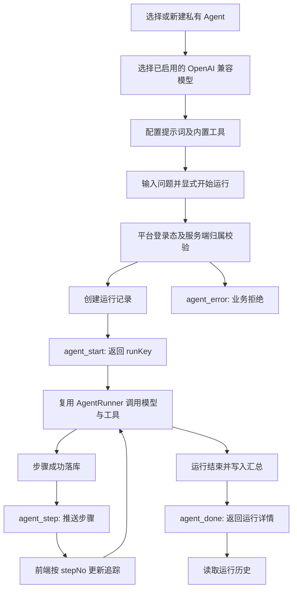
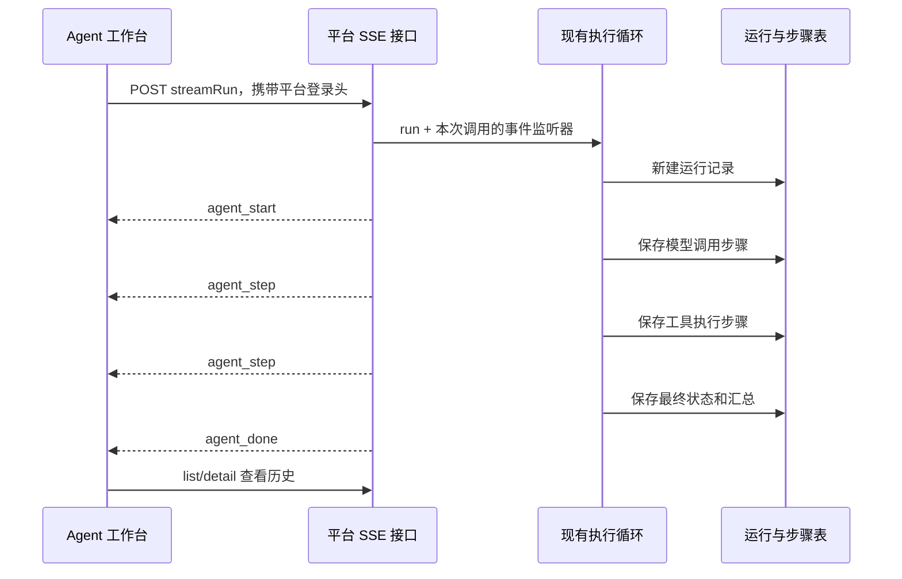

# 学习文档：Agent 工作台与实时追踪（阶段 1 · 子阶段 3）

## 1. 业务目标与范围

之前已经有 Agent 配置、工具注册、运行记录及执行循环，本次不重新实现它们。
本模块补上用户侧的「配置 → 运行 → 逐步观察 → 查看历史」，以及运行步骤的 SSE 传输。

- 配置绑定模型 iid，编辑系统提示词、最大迭代次数和 Token 预算。
- 工具面板只开放当前时间和知识库检索；HTTP 工具仍不开放。
- 每个步骤持久化后发送事件，页面展示输入、输出、耗时及失败原因。
- 最终结果展示运行汇总、Token 与成本；断流保留已收到步骤，不自动重新执行。
- 复用现有四张 Agent 表、网关治理及模型配置，不新增数据库结构或中间件。

不包含模型健康检查、主备路由、通用 JSON Schema 编辑器、后台任务队列或强制中断上游请求。

## 2. 业务流程图





## 3. 前端原理

### 3.1 为什么不用已有的聊天流式函数

已有 `streamingRequest` 是 Dify 聊天协议客户端：它等待 Dify 配置，处理会话 ID 和文字增量。
Agent 的请求使用平台登录态，返回结构化执行步骤，而不是聊天文字。
强行复用会让没有配置 Dify 的用户无法运行独立 Agent，也会混淆取消及完成语义。

`frontend/src/api/agent.ts` 的 `streamAgentRun` 因此只负责 Agent 协议，不改动旧聊天通道。
CRUD 仍使用原有 Axios 实例和其登录拦截器，SSE 使用支持流式读取的 `fetch`。

### 3.2 网络块不等于事件

一次 `reader.read()` 可能只收到半个汉字，也可能包含多个事件。
客户端使用流式 `TextDecoder` 保留 UTF-8 未完成字节，再按行保存 `event` 和多行 `data`，遇到空行才派发一帧。

支持 LF、CRLF、注释心跳及多行 data；未知事件不会被错误显示为回答。
事件必须属于当前 runKey；非法 JSON、跨运行步骤、缺少开始事件或非终态 done 都按协议失败处理。
单帧缓存有大小上限，首响应及流静默均有超时。

### 3.3 完成、业务失败、传输失败是三件事

| 情况 | 页面应如何理解 |
| --- | --- |
| `agent_done` 且 `run.status=succeeded` | 服务端运行正常完成 |
| `agent_done` 且 `run.status=failed` | 已完成收尾，但业务执行失败；展示步骤和原因 |
| `agent_error` | 校验拒绝或服务端无法正常完成本次请求 |
| EOF 但没有 done | 连接中断，不能当成运行成功 |
| 用户停止接收 | 关闭当前监听，不承诺已立即停止模型调用 |

`closed` 终态标志保证完成和错误不会重复回调。停止、卸载与超时都会释放定时器、取消 reader 和 fetch。
断流后不自动重发 POST，因为一次重发可能产生第二次模型调用和费用。

### 3.4 界面状态与可访问性

页面沿用已有布局和颜色变量，不另起一套主题。
加载、错误重试、空列表与正常内容分别呈现；正在接收步骤时不以整页 loading 覆盖已经收到的时间线。
步骤使用稳定编号，失败同时有文字与状态色，输入输出按文本显示，不能执行模型返回的 HTML。

切换配置或运行详情时使用请求序号隔离旧响应，卸载后不能重新修改状态。
模型下拉使用真实模型配置，只显示可用的 OpenAI 兼容项，不在浏览器保存上游密钥。

组件边界：`AgentEditor` 管配置表单，`AgentTools` 管固定契约工具，`AgentRunPanel` 复用实时与历史展示，`AgentHistory` 管最近记录及筛选。
`useAgentWorkspace` 负责接口与选择状态，`useAgentRun` 负责本次流的生命周期；父层提交真实请求，子组件通过事件提交表单数据。

本项目使用 hash 路由，错误定位不能直接使用 `href="#step-id"`，否则会被路由器当成跳页并卸载工作台。
这里使用按钮将焦点移到对应步骤，再执行页内滚动；鼠标和键盘均不改动路由。
收到不属于当前 Agent 的终态时，必须结束接收、保留已有步骤并提示核实，不能静默忽略后一直显示运行中。

## 4. 后端原理

### 4.1 一套执行器，两种响应方式

同步 `/run` 仍保留。流式 `/streamRun` 复用同一套执行循环，只增加本次调用专用的事件监听器。
不是通过全局广播按用户过滤事件，避免并发运行之间串台。

模型调用仍使用已有 `AgentModelClient`，沿用限流、预扣、结算、计价和审计。
工具范围没有扩大，知识检索继续使用用户归属约束。

### 4.2 持久化优先

关键顺序是「写入步骤成功 → 发送步骤事件」，不是先给页面显示成功再尝试保存。
否则页面可能看到一个刷新历史后消失的步骤。

SSE 的 `agent_done` 需要已写入汇总且能读取到运行详情；收到 HTTP 200 本身不构成成功证据。
归属校验仍在业务层完成，前端隐藏按钮不能替代后端鉴权。

### 4.3 断连的边界

服务端在写事件发现断连后，可以阻止后续模型轮次和工具调用，并保存已有汇总。
但同步阻塞的上游调用不能因为浏览器点击停止就立即终止。
因此界面使用「停止接收」而非「取消成功」，需要在运行历史中刷新最终状态。

本实现不是进程持久化任务队列；进程退出后的任务续跑、分布式取消和断点续传不在本模块范围内。

## 5. API 调用链路

HNSP 按方法参数名映射 DTO，请求必须放在 `data` 字段内。

```json
{
  "data": {
    "agentKey": "示例运行所属配置标识",
    "question": "查询当前时间"
  }
}
```

| 接口前缀 `/ai/api` | 用途 |
| --- | --- |
| `/agentBean/list` | 查询当前用户的配置 |
| `/agentBean/create`、`update`、`delete` | 管理配置 |
| `/agentToolBean/list`、`save`、`delete` | 管理工具 |
| `/agentBean/streamRun` | 发起一次执行并接收 SSE |
| `/agentRunBean/list` | 最近运行记录，可带 agentIid |
| `/agentRunBean/detail` | 按 runKey 查询持久化详情 |

事件协议如下。

| 事件 | data 内容 |
| --- | --- |
| `agent_start` | `{runKey}` |
| `agent_step` | 单条 `AgentStepBean` |
| `agent_done` | `{run, steps}` |
| `agent_error` | `{message}` |

创建配置的接口不保证回填 iid，页面需要重新查询列表，根据返回的 agentKey 找到新配置，再管理其工具。
不能拿列表下标或臆造的 ID 代替数据库主键。

## 6. 数据库设计与迁移

本次没有表、列或索引变更，继续使用已有迁移方案 `scripts/sql/agent-schema.sql`。

| 表 | 本次如何使用 |
| --- | --- |
| `agentbean` | 提示词、模型、预算等配置 |
| `agenttoolbean` | 工具名称、类型及固定参数 Schema |
| `agentrunbean` | 一次运行的状态、问题、回答、Token、成本 |
| `agentstepbean` | 按 runKey/stepNo 展开的步骤明细 |
| `aicalllogbean` | 复用已有 runKey/stepNo 的调用审计 |

步骤推送不是新的数据源；数据库中的运行和步骤记录才是历史查询依据。
不伪造旧运行中未记录的指标：缺失字段应显示破折号而非自动补零。

## 7. 核心代码与计价口径

- `AgentRunner`：模型与工具编排，仍负责迭代、预算和重复调用护栏。
- `AgentRunHolder`：持久化及归属约束，追踪事件必须发生在写成功之后。
- `AgentBeanController`：流式 HTTP 入口及固定 SSE 帧。
- `streamAgentRun`：平台鉴权、增量解析、终态互斥、断流与资源清理。
- `AgentView`：配置与运行的交互，显示真实事件和历史结果。

历史字段 `costCents` 的实际单位是**毫分**，本次不改动存储单位。

```text
1 元 = 100 分 = 100000 毫分
展示金额（元） = costCents / 100000
示例：123 毫分 = 0.00123 元
```

这是金额单位换算，不是模型评分或伪造的准确率。
运行状态为成功，也不意味着每个工具步骤都成功：执行器可以把工具失败回灌给模型，再由模型给出后续回答。

### 7.1 步骤去重和排序

`agentPresentation.ts` 使用服务端 stepNo，而不是到达顺序或数组下标。

```ts
export function mergeSteps(previous: AgentStep[], incoming: AgentStep[]) {
  const steps = new Map(previous.map((step) => [step.stepNo, step]))
  incoming.forEach((step) => steps.set(step.stepNo, step))
  return [...steps.values()].sort((a, b) => a.stepNo - b.stepNo)
}
```

同一编号的后到数据覆盖先到数据，终态详情可以补全已收到的步骤。不同运行的隔离在调用此函数前校验，不能用排序代替归属校验。

### 7.2 请求序号隔离

工具列表的请求同时记录“本次请求序号”和“当前选择版本”。只有两者都仍匹配且组件存活，才接受响应。
这不仅防止旧成功结果覆盖新数据，也防止旧失败结果把新页面误标成错误；请求失败时不清除其他面板的成功内容。

### 7.3 先持久化、后通知

执行器通过 `recordStep` 先调用 `AgentRunHolder.addStep`，确认 Mapper 影响行数恰好为 1，再触发 `Listener.onStep`。
启动和完成汇总同样检查影响行数；任何写库失败都不能走正常完成事件。终态还需重新读取历史详情，保证页面收到的是持久化结果。

## 8. 异常处理

| 异常 | 处理原则 |
| --- | --- |
| 未登录、Agent 非本人、问题为空 | 服务端拒绝，不调用模型 |
| 无可用模型 | 引导先配置，不能回退到虚构模型 |
| 创建成功但没有 iid | 重新查询列表后定位 |
| 模型或工具失败 | 保留失败步骤与可解释错误 |
| 步骤写入失败 | 不推送该步骤的成功事件 |
| HTTP 200 返回 JSON/HTML 而非 SSE | 视为登录或协议异常，不当作成功 |
| 流式连接断开 | 保留步骤，提示查看历史；不自动重试收费请求 |
| 迟到的列表或详情响应 | 请求序号丢弃过期结果 |
| 页面卸载 | 取消客户端读取及定时器 |

## 9. 验收方法

验收分层，不能相互冒充。

1. 后端单测验证执行器、归属、持久化及 SSE 事件顺序，模型与数据库替身不消耗真实额度。
2. 前端协议测试逐字节拆分中文和 CRLF，覆盖终态、截断、越界事件、超时及主动停止。
3. 组件测试验证表单、列表三态、步骤追加、失败展示及请求竞态。
4. 浏览器通过本地 HTTP 测试上游逐段发送 SSE，在发送最终结果前断言第一步已经可见，避免整段 mock 返回造成“假实时”。
5. 全量旧测试及类型、构建、图标、样式、密钥、Markdown、包体门禁继续执行。

浏览器中的测试接口与生产代码隔离；它验证前端交互和传输，不等于已经调用真实模型或验证了部署数据库。

### 本次实测结果（2026-11-06）

| 检查 | 实测结果 |
| --- | --- |
| 后端 Maven 全量测试 | 531 项通过：common 7、permission 71、service 426、app-start 27；0 失败、0 错误、0 跳过 |
| 前端逻辑测试 `npm test` | 230 项通过，含 Agent 协议 18 项 |
| 前端组件测试 `npm run test:component` | 251 项通过，含 Agent 工作台 21 项 |
| 浏览器全量 `npm run test:e2e` | 19 项通过，含 Agent 4 项；原聊天、文档流水线及 RAG 评估回归通过 |
| 旧流式 / Markdown 回归 | 分别 14 / 10 项通过 |
| 类型检查、生产构建 | `typecheck`、`build` 通过 |
| 包体、图标、样式、产物密钥闸门 | `check:bundle`、`check:icons`、`check:styles`、`check:secrets` 均通过 |
| 响应式及交互复核 | 320 / 768 / 1024 / 1440 宽度无页面横向溢出；桌面与移动端截图已复核；错误定位点击与键盘 Enter 不离开当前路由 |

浏览器验收核对了 `{data: ...}` 请求体、平台鉴权头、创建后重读主键、固定工具 Schema、最终成本换算、历史详情请求及失败状态。
分段测试由本地 HTTP 测试上游先发送 start 和第一步，页面验证可见后才发送后续步骤与 done，而不是一次返回整段文本。
异常终态、服务端拒绝及缺失 done 的断流都不会显示成功或自动发起第二次收费请求。

**验证边界：** 本机业务后端未启动，本轮没有真实数据库写入、真实模型扣费或部署环境联调；浏览器使用独立测试接口，后端单测使用模型与 Mapper 替身。
因此这些通过结果不能表述为“真实模型全链路已验收”。本轮未修改已有角色授权、数据库结构或密钥，也没有提交或推送代码。

实际环境验收还需要：管理员按原流程赋予菜单 → 使用已启用的模型创建 Agent → 添加当前时间或知识检索工具 → 执行一次 → 刷新历史核对数据库结果与调用用量；失败路径再核对模型拒绝、断连与归属拒绝。
这一步可能消耗真实额度，应在明确可用的测试环境与账户后执行。

## 10. 面试问答

### Q1：为什么用 POST + fetch，而不是 EventSource？

发起执行需要请求体及平台鉴权头；原生 EventSource 面向 GET，不能按本协议发送。
fetch 可以读取响应流，但需要自行处理解析、超时与终态。

### Q2：怎么证明不是前端伪造的进度？

步骤来自后端持久化后的事件，带 runKey、stepNo 和实测耗时。浏览器测试在终态尚未发送时检查步骤已出现。

### Q3：为什么 EOF 不是成功？

网络代理、断网、进程退出都能关闭连接。只有业务终态事件能表明后端已经完成收尾。

### Q4：为什么断流不自动重试？

POST 可能已经触发模型调用；没有跨运行幂等保障时，重试会重复执行和计费。应先查历史，再由用户决定是否重新运行。

### Q5：停止接收和取消执行有什么区别？

前者关闭浏览器读取，后者需要服务端取消协议和可中断上游连接。本模块只保证前者，并在服务端检测断连后停止后续步骤。

### Q6：如何防止甲用户看到乙用户的步骤？

运行前校验配置归属；历史查询携带当前用户条件；流式监听器与单次调用绑定，不使用全局广播池。

### Q7：为什么固定工具 Schema，而不是提供任意编辑器？

当前只实现两类内置工具，通用编辑器会暗示任意 Schema 或工具都可执行。固定契约让界面能力与实际执行器一致，通用 Schema 校验需要独立建设。

### Q8：新增菜单会自动授予用户权限吗？

不会。仅增加菜单及角色编辑器中的可选项，已有角色的 viewjson 不变；需要管理员按原流程显式配置。后端仍执行归属鉴权。

### Q9：怎么避免切换配置后出现上一个配置的工具？

每次选择增加请求序号。响应返回时比较序号，只接受仍属于当前选择的结果；卸载时使全部在途响应失效。

### Q10：实时运行中的 Token 能否靠字符串长度估算？

不能冒充真实 usage。这里展示模型响应和服务端汇总的统计；未返回的值不伪造，计价统一按毫分换算。
