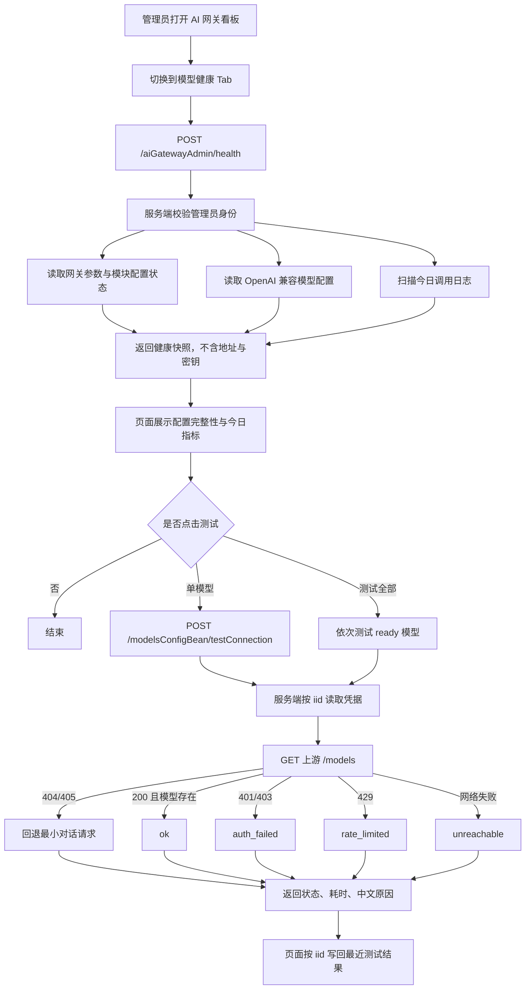
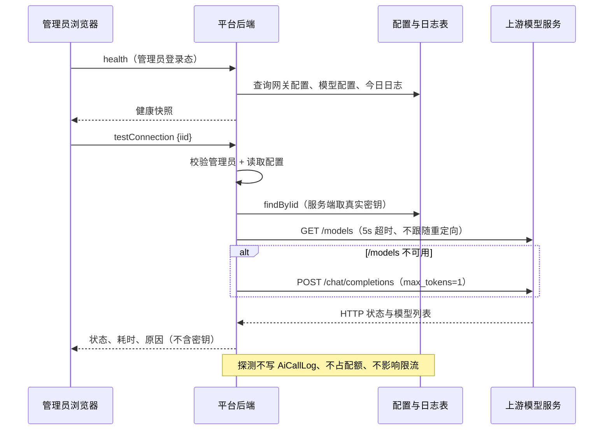

# 学习文档：模型可观测与健康面板（阶段 1 · 子阶段 4）

## 1. 业务目标与范围

前三轮已经具备：网关治理与用量汇总、RAG 评估、文档流水线、Agent 工作台。
但管理员仍然回答不了三个很具体的问题：

- 某个直连模型现在到底能不能用？是地址错了、密钥错了，还是模型名不存在？
- 哪个模型的失败率高、P95 慢、成本异常？
- 模型配置是否完整（地址、密钥、上游模型名、单价、向量模型）？

本模块补的是「只读可观测」，不改造网关主链路。

- 新增服务端连接测试：管理员显式触发，只传 `iid`，密钥由服务端读取。
- 新增健康快照：网关参数、模块配置完整性、直连模型配置完整性、今日调用统计。
- 用量看板的模型细分补齐成功率与 P95。
- 模型配置页补齐启用开关、单价编辑、连接状态与连接测试入口。
- 统一成本单位口径为**毫分**，修正历史注释与展示。

明确不做：

- 不改 `AiGatewayService` 的代理主链路，不加入熔断、重试、主备路由或并发闸门。
- 不做定时探测或自动告警；健康面板刷新不会自动请求上游。
- 不开放任意 URL 探测；探测目标只能是管理员已保存的模型配置。
- 不新增数据库表，不保存探测历史。

## 2. 业务流程图





## 3. 前端原理

### 3.1 健康 Tab 懒加载

模型健康面板不是首屏必需内容，因此只在第一次切换到该 Tab 时请求：

```ts
function onTabChange(name: string | number) {
  if (name === 'health' && !state.health) {
    loadHealth()
  }
}
```

首次加载后保留在内存，重复切换不重复请求；用户主动点「刷新」才重新拉取。
这样既避免无意义的后台请求，也避免每次切换都重新扫描今日日志。

### 3.2 三种状态不能混为一谈

页面上「可用 / 未测试 / 不可用」是三种不同含义：

| 状态 | 含义 | 展示 |
| --- | --- | --- |
| 配置不完整 | 地址、密钥或上游模型名缺失 | 「配置完整」列为否，测试按钮禁用 |
| 未测试 | 配置完整，但本次页面会话还没探测 | info 标签「未测试」 |
| 测试失败 | 已真实探测，返回非 ok | danger 标签 + 中文原因 |
| 模型缺失 | 服务可达，但模型列表中没有该模型 | warning 标签，提示核对上游模型名 |

探测结果只保存在当前页面内存，按 `iid` 索引：

```ts
state.probeResults[iid] = result
```

它不会写入数据库，也不会在刷新页面后保留。因此「最近测试」表示“本次页面会话内的最近一次探测”，不是持久化历史。配置被修改后，旧结果也不会自动失效，应以重新测试为准。

### 3.3 测试全部为什么串行

「测试全部」只选择 `ready` 的模型，并逐个 `await`：

```ts
for (const model of targets) {
  const result = await testModel(model.iid, true)
  // 汇总 ok / model_missing / failed
  state.probeProgress = { ...state.probeProgress, done: state.probeProgress.done + 1 }
}
```

串行有三个原因：

1. 避免同时向上游打 N 个请求，触发限流或放大故障。
2. 进度条能反映真实完成数量，而不是“全部发出去了”。
3. 单个模型失败不会中断整批，最终用一条汇总消息报告。

单模型测试失败时会弹错误消息；批量测试使用 `silent=true`，避免每个模型弹一条。

### 3.4 模型配置页的部分更新

启用开关只提交 `iid` 与 `enable`：

```ts
await modelsConfigApi.update({
  data: { iid: row.iid, enable },
  where: { iid: row.iid },
})
```

不把整行数据回传，原因是页面可能只加载了脱敏后的配置，整行回传会有覆盖其他字段的风险。
代价是必须确认后端部分更新语义：只拼接非 `null` 字段。本次通过反编译框架的 `SqlMapperHelper` 调用链核实了这一点，确认 `value == null` 时跳过该列。

开关请求失败时，页面把开关恢复原值，不把失败渲染成成功。
单价输入只接受非负整数，单位是「分 / 百万 tokens」，避免小数精度和负价格。

### 3.5 成本展示口径

`costCents` 实际单位是毫分，不是分。展示时统一折算：

```ts
const yuan = Number(milliCents ?? 0) / 100_000
// 不足 1 分时保留 4 位小数，避免显示成 ¥0.00
return yuan > 0 && yuan < 0.01 ? `¥${yuan.toFixed(4)}` : `¥${yuan.toFixed(2)}`
```

如果模型没有配置单价，页面不能把成本显示成「免费」或「0 元」：

- 模型细分里显示「未定价」标记。
- 今日成本卡片提示「仅含已定价模型」。

这是可观测性的基本原则：**缺失数据要显示为缺失，而不是零**。

## 4. 后端原理

### 4.1 健康快照不是实时探测

`health` 只返回配置完整性与今日统计，不主动请求上游。原因：

- 每刷新一次面板就打出 N 个外部请求，会放大上游压力。
- 上游慢或不可达时，健康接口会被拖到超时。
- 探测会产生网络副作用，应该由管理员显式触发，而不是由“看页面”隐式触发。

因此把两件事拆开：

| 能力 | 触发方式 | 是否访问上游 | 是否写审计 |
| --- | --- | --- | --- |
| 健康快照 | 打开/刷新面板 | 否 | 否 |
| 连接测试 | 点击测试按钮 | 是 | 否 |

返回值只包含 `iid / name / upstreamModel / enabled / ready / priced / hasEmbedModel`，
不包含 `baseUrl` 与 `apiKey`。

### 4.2 连接测试的边界

`ModelConnectionProbe.test` 的校验顺序：

1. 未登录直接拒绝。
2. 非管理员拒绝，且在读取配置和发起网络请求之前完成。
3. 只接受 `iid`，服务端用 `findByIid` 读取真实凭据。
4. 只测试 OpenAI 兼容协议。
5. 地址、密钥、上游模型名必须齐全，地址必须以 `http://` 或 `https://` 开头。

请求本身的安全边界：

- 连接与读取超时均为 5 秒。
- 不跟随重定向，避免被重定向到非预期地址。
- 响应体最多读取 1 MB，防止异常大响应拖垮内存。
- 结果与日志都不输出密钥；日志只记录 `uid / iid / model / status / http / latency`。

这降低了探测面，但不等价于完整的 SSRF 防护：管理员仍可以保存一个内网地址。
当前定位是内部管理台，后续如需更强隔离，可增加域名白名单或独立探测服务。

### 4.3 状态映射

| 上游响应 | 结果状态 | 是否可用 |
| --- | --- | --- |
| `/models` 200 且包含配置模型 | `ok` | 是 |
| `/models` 200 但不包含 | `model_missing` | 否 |
| 401 / 403 | `auth_failed` | 否 |
| 429 | `rate_limited` | 否 |
| 404 / 405（不支持 `/models`） | 回退最小对话请求 | 视回退结果 |
| 网络异常 / 超时 | `unreachable` | 否 |
| 其他 HTTP 状态 | `http_error` | 否 |

回退请求使用 `max_tokens=1`，只验证地址、密钥与模型名三者匹配，成本可忽略。
回退返回 400/404 时提示核对上游模型名，而不是笼统报“网络错误”。

### 4.4 按模型聚合

`scanLogs` 分页扫描调用日志，同时维护：

- 全局延迟列表 `latencies` 与首 token 列表 `firstTokens`。
- 按模型分组的延迟列表 `modelLatencies`。
- 按模型的调用数、失败数、tokens、成本。

成功率公式：

```text
成功率 = (调用数 - 失败数) / 调用数 × 100%
失败数 = status ∈ {failed, aborted, blocked}
```

`blocked` 也计入失败，因为它代表请求没有完成并产生有效回答。页面必须能区分“被治理拦截”和“上游失败”，所以汇总里仍保留 `blockedCalls` 单独计数。

P95 使用最近秩：

```text
索引 = ceil(n × 0.95) - 1   （0-based）
```

与全局 P95 使用同一函数，避免“模型 P95”和“整体 P95”口径不一致。

成本判断：

- 某模型有调用、有 token、但成本为 0 → 标记 `hasUnpricedModels = true`。
- 模型细分里 `priced` 为 false 时，不把成本解释成免费。

### 4.5 今日统计复用同一套聚合

健康快照中的 `today` 直接调用 `scanLogs(null, 今天, summary)`，
与用量看板共用同一套分页、失败分类、P95 和成本口径。
不另写一份“今日统计”逻辑，避免两个页面的数字对不上。

## 5. API 调用链路

平台约定请求体放在 `data` 字段内；健康接口无参数。

| 接口前缀 `/ai/api` | 用途 | 请求体 |
| --- | --- | --- |
| `/aiGatewayAdmin/health` | 健康快照 | `{}` |
| `/modelsConfigBean/testConnection` | 单模型连接测试 | `{"data":{"iid":1}}` |
| `/modelsConfigBean/update` | 启用开关/单价 | `{"data":{"iid":1,"enable":false},"where":{"iid":1}}` |
| `/aiGatewayAdmin/summary` | 用量汇总（含模型细分） | `{"data":{"startDate":"...","endDate":"..."}}` |
| `/modelsConfigBean/queryPage` | 模型配置分页 | 分页参数与筛选条件 |

连接测试响应示例（不含地址与密钥）：

```json
{
  "resp_code": 0,
  "datas": {
    "iid": 1,
    "modelName": "示例模型",
    "upstreamModel": "example-chat",
    "status": "ok",
    "modelAvailable": true,
    "httpStatus": 200,
    "latencyMs": 182,
    "message": "连接成功，模型「example-chat」可用",
    "checkedAt": 1762300000000
  }
}
```

状态取值固定为：
`ok / model_missing / auth_failed / rate_limited / unreachable / http_error`。

所有接口的管理员校验都在后端完成。前端隐藏按钮或禁用测试入口不能替代鉴权。

## 6. 数据库设计与迁移

本次不新增表、不新增业务列，只增加一个复合索引：

```sql
CREATE INDEX IF NOT EXISTS idx_aicalllog_model_time
  ON aicalllogbean ("modelName", "createtime");
```

用途：按模型维度排查失败率或耗时异常时，避免对调用日志做全表扫描。

启动初始化器 `TableSchemaInitializer` 会执行同一条幂等语句；已有环境重启即可生效。
如需手工执行，直接在目标库运行上面的 SQL；回滚可执行：

```sql
DROP INDEX IF EXISTS idx_aicalllog_model_time;
```

复用的现有结构：

| 表/列 | 用途 |
| --- | --- |
| `modelsconfigbean` | 地址、密钥、上游模型名、启用状态、单价、向量模型 |
| `aicalllogbean.modelName` | 按模型聚合 |
| `aicalllogbean.status` | 成功/失败/阻断分类 |
| `aicalllogbean.latencyMs` | 平均延迟与 P95 |
| `aicalllogbean.costCents` | 成本汇总（毫分） |
| `aicalllogbean.createtime` | 今日统计与时间范围扫描 |

没有探测历史表，因此“最近测试结果”不能跨页面刷新保留；这是本阶段的明确边界，不是遗漏。

## 7. 核心代码与指标口径

### 7.1 探测与回退

```java
HttpReply modelsReply = request("GET", baseUrl + "/models", apiKey, null);
if (modelsReply.status == 200) {
    Boolean available = modelListed(modelsReply.body, upstreamModel);
    // null = 不是可识别的模型列表；true/false = 是否列出目标模型
}
if (modelsReply.status == 404 || modelsReply.status == 405) {
    return chatFallback(baseUrl, apiKey, upstreamModel, startedAt);
}
```

回退不是“失败后重试”，而是协议能力探测：部分 OpenAI 兼容服务没有实现 `/models`，但对话接口可用。

### 7.2 成功率与 P95

```text
成功率 = (calls - failed) / calls × 100
P95 索引 = ceil(n × 0.95) - 1
```

示例：5 次调用，延迟为 `100, 200, 300, 400, 5000` ms。

- `ceil(5 × 0.95) - 1 = 4`，P95 = 5000 ms。
- 若有 1 次失败，成功率 = `(5 - 1) / 5 × 100 = 80%`。

这两个指标都来自真实调用日志，不是随机生成或前端估算。

### 7.3 成本单位

```text
1 元 = 100 分 = 100000 毫分
展示金额（元） = costCents / 100000
单次成本（毫分） = promptTokens × 输入单价 / 1000
                 + completionTokens × 输出单价 / 1000
```

其中单价单位是「分 / 百万 tokens」。除以 1000 后得到毫分，再累加。
示例：输入 2000 tokens、输入单价 200 分/百万：

```text
2000 × 200 / 1000 = 400 毫分 = 0.004 元
```

这是一个金额换算，不是模型评分。页面不会把“未配置单价”显示成 0 元。

### 7.4 配置完整性判断

```text
ready  = baseUrl 非空 && apiKey 非空 && upstreamModel 非空
priced = 输入单价非空 || 输出单价非空
```

`enabled` 与 `ready` 分开：启用但配置不完整，仍然是“不可用”；
配置完整但未启用，也不应该被测试全部选中。

## 8. 异常处理

| 异常 | 处理原则 |
| --- | --- |
| 未登录 | 服务端拒绝，不读取配置 |
| 非管理员 | 在读取配置和发起网络请求前拒绝 |
| 缺少 iid / 配置不存在 | 返回可读错误，不发起网络请求 |
| 非 OpenAI 兼容协议 | 提示无需测试，不探测 |
| 地址/密钥/模型名缺失 | 返回“均配置后才能测试” |
| 地址不是 http(s) | 拒绝，避免非法协议 |
| 上游不可达、超时 | `unreachable`，提示检查地址与网络 |
| 401 / 403 | `auth_failed`，提示检查密钥 |
| 429 | `rate_limited`，提示稍后重试 |
| 200 但不是模型列表 | `http_error`，提示检查是否为兼容接口 |
| 模型不在列表中 | `model_missing`，warning 而非 error |
| `/models` 404/405 | 回退最小对话请求 |
| 回退请求 400/404 | 提示核对上游模型名 |
| 健康接口失败 | 保留页面既有内容，错误提示 + 可重试 |
| 批量测试中单个失败 | 不中断整批，计入失败汇总 |
| 测试过程中离开页面 | 页面内存结果随组件卸载丢失，不伪造持久化 |

所有失败路径都不会把“未测试”显示成“可用”，也不会把探测失败写成一条成功的调用审计。

## 9. 验收方法

验收分四层，不能相互冒充：

1. 后端单测：`ModelConnectionProbeTest` 用本地 `HttpServer` 覆盖 7 条路径；
   `AiGatewayAdminHolderTest` 覆盖模型成功率、P95、健康快照与管理員校验。
2. 前端逻辑测试：确认成本、时间、健康状态等展示函数的口径。
3. 组件测试：健康面板懒加载、单模型测试、批量测试、配置页开关与单价。
4. 浏览器测试：真实 Chromium/Edge 渲染页面，`page.route` 拦截后端接口，核对真实请求体。

常用命令：

```bash
# 后端（JDK 8）
mvn -s C:/Users/24774/.m2/settings-offline.xml test

# 前端
npm test
npm run test:component
npm run test:e2e
npm run typecheck
npm run build
npm run check:bundle
npm run check:icons
npm run check:styles
npm run check:secrets
```

### 本次实测结果（2026-11-06）

| 检查 | 实测结果 |
| --- | --- |
| 后端 Maven 全量测试 | 49 个测试类 / 542 项通过；0 失败、0 错误、0 跳过 |
| 新增后端测试 | `ModelConnectionProbeTest` 7 项、`AiGatewayAdminHolderTest` 4 项 |
| 前端逻辑测试 `npm test` | 19 个文件 / 230 项通过 |
| 前端组件测试 `npm run test:component` | 27 个文件 / 256 项通过（新增 5 项） |
| 浏览器全量 `npm run test:e2e` | 21 项通过（新增 2 项，含健康面板与模型配置） |
| 类型检查、生产构建 | `typecheck`、`build` 通过 |
| 图标门禁 | 58 个图标全部解析，其中 23 个全局图标 |
| 样式门禁 | 2102 处，与基线一致 |
| 包体门禁 | 首屏 JS 203.1 kB（预算 260）、CSS 58.2 kB（预算 80） |
| 产物密钥扫描 | 117 个产物，无密钥痕迹 |

**验证边界：** 本机业务后端未启动，本轮没有真实数据库写入、真实上游模型探测或部署环境联调。
浏览器测试使用 `page.route` 拦截接口，后端单测使用本地 HTTP 测试上游与 Mapper 替身。
因此以上结果不能表述为“真实模型全链路已验收”。

实际环境验收还需要：

1. 启动后端与数据库，确认索引创建成功。
2. 管理员打开 AI 网关看板，核对健康快照中的网关参数与今日统计。
3. 对一个已配置的模型执行连接测试，分别验证正常、密钥错误、模型名错误三条路径。
4. 在模型配置页切换启用状态、修改单价，刷新后确认只改动了目标字段。
5. 产生若干次真实调用后，核对模型成功率、P95 与成本是否与调用日志一致。

这一步可能消耗真实额度，应在明确可用的测试环境与账户后执行。

## 10. 面试问答

### Q1：为什么连接测试不放进网关主链路？

探测是运维动作，不是业务请求。放进主链路会让每次代理都承担额外网络开销，
还会污染限流、配额和审计口径。独立组件可以明确边界：不写 `AiCallLog`、不占配额、不影响路由。

### Q2：为什么前端只传 iid，不让浏览器传地址和密钥？

凭据必须由服务端从数据库读取。让浏览器回传密钥会扩大泄露面，
也会把探测目标变成任意 URL。只传 `iid` 同时完成了“目标限定在已保存配置上”。

### Q3：成功率为什么把 blocked 也算失败？

`blocked` 表示请求被治理策略拦截，没有产生有效回答。
如果把它算成功，会掩盖真实的可用性问题。但汇总里仍单独保留 `blockedCalls`，
便于区分“上游失败”和“被限流/配额拦截”。

### Q4：P95 用哪种算法？

最近秩：排序后取 `ceil(n × 0.95) - 1`。
数据量小时它比插值法更直观，也和全局 P95 保持同一口径。
代价是样本少时 P95 可能等于最大值，页面需要结合调用量一起看。

### Q5：为什么成本用毫分存储？

单次模型调用经常不足 1 分，用“分”取整会把大量调用记成 0。
毫分保留足够精度，同时仍是整数，避免浮点累加误差。
展示时再折算成元，小于 1 分时保留 4 位小数。

### Q6：探测接口如何降低 SSRF 风险？

只接受 `iid`，目标来自管理员已保存的配置；只允许 http(s)；不跟随重定向；
5 秒超时；响应体上限 1 MB；结果和日志不回传密钥。
这不是完整的 SSRF 防护，管理员仍可保存内网地址；更强隔离需要域名白名单或独立探测服务。

### Q7：为什么测试全部要串行？

并发探测会同时打向上游，容易触发 429，也会让故障放大。
串行能给出真实进度，单个失败不影响后续模型，最后统一汇总。

### Q8：为什么加 `(modelName, createtime)` 复合索引？

按模型排查时，查询条件通常同时包含模型名和时间范围。
复合索引可以先按模型缩小范围，再按时间过滤；单列索引无法同时满足这两步。

### Q9：健康快照和连接测试为什么要拆开？

健康快照是“配置是否完整”的静态判断，成本低、可以频繁刷新；
连接测试是“上游是否可达”的动态探测，有网络副作用和延迟。
拆开后页面刷新不会被上游拖慢，探测也只在管理员明确点击时发生。

### Q10：怎么证明启用开关不会清空其他字段？

先确认后端部分更新语义：只拼接非 `null` 字段。
本次通过反编译框架的 `SqlMapperHelper → DbTableHelp.getSetColumns → SqlFieldTools.getSetColumns`
调用链核实，`value == null` 时该列被跳过。
前端再只提交 `{iid, enable}`，并用组件测试断言请求体；后端更新测试验证其他字段不变。
