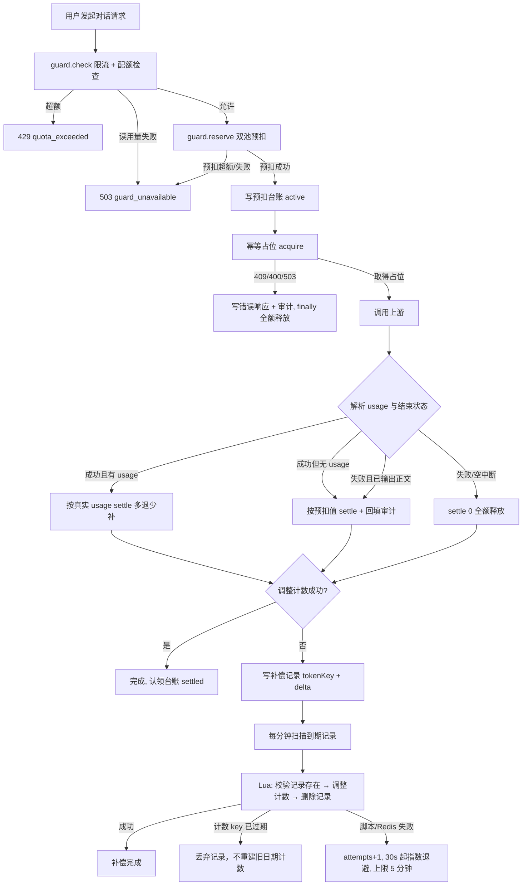
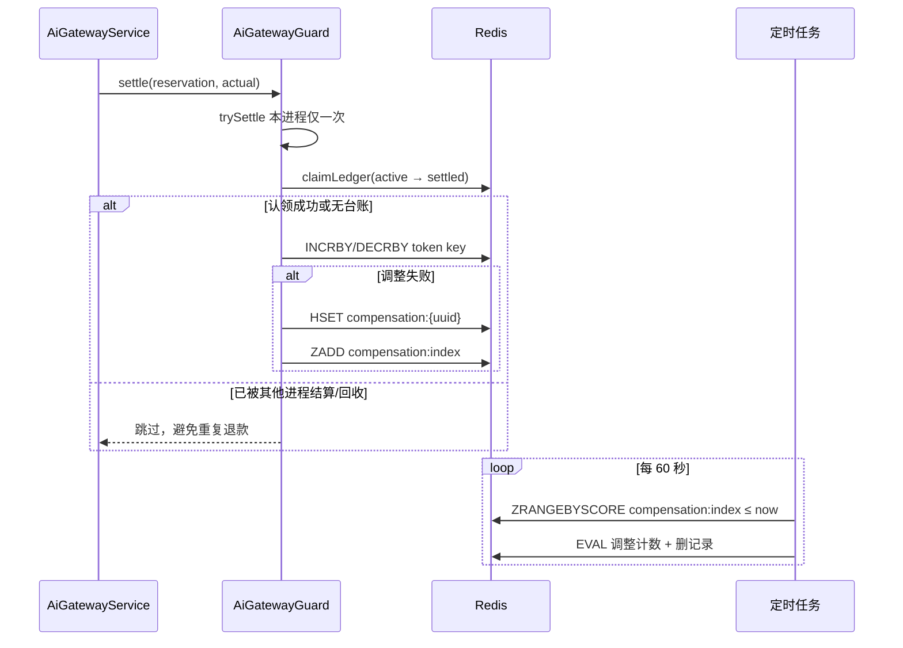

# 学习文档：网关计费一致性与补偿（阶段 1 · 子阶段 5A）

## 1. 业务目标与范围

网关已经具备限流、用户/部门双池预扣、按真实 usage 结算、失败全额释放、
客户端中断按预扣值计费、预扣台账回收。本轮审查又发现四个「账对不上」的缺口：

| 编号 | 缺口 | 后果 |
| --- | --- | --- |
| G1 | `usedTokens` 读 Redis 失败时返回 0 | Redis 抖动一下，所有用户的配额检查都变成「已用 0」，等于临时解除限额 |
| G2 | 上游正常结束但没返回 usage 时走 `settle(0)` | 用户拿到完整回答却一分不扣，省略 usage 的供应商等于免费 |
| G3 | 结算时调整计数失败只打 warn | 预扣台账已被认领，这笔偏差再也没人修，用户额度永久停在预扣值 |
| G4 | 台账回收退款失败同样只打 warn | 与 G3 相同，且发生在「预扣本来就不该继续占用」的场景 |
| G5 | `idempotencyGuard.acquire` 在 try 之外 | 占位逻辑若抛出未捕获异常，预扣不会进 finally，泄漏到 30 分钟后的回收任务 |

本子阶段（5A）只处理后端计费链路：

- 配额检查改为 fail-closed：读不到已用量就返回 `guard_unavailable`（503），不再放行。
- 新增「成功但无 usage」计费分支：按预扣值结算，并回填审计用量。
- 新增结算补偿队列：调整失败时记录「单个 key + 增量」，定时原子重试。
- 台账回收改走同一补偿通道。
- 幂等占位移入 try，任何异常都能被 finally 兜住。

明确不做（留给 5B / 5C）：

- 前端 `Idempotency-Key`、`X-Request-Id` 透传与 409 可读提示。
- 熔断/半开、主备路由、并发闸门、客户端取消的即时上游关闭。
- 不做新数据库表，不改 Dify / 模型网关请求格式。

## 2. 业务流程图





## 3. 前端原理

本子阶段不改前端。前端需要感知的只是两类错误码：

- `429 quota_exceeded`：额度用完，重试无意义。`chatError.ts` 已有专门分支，
  保留服务端原始文案，不自动重试、不提示切换模型。
- `503 guard_unavailable`：治理依赖不可用。前端当前没有专门分支，
  会展示服务端返回的中文原因。它和 429 的区别在于「该找管理员看服务，而不是等额度恢复」。

为什么现在不做前端幂等键：

1. 生成幂等键、处理 409、区分「可安全重试」与「上次已执行」需要改对话发送状态机；
2. 修改面比后端大，必须单独回归流式对话与文件上传两条路径；
3. 本阶段先把「记账正确」收口，避免一次改动同时动计费与交互。

## 4. 后端原理

### 4.1 fail-closed 的边界

`readTokenCount` 把「读取失败」和「没有计数」分成两个返回值：

```java
private Long readTokenCount(String userId) {
    try {
        Object value = redisServer.get(todayTokenKey(userId));
        if (value == null) {
            return 0L;          // 确实还没用过
        }
        return Long.parseLong(String.valueOf(value));
    } catch (Exception e) {
        log.error("[AiGateway] 读取 Token 用量失败, uid={}", userId, e);
        return null;            // 不知道用了多少 → 不能猜 0
    }
}
```

`checkQuota` 只在 `used != null` 时比较额度；`null` 直接返回
`CODE_GUARD_UNAVAILABLE`。展示接口 `usedTokens` 仍返回 0 兜底——
看板数字不准可以接受，拿它做准入判断不可以。

### 4.2 预扣与结算的状态机

```text
（无预扣）── 配额不限/不使用 token 配额 ──────────────► 空操作
     │
     ├─ reserve 成功 ──► Reservation.active（双池已 INCRBY）
     │                        │
     │                        ├─ settle(actual) ──► 认领台账 ──► 调整 delta
     │                        │                            └─ 失败 → 补偿队列
     │                        └─ 进程崩溃 ──► 30 分钟后 reaper 全额退回
     │
     └─ reserve 超额/依赖不可用 ──► Reservation.blocked（不进入代理）
```

关键不变量：

1. **一次预扣只结算一次**：`Reservation.trySettle()` 用 CAS 挡住同进程重复调用；
   跨进程由台账 Lua 的 `active → settled` 状态迁移挡住。
2. **用预扣时的 key**：跨零点完成的长请求，结算改的是预扣那一天的 key，
   不会出现「第一天预扣退不回来、第二天额度被多扣」。
3. **读写失败不猜值**：读不到已用量拒绝请求；调整失败必须留下可重试的记录。

### 4.3 补偿队列为什么按「单个 key + 增量」拆分

一次结算可能同时改用户池和部门池：

```text
settle(delta = actual - reserved)
  ├─ userKey: +delta
  └─ unitKey: +delta
```

如果只记录「整笔结算待重试」，重试时可能出现「用户池上次其实已经成功、
部门池失败」，整笔重放会把用户池再调一次，造成重复退款。

因此每条补偿记录只描述一个 key、一个 delta：

```text
ai:gateway:compensation:{uuid}
  tokenKey = ai:gateway:tokens:u1:20261106
  delta    = -600
  userId   = u1
  attempts = 0
  createdAt= 1762...
ai:gateway:compensation:index   (ZSET, score = 下次可重试时间)
```

`settleKey` 对每个 key 独立 try/catch：一个池失败不影响另一个池，
失败的那个单独入队。

### 4.4 Lua 保证「至多调整一次」

补偿重试的两个并发风险：

- 多个实例同时扫到同一条记录；
- 脚本执行成功但客户端超时，任务以为失败又重试。

脚本把「检查记录、调整计数、删除记录、移除索引」放在一次 Redis 原子执行里：

```lua
if redis.call('EXISTS', KEYS[1]) == 0 then return -1 end;
if redis.call('EXISTS', KEYS[2]) == 0 then
  redis.call('DEL', KEYS[1]); redis.call('ZREM', KEYS[3], KEYS[1]); return 0
end;
redis.call('INCRBY', KEYS[2], ARGV[1]);
redis.call('EXPIRE', KEYS[2], ARGV[2]);
redis.call('DEL', KEYS[1]); redis.call('ZREM', KEYS[3], KEYS[1]); return 1
```

- `KEYS[1]`：补偿记录 Hash
- `KEYS[2]`：Token 计数 key
- `KEYS[3]`：补偿索引 ZSET
- 返回 `-1`：记录不存在（已被别的实例处理）
- 返回 `0`：Token 计数 key 已过期 → 丢弃记录，不重建旧日期计数
- 返回 `1`：本次真正应用了增量

注意：这个脚本假设三个 key 在同一个 Redis 实例/槽位。当前部署是单实例 Redis；
若未来上 Redis Cluster，需要把相关 key 加相同 hash tag，或改为「先读后写 + 幂等标记」。

### 4.5 重试节奏与上限

- 扫描间隔：60 秒，每次最多 100 条。
- 首次失败：30 秒后重试；第 n 次失败：`min(30s × n, 5min)`。
- 记录 TTL：2 天，覆盖计数 key 的生命周期；过期即自然丢弃。
- 写队列本身失败：只打 error 日志。Redis 整体不可用时无法再提供可靠队列，
  不能假装已入队；此时依赖计数 key 次日过期把偏差抹平。

### 4.6 「没有 usage」与「usage 为 0」

解析器新增 `usageSeen`：

| 上游表现 | `usageSeen` | `totalTokens` | 计费 |
| --- | --- | --- | --- |
| 完全没给 usage | false | null | 成功且已输出正文 → 按预扣值 |
| `usage` 对象存在但全为 0 | true | null | 按 0 结算（信任上游的明确值） |
| `usage.total_tokens = 321` | true | 321 | 按 321 结算 |

`totalTokens` 为 null 也可能是「usage 里只有 0」造成的；
如果只判断 null，就会把「明确 0 消耗」误判成「没给用量」，反向多收费。

## 5. API 调用链路

本子阶段没有新增 HTTP 接口。链路仍是：

```text
POST /api/aiGateway/chat/chat-messages
  └─ AiGatewayController
       └─ AiGatewayService.proxy(module, userId, request, response)
            ├─ guard.check(userId, module)          → 限流 + 配额只读检查
            ├─ guard.reserve(userId, module)        → 双池预扣 + 台账
            ├─ endpoint 白名单 / 请求体校验
            └─ doProxy(...)
                 ├─ idempotencyGuard.acquire(...)   → 占位（现在位于 try 内）
                 ├─ 转发上游 / SSE 透传
                 ├─ AiGatewayUsageParser            → usage / 错误 / 会话 ID
                 ├─ guard.settle(reservation, n)    → 结算或补偿入队
                 └─ callLogHolder.record(...)       → 审计
```

Redis key 一览：

| key | 类型 | 用途 | TTL |
| --- | --- | --- | --- |
| `ai:gateway:rate:{uid}:{yyyyMMddHHmm}` | String | 每分钟限流计数 | 120 秒 |
| `ai:gateway:tokens:{uid}:{yyyyMMdd}` | String | 用户当日已用 Token | 2 天 |
| `ai:gateway:tokens:unit:{gid}:{yyyyMMdd}` | String | 部门当日共享池 | 2 天 |
| `ai:gateway:reservation:{uuid}` | Hash | 预扣台账 | 2 小时 |
| `ai:gateway:reservation:index` | ZSet | 台账回收索引 | 随成员 |
| `ai:gateway:compensation:{uuid}` | Hash | 单 key 补偿记录 | 2 天 |
| `ai:gateway:compensation:index` | ZSet | 补偿重试索引 | 随成员 |
| `ai:gateway:idem:{uid}:{module}:{key}` | String | 幂等占位 | 10 分钟 |

## 6. 数据库设计与迁移

本子阶段**没有数据库结构变更**，因此没有 SQL 迁移脚本。

原因：预扣、结算、补偿都是「当天有效」的短期状态，天然适合 Redis 的 TTL；
落库会引入清理任务、状态迁移和额外事务，收益只有「审计历史」，
而审计已经由 `aicalllogbean` 承担。

上线兼容性：

- 旧实例不识别补偿索引，但不会读写它；新实例写入的记录只会由新实例处理。
- 滚动发布期间，新旧实例都遵守同一套 Token 计数 key 与台账 key 格式。
- 若回滚到旧版本：补偿索引中的记录会保留到 TTL 过期，不影响旧版本运行；
  已认领的台账状态旧版本同样能识别。

## 7. 核心代码与指标口径

### 7.1 结算入口

```java
public void settle(Reservation reservation, long actualTokens) {
    if (reservation == null || !reservation.isActive() || !reservation.trySettle()) {
        return;
    }
    Boolean claimed = claimLedger(reservation.getLedgerKey(), SETTLE_LEDGER_SCRIPT);
    if (Boolean.FALSE.equals(claimed)) {
        return;
    }
    long delta = actualTokens - reservation.getTokens();
    settleKey(userKeyOf(reservation), delta, reservation.getUserId());
    if (reservation.getUnitOwner() != null) {
        settleKey(unitKeyOf(reservation), delta, reservation.getUserId());
    }
}
```

口径：

- `reserved = properties.quotaReserveTokens`（默认 1500）。
- `delta = actualTokens - reserved`；负数退还，正数补扣。
- `actualTokens` 的来源优先级：真实 usage > 中断/失败时的预扣值 > 0（全额释放）。
- 「成功但无 usage」记 `actualTokens = reserved`，审计 `totalTokens` 同步回填，
  保证看板用量与真实扣掉的额度一致。

### 7.2 补偿入队

```java
private void settleKey(String key, long delta, String userId) {
    if (delta == 0) {
        return;
    }
    try {
        adjustTokens(key, delta);
    } catch (Exception e) {
        log.error("[AiGateway] 调整 Token 计数失败，写入补偿队列, uid={}, key={}, delta={}: {}",
                userId, key, delta, e.getMessage());
        enqueueCompensation(key, delta, userId, e.getMessage());
    }
}
```

### 7.3 重试选择

```java
recordKeys = stringRedisTemplate.opsForZSet()
        .rangeByScore(COMPENSATION_INDEX_KEY, 0D, (double) now, 0, 100);
```

`score` 表示「下次可重试的时间戳」。首次入队用当前时间，意味着下一轮扫描就能重试；
失败后把 score 推到 `now + delay`，形成退避。

### 7.4 失败路径的计费判定

`doProxy` 中计费分支的顺序（自上而下，先命中先返回）：

1. 成功且有 `totalTokens` → 按真实 usage。
2. 成功、无 usage（`!usageSeen`）、已输出正文、有预扣 → 按预扣值。
3. 失败、无 usage、SSE、已输出正文、有预扣 → 按预扣值。
4. 失败但有 usage → 只记日志，不计费。
5. 其他 → `settle(0)` 全额释放。

### 7.5 幂等占位的异常保护

```java
AiIdempotencyGuard.Lease idempotencyLease = null;
try {
    AiIdempotencyGuard.Acquisition idempotency =
            idempotencyGuard.acquire(userId, module, request);
    ...
    idempotencyLease = idempotency.getLease();
    ...
} finally {
    if (reservation != null && reservation.isActive()) {
        guard.settle(reservation, billable ? actualTokens : 0L);
    }
    ...
}
```

409/400/503 的拒绝仍会走 finally：`billable=false` → `settle(0)`，
与被拒绝的请求不应该占用额度保持一致。

## 8. 异常处理

| 场景 | 处理 | 用户/运维可见结果 |
| --- | --- | --- |
| 配额已用量读取失败 | fail-closed | 503 `guard_unavailable` + 中文原因 |
| 预扣 INCRBY 无返回 | 拒绝本次调用 | 503 `guard_unavailable` |
| 用户池/部门池任一超额 | 回滚已预扣部分，拒绝 | 429 `quota_exceeded` |
| 台账写失败 | 告警后继续 | 请求正常；失去崩溃恢复保护 |
| 台账认领失败（Redis 异常） | 降级为无台账结算并继续 | 请求正常；极小概率与 reaper 重复调整（见 §9 残余风险） |
| 结算调整失败 | 写补偿记录 | 请求正常；额度偏差由定时任务修复 |
| 补偿记录写失败 | error 日志 | 无法自动修复；计数 key 次日过期 |
| 补偿脚本失败 | attempts+1，退避重试 | 最多重试到记录 TTL（2 天） |
| 计数 key 已过期 | 丢弃补偿记录 | 不重建旧日期计数 |
| 多个实例同时补偿 | Lua 原子删除记录 | 只有一个实例真正调整 |
| 幂等占位抛异常 | 被 finally 兜住 | 预扣不泄漏；响应按网关错误返回 |
| 上游正常结束但无 usage | 按预扣值收费 | 不免费，审计有值 |
| usage 明确为 0 | 按 0 结算 | 不多收 |

## 9. 验收方法

### 9.1 自动化测试

新增/更新的测试类：

| 测试类 | 用例 | 覆盖点 |
| --- | --- | --- |
| `AiGatewayGuardTest` | 24 项 | fail-closed、补偿入队、reaper 退款失败入队、补偿 Lua 调用、原有预扣/结算 |
| `AiGatewayServiceTest` | 28 项 | 无 usage 成功按预扣结算、usage=0 按 0 结算、原有幂等/中断/限流/多部分请求 |
| `AiGatewayUsageParserTest` | 13 项 | `usageSeen` 区分「缺失」与「明确为 0」 |
| `AiIdempotencyGuardTest` | 12 项 | 幂等键格式、冲突、Redis 不可用（回归） |

后端全量（JDK 8，离线 Maven 仓库）：

```text
app-common            7 项
app-business-permission 71 项
app-business-service 444 项
app-start             27 项
合计 549 项，Failures 0，Errors 0
BUILD SUCCESS
```

前端回归（本次未改前端，确认无连带影响）：

```text
npm test           19 个文件 / 230 项通过
npm run test:component 27 个文件 / 256 项通过
npm run typecheck  通过
npm run build      通过
```

### 9.2 本阶段没有证明什么

必须明确：

- 没有启动业务后端，**没有做真实 PostgreSQL / Redis / 上游模型联调**。
- 补偿 Lua 脚本只在单元测试中被 Mockito 捕获调用参数，**没有在真实 Redis 上执行**。
  本机没有 `redis-cli`，Docker daemon 也未运行。
- 没有做浏览器点击级验证；本阶段没有前端改动。

因此本阶段的结论是「代码与单测层面收口」，不是「生产环境端到端验证完成」。

### 9.3 残余风险

1. **认领台账与调整计数之间的 Redis 抖动**
   `claimLedger` 抛异常时按「无台账」继续结算。如果脚本实际已经执行（超时但成功），
   或者脚本没执行而调整成功，台账会停留在 `active`，30 分钟后 reaper 可能再全额退一次。
   概率低但确实存在。彻底解决需要「结算意图」落库或把认领与调整合并为一个 Lua，
   属于后续独立改造，不在本子阶段扩大范围。
2. **补偿队列依赖 Redis**
   Redis 整体不可用时队列写不进去，只留 error 日志。此时可用性优先于记账精度，
   与既有 fail-closed 准入策略并不矛盾：请求在入口已经被拒绝。
3. **Redis Cluster 跨槽**
   当前脚本假设相关 key 同槽；单实例部署成立，集群化时需要重新设计 key tag。

## 10. 面试问答

### Q1：为什么配额检查读失败要拒绝请求，而不是当作 0？

因为配额是**花钱的控制点**。把「读不到」解释成「没用量」，等于任何一次 Redis 抖动
都会临时解除所有用户的额度限制；而本项目的登录态本来就存 Redis，
Redis 挂了请求根本进不来。此时「为了可用性放行」保护的是一个已经不存在的场景，
只会静默失去治理能力。所以选择 fail-closed，并返回可区分的
`guard_unavailable`，而不是混进 429。

### Q2：预扣和结算为什么需要台账？

预扣发生在请求开始，结算在 finally。两者之间可能隔着几十秒的流式输出，
进程被 kill -9 时 finally 不会执行。没有台账，这笔预扣会一直占到当天结束，
用户看到额度「凭空少了一截」。台账记录「占了哪个池、多少 Token、用的哪个 key」，
定时任务发现超过 30 分钟仍是 active 的记录就退回。
同时台账的 `active → settled` 原子迁移也解决了多实例重复结算。

### Q3：为什么补偿记录要按单个 key 拆分？

一次结算要同时改用户池和部门池。如果只记录整笔结算，重试时无法知道上次哪个池成功；
整笔重放会给已经成功的池再调一次，产生重复退款。拆成两条记录后，
每条只关心自己的 key，重试天然幂等，互不影响。

### Q4：为什么用 Lua 而不是「先查再改」？

「检查记录是否存在、调整计数、删除记录」如果分三次请求，两个实例可能同时通过检查，
各自调整一次。Lua 在 Redis 内串行执行，天然互斥；再配合「删除记录」作为幂等标记，
实现「至多调整一次」。脚本还必须处理计数 key 已过期的情况——直接丢弃记录，
不能因为补偿把旧日期的 key 重新创建出来。

### Q5：上游没给 usage 为什么要按预扣值收费？不怕多收吗？

需要区分三种情况：失败且没输出 → 全额退；成功但没给 usage → 已经产出内容，
上游一定产生了费用，按预扣值收费是「无法精确时的保守估计」；
usage 明确为 0 → 信任上游，按 0 结算。多收的部分会在下一次预扣结算时自然修正
（预扣本来就是估算值）。如果不收，供应商只要省略 usage 字段就能让所有调用免费。

### Q6：这套补偿机制和消息队列的「至少一次」有什么区别？

补偿队列是 Redis ZSet + Hash 的轻量实现，目标不是通用消息队列，而是
「单 key 增量调整」这一种极窄的场景：

- 记录小、生命周期短（2 天）、可丢弃（计数 key 过期后无意义）；
- 用 Lua 的「删除即确认」实现至多一次；
- 没有消费者组、没有死信队列，失败靠退避重试和 TTL 兜底。

引入 Kafka/RocketMQ 会带来部署、监控、序列化和顺序性问题，
对「每天少量结算补偿」这个量级不划算，也违背项目「优先现有技术栈」的约束。
