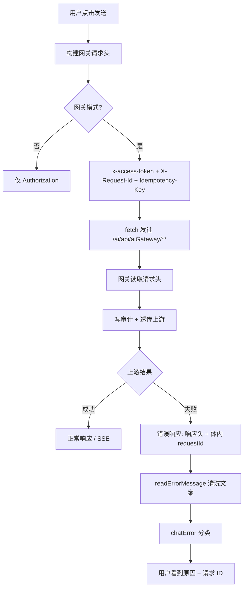
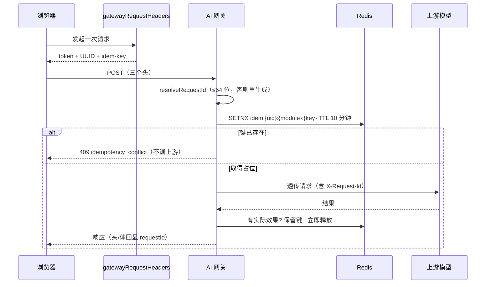
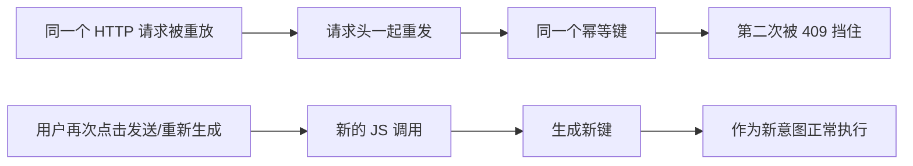

# 学习文档：前端请求追踪与幂等键（阶段 1 · 子阶段 5B）

## 1. 业务目标与范围

子阶段 5A 已经把网关的后端能力补齐：

- 浏览器可以传 `X-Request-Id`，网关会校验长度、写入审计、透传上游，并在错误响应里回显；
- 浏览器可以传 `Idempotency-Key`，网关按「用户 + 模块 + 键」占位 10 分钟，重复请求返回 409。

但前端一个都没发。结果是：

| 编号 | 缺口 | 后果 |
| --- | --- | --- |
| G1 | 所有网关请求都不带 `X-Request-Id` | 网关只能自己生成 UUID，用户在界面上看不到；报障时仍然只能描述「大概几点」 |
| G2 | 所有网关请求都不带 `Idempotency-Key` | 后端的幂等能力只对第三方客户端生效，浏览器这条主链路等于没接 |
| G3 | `readErrorMessage` 只取 `message`，丢掉 `requestId` | 即使后端把 ID 放进了错误体，用户也拿不到 |
| G4 | `directModel.parseGatewayError` 自建一套解析 | 只认站内 `{message}`，OpenAI 兼容信封会退化成整段 JSON；也不带请求 ID |
| G5 | `chatError` 没有幂等分支 | 409 会落到「未知错误」兜底文案，用户不知道这是「上次已经提交过」且不该重试 |

本子阶段（5B）只改前端：

- 新增 `src/api/requestId.ts`，生成请求 ID 与幂等键；
- 网关请求头统一由 `gatewayRequestHeaders()` 产出：鉴权 + `X-Request-Id` + `Idempotency-Key`；
- 所有走 AI 网关的原生 `fetch` 与统一 `request()` 都接入；
- 错误文案统一附带「（请求 ID：xxx）」，同时兼容站内与 OpenAI 两种错误信封；
- `chatError` 增加 `idempotency_conflict`（不可重试）与 `idempotency_unavailable`（可重试）分支；
- 分类前先剥离请求 ID，避免 UUID 里的数字被误判成 HTTP 状态码。

明确不做：

- 不改后端协议、不加数据库表；
- 不改 `axios.js` 拦截器：它服务的是 HNSP 管理接口，不是 AI 网关代理链路；
- 不做自动重试，不缓存并重放响应；
- 不改 SSE 事件格式。

## 2. 业务流程图





幂等键的语义边界：



## 3. 前端原理

### 3.1 一个工厂统一产出三类头

`gatewayRequestHeaders()` 做了三件事：

1. 按当前场景取登录 Cookie：管理后台用 `admin_loginToken`，业务页面用 `loginToken`，再互相兜底；
2. 生成 `X-Request-Id`；
3. 生成 `Idempotency-Key`。

把它放在 `difyConfig.ts` 的原因是：这个项目有 7 个模块用原生 `fetch` 调网关
（聊天、知识库对话、数据集、文档、分段、文档预览、直连模型），
另有一条统一 `request()` 链路。之前鉴权头就是从这里发出的，
把追踪与幂等键放在同一位置，调用方不用理解协议细节，也不会漏。

非网关模式（`VITE_AI_GATEWAY=0`）直接返回空对象：
直连 Dify 时后端不参与，发这些头没有意义，也避免改变回退链路的行为。

### 3.2 为什么每次调用生成新键

这里要区分两种「重复」：

| 重复来源 | 是否应该拦截 | 原因 |
| --- | --- | --- |
| 浏览器、代理、负载均衡把同一个 HTTP 请求重放 | 应该 | 请求头会一起重发，后端看到同一个键，第二次 409，避免重复计费/重复建数据 |
| 用户再次点击发送、点击「重新生成」 | 不应该 | 这是一次新的业务意图，应该正常执行 |

所以键的粒度是「一次 JS 调用一个键」，不是「一个会话一个键」，
也不是「一个页面一个键」。会话级复用会把用户正常的第二次提问误杀。

### 3.3 非安全上下文的回退

`crypto.randomUUID()` 只在安全上下文（HTTPS 或 localhost）可用。
内网常用 HTTP 部署，直接调用会抛错。`newRequestId()` 先判断能力再回退：

```ts
if (cryptoObj && typeof cryptoObj.randomUUID === 'function') {
  return cryptoObj.randomUUID()
}
return `req-${Date.now().toString(36)}-${Math.random().toString(36).slice(2, 12)}`
```

两种结果都满足后端的 64 字符上限；幂等键再包一层 `idem-` 前缀，
长度与字符集都落在 `[A-Za-z0-9._:-]{8,128}` 内。

### 3.4 错误文案清洗：两种协议 + 请求 ID

后端有两套错误信封：

```json
{ "code": "quota_exceeded", "message": "今日 AI 额度已用完…", "status": 429, "requestId": "..." }
```

```json
{ "error": { "message": "上游限流", "type": "rate_limit_error", "code": "rate_limit_exceeded", "request_id": "..." } }
```

`readErrorMessage` 的取值顺序：

1. 响应头 `X-Request-Id`（网关对所有响应都回显，最可靠）；
2. 站内错误体 `requestId`；
3. OpenAI 错误体 `error.request_id`。

文案统一追加 `（请求 ID：xxx）`。没有 ID 时保持原样，不产生空括号。
非 JSON 响应（如代理层 502 HTML）走 `动作 (状态码): 原文` 的兜底格式，
同样带 ID（如果响应头有）。

`directModel` 原来有一套独立的解析，只认站内 `message`。
现在直接复用 `readErrorMessage`，两条通道的错误展示口径一致。

### 3.5 分类前剥离请求 ID

`chatError` 靠关键词和数字判断错误类型，例如 `includes("400")`。
UUID 里出现 `400`、`500` 的概率不为零，如果直接把带 ID 的文案丢进分类器，
一条「上游模型异常」可能被误判成「请求参数有误」。

所以 `parseChatError` 分两步：

1. `stripRequestId(rawText)` 去掉末尾的 `（请求 ID：…）`，再交给分类器；
2. 分类完成后，如果文案里还没有 ID，再从原文提取并补回去。

这样既不影响分类，又保证用户看得到 ID。

### 3.6 幂等分支

| code / 文案 | 含义 | 是否可重试 |
| --- | --- | --- |
| `idempotency_conflict` / `请勿重复提交` | 上一次相同请求已被受理，本次没有执行 | 否 |
| `idempotency_unavailable` / `幂等服务暂不可用` | 网关无法取得占位，按 fail-closed 拒绝，未计费也未建数据 | 是 |

冲突分支必须排在配额、模型、认证等分支之前：
它的文案里可能同时出现「服务」「请求」等泛化词，放后面容易被误判。

### 3.7 覆盖范围

| 文件 | 调用形态 | 是否接入 |
| --- | --- | --- |
| `api/request.ts` | `request()` / `uploadFileToDify()` / `streamingRequest()` | 是（默认头） |
| `api/knowledgeChat.ts` | 原生 fetch 检索 | 是 |
| `api/dataset.ts` | 原生 fetch 数据集 CRUD | 是（统一 `getHeaders`） |
| `api/document.ts` | 原生 fetch 文档 CRUD | 是（统一 `getHeaders`） |
| `api/chunk.ts` | 原生 fetch 分段 CRUD | 是（统一 `getHeaders`） |
| `api/directModel.ts` | 原生 fetch 直连模型 SSE | 是 |
| `components/DocumentPreviewDialog/index.vue` | 原生 fetch 下载链接 | 是 |
| `api/axios.js` | HNSP 管理接口 | 否（不属于 AI 网关代理链路） |

## 4. 后端原理（已存在，5B 只消费）

### 4.1 请求 ID 的处理

- 读取 `X-Request-Id`，`trim()` 后长度 ≤ 64 才采用，否则重新生成 UUID；
- 存进 `ThreadLocal`，随审计落库，并透传给上游；
- 错误响应同时写响应头与响应体，SSE 响应也写响应头；
- 请求结束 `finally` 清理，避免 Tomcat 线程复用导致 ID 串号。

### 4.2 幂等占位的语义

- 方法过滤：`GET` / `HEAD` / `OPTIONS` 直接忽略，所以前端可以无条件带键；
- 键隔离：`ai:gateway:idem:{userId}:{module}:{key}`，不同用户、不同模块互不影响；
- TTL 10 分钟；
- 参数校验：必须是 8~128 位 `[A-Za-z0-9._:-]`，否则 400；
- Redis 不可用：503 `idempotency_unavailable`，按 fail-closed 拒绝，不悄悄放行；
- 结束处理：上游产生实际效果 → 保留键到 TTL 结束；没有产生效果 → 立即释放，允许客户端用同一个键重试。

### 4.3 为什么 409 不可重试、503 可重试

409 表示「这个键已经执行过或正在执行」，再用同一个键重试只会继续撞墙；
用户如果确实要再做一次，应该作为新操作重新发起（前端会生成新键）。

503 表示「这次连占位都没拿到」，网关没有调用上游、没有计费、没有建数据，
稍后重试是安全的。

## 5. API 调用链路

### 5.1 请求头

| 头 | 值 | 约束 |
| --- | --- | --- |
| `x-access-token` | 当前场景的登录 Cookie | 后端校验登录态 |
| `X-Request-Id` | UUID 或回退串 | ≤ 64 字符，超长会被后端替换 |
| `Idempotency-Key` | `idem-` + UUID | 8~128 位 `[A-Za-z0-9._:-]` |

### 5.2 典型链路

```text
浏览器
  → POST /ai/api/aiGateway/chat/chat-messages
    headers: x-access-token, X-Request-Id, Idempotency-Key
  → AiGatewayService.proxy
    → resolveRequestId
    → AiIdempotencyGuard.acquire
    → 限流 + 配额预扣
    → 转发上游（带 X-Request-Id）
  ← SSE / JSON
  ← 错误时：响应头 X-Request-Id + 体内 requestId
```

### 5.3 用户看到的错误示例

```text
今日 AI 额度已用完（已用 1500 / 1500 tokens），请明天再试或联系管理员（请求 ID：3f2c…）
相同请求已处理或正在处理中，请勿重复提交（请求 ID：3f2c…）
```

## 6. 数据库设计与迁移

本子阶段没有数据库变更：

- 请求 ID 走既有审计字段，不新增列；
- 幂等占位只存在 Redis，键带 10 分钟 TTL，不落库；
- 无需迁移脚本，回滚只需回退前端代码。

## 7. 核心代码与口径

### 7.1 ID 生成

`frontend/src/api/requestId.ts`

```ts
export function newRequestId(): string {
  const cryptoObj = typeof globalThis !== 'undefined' ? globalThis.crypto : undefined
  if (cryptoObj && typeof cryptoObj.randomUUID === 'function') {
    return cryptoObj.randomUUID()
  }
  return `req-${Date.now().toString(36)}-${Math.random().toString(36).slice(2, 12)}`
}

export function newIdempotencyKey(): string {
  return `idem-${newRequestId()}`
}
```

### 7.2 请求头工厂

`frontend/src/stores/difyConfig.ts`

```ts
const headers: Record<string, string> = {
  'X-Request-Id': newRequestId(),
  'Idempotency-Key': newIdempotencyKey(),
}
if (token) {
  headers['x-access-token'] = token
}
```

### 7.3 错误清洗

`frontend/src/api/request.ts`

```ts
const requestId = extractRequestId(response, parsed)
const suffix = requestId ? `（请求 ID：${requestId}）` : ''
const message = extractServerMessage(parsed)
if (message) {
  return `${message}${suffix}`
}
```

### 7.4 分类与回填

`frontend/src/utils/chatError.ts`

```ts
const parsed = classifyChatError(stripRequestId(rawText))
const requestId = extractRequestId(rawText)
if (!requestId || parsed.message.includes('（请求 ID：')) {
  return parsed
}
return { ...parsed, message: `${parsed.message}（请求 ID：${requestId}）` }
```

### 7.5 可验证口径

- 每个网关请求都有 `X-Request-Id`，长度 ≤ 64；
- 每个网关请求都有 `Idempotency-Key`，匹配 `^[A-Za-z0-9._:-]{8,128}$`；
- 同一逻辑请求的两次 JS 调用键不同（单测断言）；
- 错误文案若拿到 ID，必须且只出现一次「（请求 ID：…）」；
- 请求 ID 中的数字不改变 `parseChatError` 的分类结果（单测断言）。

## 8. 异常处理

| 场景 | 行为 |
| --- | --- |
| 非网关模式 | 不追加任何追踪/幂等头，行为与改造前一致 |
| 浏览器不支持 `randomUUID` | 回退到时间戳 + 随机串，仍然满足后端约束 |
| 网关返回 409 | 展示服务端文案 + ID，标记不可重试，不自动重试 |
| 网关返回 503 `idempotency_unavailable` | 展示文案 + ID，标记可重试 |
| Redis 不可用（后端） | 带键请求 503；前端按可重试处理 |
| 响应体不是 JSON（如 502 HTML） | 保留原文与状态码，有响应头 ID 时附带 |
| 401 / 403 | 保留原有「登录失效」提示，有响应头 ID 时附带 |
| 用户在流式生成中取消 | 不触发错误回调，不展示 ID（没有错误） |
| 用户主动重新生成 | 新的 JS 调用 → 新键 → 不会被旧键的 409 拦住 |
| 旧版后端不认识这两个头 | 直接忽略，不影响任何既有功能 |

## 9. 验收方法

### 9.1 自动化结果（2026-11-06 实测）

| 项目 | 命令 | 结果 |
| --- | --- | --- |
| 类型检查 | `npm run typecheck` | 通过 |
| 逻辑单测 | `npm test` | 20 个文件 / 241 项通过（改造前 230，新增 11） |
| 组件测试 | `npm run test:component` | 27 个文件 / 256 项通过 |
| 浏览器 E2E | `npm run test:e2e` | 21 项通过 |
| 流式回归门禁 | `npm run check:streaming` | 14 项通过 |
| Markdown 门禁 | `npm run check:markdown` | 10 项通过 |
| 密钥扫描 | `npm run check:secrets` | 117 个产物文件，无密钥痕迹 |
| 图标门禁 | `npm run check:icons` | 58 个图标全部可解析 |
| 样式基线 | `npm run check:styles` | 48 个文件 / 2102 处，与基线持平 |
| 产物体积 | `npm run check:bundle` | 首屏 JS 203.3 kB（预算 260），CSS 58.3 kB（预算 80） |
| 生产构建 | `npm run build` | 通过 |

新增/更新的测试：

- `src/api/__tests__/requestId.spec.ts`：长度、字符集、唯一性、无 `randomUUID` 回退；
- `src/api/__tests__/request.spec.ts`：站内/OpenAI 两种信封、响应头优先、无 ID 不追加后缀；
- `src/api/__tests__/directModel.spec.ts`：OpenAI 信封 + 请求 ID；
- `src/utils/__tests__/chatError.spec.ts`：幂等冲突、幂等服务不可用、ID 不干扰分类；
- `e2e/smoke.spec.ts`：真实浏览器里断言请求带两个头，且配额错误展示请求 ID。

### 9.2 本阶段没有证明什么

- 没有对真实后端 / Dify 发起联调：E2E 的接口层由 `page.route` 拦截，
  只证明浏览器真实发出了这两个头；网关对头的接受与审计写入，
  依据的是 5A 的后端单测与代码路径，不是本轮重新实测。
- 没有重新执行 Redis 上的幂等占位：本机没有 `redis-cli`，Docker 未运行。
- 后端代码在本子阶段零改动，因此没有重跑后端 549 项测试。

### 9.3 残余风险

- SSE 流已经建立后，上游在流内返回 `error` 事件时，事件体里没有请求 ID；
  这类错误只能靠客户端文案提示，无法直接给用户一个可检索的 ID。
- `axios.js` 服务的 HNSP 接口没有接入请求 ID，管理后台的普通接口报错仍无 ID。
- 幂等键只能防「传输层重放」，防不了用户换一个浏览器或手动改请求头后的重复提交；
  真正的业务级去重仍需要服务端按业务唯一键判断。
- 若未来网关部署在跨域环境，需要确认 CORS 允许这两个自定义请求头。

## 10. 面试问答

### Q1：日志里已经有时间戳了，为什么还要 `X-Request-Id`？

时间戳只能定位到「某一秒有很多请求」，无法把浏览器控制台、网关日志、上游日志
精确串成一条线。请求 ID 由客户端生成、全链路透传，三处日志出现同一个值，
排查时可以直接检索，不需要靠时间窗口猜。

### Q2：前端生成幂等键有什么意义？后端不能自己生成吗？

后端自己生成只能保证「每次收到请求都有键」，但每次请求本来就会生成不同的键，
起不到去重作用。幂等键必须由「发起方」生成，并且在重试时复用同一个值，
才能让服务端识别出「这是同一次操作」。

### Q3：为什么每个请求都生成新键，而不是一个会话一个键？

会话级键会把用户正常的第二次提问误判成重复。键的粒度应该匹配业务意图：
一次发送/一次创建是一个意图；浏览器自动重放同一个 HTTP 请求时，
请求头会原样重发，所以「一次 JS 调用一个键」刚好覆盖需要防的场景。

### Q4：409 和 503 都是失败，为什么一个不可重试、一个可重试？

409 表示这个键已经被受理过，请求本身没有失败，只是不该再执行一次；
继续重试只会反复撞键。503 表示网关连幂等占位都没拿到，请求没有产生任何效果，
稍后重试是安全的。区分它们可以避免用户做无意义的重试。

### Q5：为什么分类错误前要先把请求 ID 剥掉？

`chatError` 用 `includes("400")` 这类字符串规则做分类，UUID 是十六进制随机串，
可能恰好包含 `400`、`500`。不剥离的话，一条「上游模型异常」可能被误判成
「请求参数错误」。先剥离、分类、再回填，既保证分类稳定，又不丢排查信息。

### Q6：为什么把三个头放在一个工厂里，而不是每个调用点自己拼？

这个项目有 7 个模块用原生 `fetch` 调网关，各自拼头必然会漏。
统一工厂把「取哪个 Cookie、怎么生成 ID、哪些方法需要幂等」这些协议细节收口，
调用方只关心业务参数；将来改头名或加头，只改一处。
