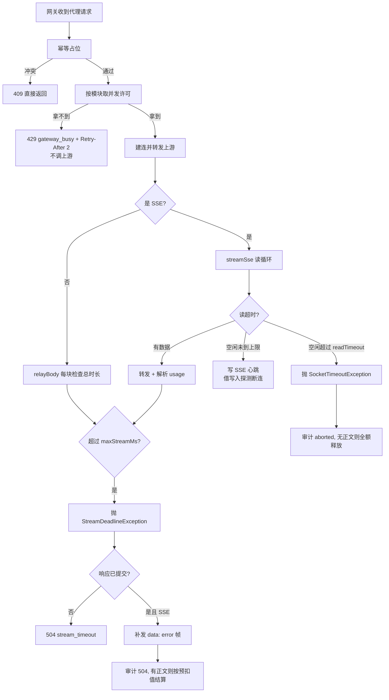
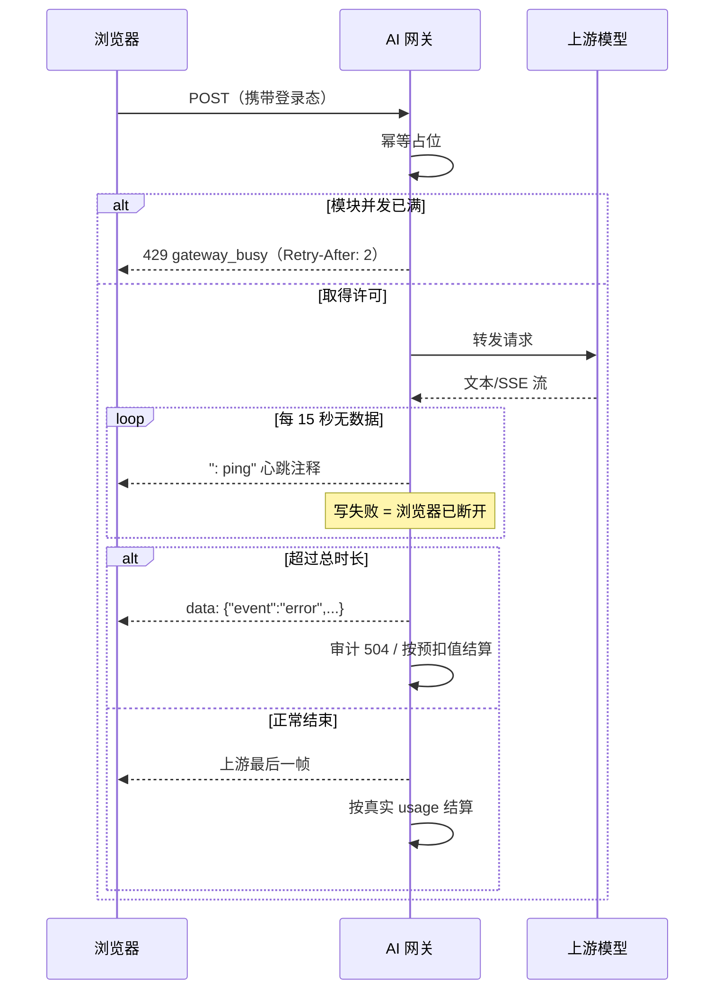

# 学习文档：网关并发闸门与流式护栏（阶段 1 · 子阶段 5C）

## 1. 业务目标与范围

5A / 5B 解决的是「一次请求算得对、查得到、不重复执行」。但只要上游变慢，
网关仍然会被拖垮，而且用户看不到任何保护：

| 编号 | 缺口 | 后果 |
| --- | --- | --- |
| G1 | 没有并发上限 | 几十条长对话同时占用 Web 线程，文件上传、知识库检索一起被拖死；上游也可能被打到限流 |
| G2 | `readTimeoutMs` 只管「两次读取之间」 | 上游持续吐字但永不结束（或极慢），连接可以挂到天荒地老 |
| G3 | 浏览器关页面后，网关仍在读上游 | 已经没人要的结果继续消耗上游配额和带宽，直到上游自己结束 |
| G4 | 流式中途超时，HTTP 状态已经发出去了 | 前端只看到流突然断了，分不清「正常结束」还是「被网关切断」 |
| G5 | 前端 90 秒空闲超时靠「任意一块数据」续命 | 一旦网关开始发心跳注释，空闲超时会被无限续命，用户永远等不到报错 |

本子阶段（5C）只改网关与前端流处理：

- 新增按模块隔离的并发闸门：非阻塞获取，超限立刻 429，不排队；
- 给流式与非流式透传加「整条响应」的总时长硬截止；
- 流式转发期间空闲发 SSE 心跳，借写入失败探测「浏览器已关」；
- 中途超时补一帧 SSE 错误事件，并让审计记为 504 `stream_timeout`；
- 前端把「心跳注释」与「真实数据」区分开：只有 `data:` 行才续期空闲超时。

明确不做：

- 不引入信号量之外的中间件，不用 Redis 做分布式并发控制；
- 不做请求排队 / 等待重试，不改变上游协议；
- 不改数据库表结构；
- 不做熔断与半开恢复（留给 5D）。

## 2. 业务流程图





## 3. 前端原理

### 3.1 心跳为什么不能续命空闲超时

真实浏览器里 `EventSource` 会忽略以 `:` 开头的注释行，但本项目的流由
`fetch` + `ReadableStream` 手工解析，每一个网络块都会进入同一个循环。
改造前，循环里**每一块**都调用 `resetIdleTimer()`：

```ts
// 改造前：任何一块数据都续命
resetIdleTimer()
```

网关开始每 15 秒发一次 `: ping` 后，90 秒空闲计时会被心跳无限续期——
上游彻底没声了，前端也永远不报「空闲超时」，用户只能干等。

现在的口径是：

| 事件 | 是否启动计时 | 是否续期 |
| --- | --- | --- |
| 收到第一个网络块（无论内容） | 是 | — |
| 注释帧 `: ping` | — | 否 |
| 真实的 `data:` 行（模型增量或事件） | — | 是 |
| 块结束但一个 `data:` 都没有 | — | 否 |

代码上分两步（`request.ts` 与 `directModel.ts` 同一口径）：

```ts
// 首个网络块启动计时，后续块不再无条件续期
if (!idleTimer) resetIdleTimer()
...
// 直到循环结束，只有见过 data: 行才续期
if (sawData && !errorCalled && !completeCalled) resetIdleTimer()
```

这样心跳完成两件互不冲突的事：中间层保持连接、网关探测断连；
而用户侧的「90 秒没有任何模型输出」仍然会如实报错。

### 3.2 新增的两类错误文案

`chatError.ts` 在幂等分支之后、配额分支之前新增：

| code / 文案 | 用户提示 | 可重试 |
| --- | --- | --- |
| `gateway_busy` / `AI 请求过多` | 服务端原文或「当前 AI 请求较多，请稍后重试。」 | 是 |
| `stream_timeout` / `超过总时长` | 服务端原文或「回答生成时间过长，已中断，请重新发送。」 | 是 |

两类都必须排在「模型 / token / 认证」分支之前：忙碌文案里可能带
`AI`、`请求`，超时文案里可能带数字或 `timeout`，放后面会被误判。

## 4. 后端原理

### 4.1 按模块隔离的并发闸门

`GatewayConcurrencyGuard` 用一个 `ConcurrentHashMap<String, Semaphore>` 按模块
维护许可：

```java
public Lease tryAcquire(String module) {
    int limit = properties.getMaxConcurrentPerModule();
    if (limit <= 0) {
        return Lease.UNLIMITED;
    }
    Semaphore semaphore = semaphoreFor(module, limit);
    return semaphore.tryAcquire() ? new Lease(semaphore) : null;
}
```

三个设计决策：

1. **按模块隔离，而不是全局一个数**。一个用户开几十条长对话，不应该把
   文件上传、知识库检索一起拖死；`chat`、`models`、`knowledgeChat`、`file`
   各自有独立计数器。
2. **非阻塞获取**。拿不到立刻 429，绝不 `acquire()` 排队。排队会把
   Tomcat 工作线程一起占住，故障从「上游慢」升级为「整个服务不可用」。
3. **在幂等之后获取**。被判定为重复的请求本来就不该执行，先占许可再判重
   会让重复请求挤掉正常请求的名额。

超限响应：

```text
HTTP/1.1 429 Too Many Requests
Retry-After: 2
{"code":"gateway_busy","message":"当前 AI 请求过多，请稍后重试",...}
```

同时写一条 `blocked` / 429 审计；此时没有调用上游，也没有产生任何计费。

### 4.2 总时长硬截止

`readTimeoutMs` 是 socket 级「两次读取之间」的超时，管不住「一直在读、
但永远不结束」的响应。新增 `maxStreamMs`（默认 600000，即 10 分钟）：

```java
private long streamDeadline(long start) {
    int maxStreamMs = properties.getMaxStreamMs();
    return maxStreamMs > 0 ? start + maxStreamMs : Long.MAX_VALUE;
}
```

流式与非流式都检查，而且**先转发当前块再判定**：

```java
out.write(buffer, 0, read);
out.flush();
relayed.bytes += read;
// 已经读到的内容不能因为到点就丢
if (System.currentTimeMillis() >= deadline) {
    throw new StreamDeadlineException(streamTimeoutMessage());
}
```

非流式 `relayBody` 同样每块检查一次，避免「大 JSON 一直传不完」。

### 4.3 心跳兼断连探测

流式响应建立后，把 socket 读超时缩短到心跳间隔：

```java
int poll = Math.max(100, heartbeatMs);
if (properties.getReadTimeoutMs() > 0) {
    poll = Math.min(poll, properties.getReadTimeoutMs());
}
conn.setReadTimeout(poll);
```

读循环里：

- 正常读到数据 → 更新 `lastUpstreamAt`，转发、解析；
- 读超时（说明空闲了一个 poll 周期）→ 先看是否超过总 deadline；
  再看是否超过 `readTimeoutMs`（上游彻底静默）；都不是就写一帧
  `: ping\n\n` 并 flush；
- 写心跳失败（`SocketException` / `Broken pipe`）→ 说明浏览器已经关了，
  立刻中断，不再继续读上游。

关键点：**心跳不算上游活动**。`lastUpstreamAt` 只在真正读到数据时更新，
否则心跳会把自己续命，`readTimeoutMs` 永远不触发。

### 4.4 中途超时的收尾

如果响应已经提交（HTTP 头和部分正文已经发给浏览器），不能再改状态码，
于是补一帧 SSE 错误，让前端知道「这是被网关切断的」：

```text
data: {"event":"error","message":"AI 响应超过总时长限制（600 秒），已断开"}
```

模型直连模块用 OpenAI 兼容信封：

```text
data: {"error":{"message":"AI 响应超过总时长限制（600 秒），已断开"}}
```

审计口径：

| 场景 | status | 审计状态码 | 计费 |
| --- | --- | --- | --- |
| 未提交响应就超时 | `failed` | 504 | 全额释放 |
| 已送出正文后超时 | `failed` | 504 | 按预扣值结算 |
| 客户端断开且未送正文 | `aborted` | 上游状态 | 全额释放 |
| 客户端断开且已送正文 | `aborted` | 上游状态 | 按预扣值结算 |

「已送出正文就计费」沿用 5A 的口径：上游确实生成了内容，
不能因为客户端没等到最后就全额退款。

### 4.5 许可释放顺序

`finally` 里最先释放并发许可，再结算、再处理幂等键：

```java
if (concurrencyLease != null) {
    concurrencyLease.release();
}
```

结算要访问 Redis，可能比释放许可慢；先放许可能让下一个请求立刻进来，
不让并发名额陪着等一次 Redis 往返。

## 5. API 调用链路

```text
浏览器
  → POST /ai/api/aiGateway/chat/chat-messages
  → AiGatewayService.proxy → doProxy
    → 限流 / 配额预扣
    → AiIdempotencyGuard.acquire
    → GatewayConcurrencyGuard.tryAcquire(module)
       ├─ 失败 → 429 gateway_busy + Retry-After: 2（不调上游）
       └─ 成功 → 转发上游
    → SSE: streamSse（deadline + heartbeat）
    → 非 SSE: relayBody（deadline）
  ← 正常：上游原样透传
  ← 超时且未提交：504 {"code":"stream_timeout"}
  ← 超时且已提交：补一帧 data: error
```

新增配置（`application-dev.example.properties`）：

| 键 | 默认值 | 含义 |
| --- | --- | --- |
| `ai.gateway.max-concurrent-per-module` | 32 | 单模块同时进行的上游请求上限，`<=0` 不限制 |
| `ai.gateway.max-stream-ms` | 600000 | 单次响应总时长上限，`<=0` 不限制 |
| `ai.gateway.sse-heartbeat-ms` | 15000 | 流式空闲心跳间隔，`<=0` 关闭心跳 |

## 6. 数据库设计与迁移

本子阶段没有数据库变更：

- 并发许可只存在进程内存，重启即清零；
- 心跳是线上字节，不落库；
- 超时复用既有审计状态码字段（504）与错误信息字段；
- 无需迁移脚本，回滚只需回退代码与配置。

## 7. 核心代码与口径

### 7.1 并发许可

`GatewayConcurrencyGuard.java`

```java
public Lease tryAcquire(String module) {
    int limit = properties.getMaxConcurrentPerModule();
    if (limit <= 0) {
        return Lease.UNLIMITED;
    }
    Semaphore semaphore = semaphoreFor(module, limit);
    return semaphore.tryAcquire() ? new Lease(semaphore) : null;
}
```

### 7.2 快速拒绝

`AiGatewayService.java`

```java
concurrencyLease = concurrencyGuard.tryAcquire(module);
if (concurrencyLease == null) {
    String busy = "当前 AI 请求过多，请稍后重试";
    Map<String, String> retryAfter = new LinkedHashMap<String, String>();
    retryAfter.put("Retry-After", "2");
    writeError(response, 429, GatewayConcurrencyGuard.CODE_BUSY, busy, retryAfter);
    record(userId, module, auditEndpoint, method, "blocked", 429,
            null, start, busy, clientIp);
    return;
}
```

### 7.3 读循环里的两种超时

`AiGatewayService.java`

```java
try {
    read = in.read(buffer);
} catch (SocketTimeoutException poll) {
    long now = System.currentTimeMillis();
    if (now >= deadline) {
        throw new StreamDeadlineException(streamTimeoutMessage());
    }
    if (heartbeatMs <= 0
            || (idleTimeoutMs > 0 && now - lastUpstreamAt >= idleTimeoutMs)) {
        throw poll;
    }
    out.write(SSE_HEARTBEAT);
    out.flush();
    continue;
}
```

### 7.4 可验证口径

- 并发上限为 1 时，同模块第二次请求返回 429 且 `upstream.calls == 0`；
- 释放许可后同模块恢复 200；不同模块互不影响；
- 上限 `<=0` 时连续 100 次获取全部成功；
- `maxStreamMs=200` 的慢流在 5 秒内被切断，审计 504 且按预扣值结算；
- 持续心跳不会让前端 90 秒空闲计时失效（fake timers 单测）；
- 心跳写入失败会触发 `aborted` 审计，且未送正文时全额释放。

## 8. 异常处理

| 场景 | 行为 |
| --- | --- |
| 模块并发已满 | 429 `gateway_busy` + `Retry-After: 2`，不调上游、不计费 |
| 并发配置 `<=0` | 不限流，许可为无操作对象，释放安全 |
| 上游持续无数据但未到 `readTimeoutMs` | 按心跳间隔发 `: ping`，连接保持 |
| 上游超过 `readTimeoutMs` 完全静默 | 中断；未提交响应则 502，已提交则记审计 |
| 响应总会话超过 `maxStreamMs` | 中断；未提交 504 `stream_timeout`，已提交补 SSE 错误帧 |
| 超时前已转发正文 | 按预扣值结算，审计写入实际扣掉的 tokens |
| 浏览器关页面 | 心跳写失败 → `aborted`；已送正文按预扣值，未送正文全额释放 |
| 心跳配置 `<=0` | 关闭心跳，退回改造前行为；`readTimeoutMs` 仍生效 |
| 心跳间隔大于读超时 | 取两者较小值作为轮询周期，不会让心跳晚于超时 |
| 前端只收到心跳 | 不续期 90 秒空闲计时，到点报「空闲超时」 |
| 前端收到 429 | 展示服务端文案，标记可重试 |
| 前端收到 `stream_timeout` | 展示原因，标记可重试 |
| 旧配置缺少新键 | 使用代码默认值（32 / 600000 / 15000），无需改配置即可生效 |

## 9. 验收方法

### 9.1 自动化结果（2026-11-06 实测）

| 项目 | 命令 | 结果 |
| --- | --- | --- |
| 后端完整 reactor | `mvn test`（JDK 8，从 `backend/AIProject`） | 7 + 71 + 450 + 27 = **555 项通过**（基线 549，新增 6） |
| 类型检查 | `npm run typecheck` | 通过 |
| 逻辑单测 | `npm test` | 20 个文件 / **244 项通过**（基线 241，新增 3） |
| 组件测试 | `npm run test:component` | 27 个文件 / **256 项通过** |
| 浏览器 E2E | `npm run test:e2e` | **21 项通过** |
| 流式回归门禁 | `npm run check:streaming` | **14 项通过** |

新增/更新的测试：

- `GatewayConcurrencyGuardTest`：同模块限流与恢复、`<=0` 不限流、模块间隔离；
- `AiGatewayServiceTest`：
  - 限流拒绝返回 429 / `Retry-After` / `gateway_busy`，上游零调用，释放后恢复；
  - 慢流超过总时长被切断，审计 504，按预扣值结算；
  - 上游静默时心跳写失败被识别为客户端断开，审计 `aborted`；
- `AiUpstreamStub`：新增 `silentSse`，先发 SSE 头再长时间不写数据；
- `chatError.spec.ts`：`gateway_busy` 与 `stream_timeout` 的文案与可重试标记；
- `directModel.spec.ts`：持续心跳下 90 秒空闲超时仍然触发；
  该用例做过变异验证——把「每块续期」加回去，用例在 4 秒内失败，
  证明它确实能捕获回归。

### 9.2 本阶段没有证明什么

- 没有对真实 Dify / 模型服务做联调：所有上游都是本地 `AiUpstreamStub`，
  只证明网关自身的限流、截止、心跳与计费逻辑。
- 没有验证多实例部署：并发上限是进程内的，两个实例的实际并发是配置值的两倍。
- 没有验证运行期热更新配置：修改 `max-concurrent-per-module` 不会重建已存在的
  `Semaphore`，需要重启才生效。
- 心跳对真实反向代理（Nginx、网关型负载均衡）的保活效果未实测；
  本轮只验证了「写失败能被发现」这一可观测行为。

### 9.3 残余风险

- 并发上限按实例计算，多实例部署时实际并发会被放大，需要按实例数下调配置，
  或后续用 Redis 做全局限流。
- `Semaphore` 是公平性默认（非公平），高并发下可能出现个别请求等待时间不均，
  但本项目采用非阻塞获取，不存在排队，影响有限。
- 总时长从请求进入网关开始算，包含建连与上传时间；超大文件上传可能提前触发
  截止，需要按业务调整 `max-stream-ms`。
- SSE 心跳会增加少量流量（每 15 秒 8 字节），对计费无影响。
- 前端空闲超时依赖 `data:` 行；若未来上游改成只发 `event:` 而不发 `data:`，
  需要同步调整解析口径。

## 10. 面试问答

### Q1：为什么用 `tryAcquire()` 而不是 `acquire()`？

`acquire()` 会把 Tomcat 工作线程阻塞在排队上。上游一旦变慢，线程池会被
排队请求占满，连健康检查和其他模块都进不来，故障从「AI 慢」扩散成
「整个服务不可用」。`tryAcquire()` 立刻返回，拿不到就 429，
把「等待」交还给客户端，服务端始终保持可响应。

### Q2：为什么按模块隔离，而不是全局限一个并发数？

不同业务的资源模型不一样：长对话占用连接几分钟，文件上传是短时高带宽，
知识库检索是短时低延迟。全局一个数会让长对话把其他业务挤死。
按模块隔离后，一个模块过载只影响自己，符合故障隔离原则。

### Q3：`readTimeoutMs` 和 `maxStreamMs` 有什么区别？

`readTimeoutMs` 是 socket 级超时，约束「两次读取之间的间隔」；
只要上游每 4 分钟吐一个字，它就永远不会触发。`maxStreamMs` 是业务级
总时长，从请求开始计时，到点无条件切断。两者一个管「卡住」，一个管「磨蹭」，
缺一不可。

### Q4：心跳为什么能探测到浏览器断开？

浏览器关页面后，TCP 连接最终会进入不可写状态；网关下一次写心跳时
会抛 `SocketException`（Broken pipe / Connection reset）。如果没有心跳，
网关只能等上游继续吐字、写响应时才发现，可能已经白白读了几分钟。
心跳把「发现断连」的延迟从「下一次模型输出」缩短到「一个心跳周期」。

### Q5：心跳为什么不能续期前端的空闲超时？

前端的 90 秒超时语义是「用户等了 90 秒还没看到任何模型输出」。
心跳是传输层保活，不是模型输出。如果心跳也续期，上游彻底卡死时
前端会永远转圈，用户既看不到内容也收不到错误。所以只认 `data:` 行。

### Q6：响应已经提交了，为什么还要补一帧 SSE 错误？

HTTP 状态码在响应头发出后就不能改了。如果直接断开，前端只能看到
「流结束但没有结束标记」，可能把半截回答当成正常完成。补一帧
`event: error` 让前端能明确区分「正常结束」和「网关切断」，
同时把原因展示给用户。这属于「协议内可表达的错误就用协议表达」。

### Q7：为什么先释放并发许可，再做结算？

结算要访问 Redis，是一次网络往返。许可代表「上游连接名额」，
连接已经关闭，名额应该立刻可用。先释放能让下一个请求马上进来，
不让所有并发名额排队等 Redis。顺序不影响正确性，但影响吞吐。
