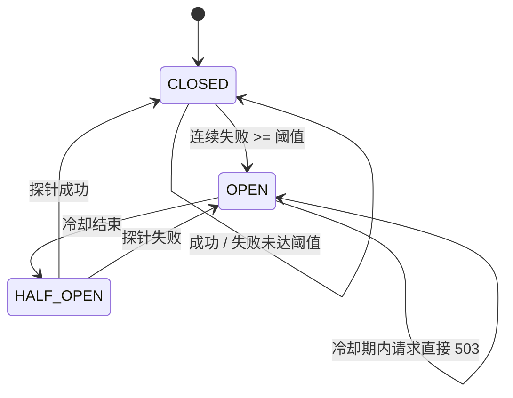
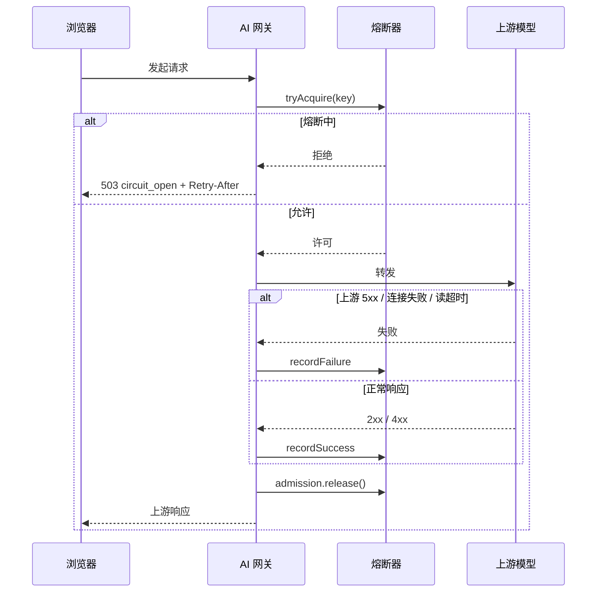
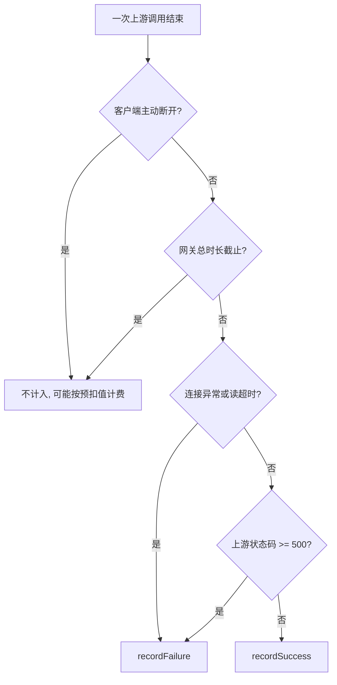

# 学习文档：上游熔断与半开恢复（阶段 1 · 子阶段 5D）

## 1. 业务目标与范围

5C 的并发闸门解决了「我们自己别被拖垮」，但它只是把并发限制在 32：
上游如果整体不可用，这 32 个请求仍然会各自等满连接超时或读取超时，
期间所有新请求只能拿到 429。用户看到的是「一直在转圈，然后说太忙」，
而不是「上游挂了，别再试了」。

| 编号 | 缺口 | 后果 |
| --- | --- | --- |
| G1 | 上游不可用时没有快速失败 | 每个请求都要等满超时，线程与并发许可被无效占用 |
| G2 | 上游恢复后没有自动探测 | 只能靠人工重启或等流量自然恢复 |
| G3 | 失败请求与正常请求使用同一入口 | 一次上游抖动会把 32 个并发名额全部打满，正常请求也被挤掉 |
| G4 | 上游 5xx 与客户端取消混在一起 | 无法区分「上游挂了」和「用户自己关了页面」 |
| G5 | 前端不认识熔断错误 | `503 circuit_open` 会落到未知错误兜底文案 |

本子阶段（5D）实现：

- 新增按「模块 + 上游地址」隔离的熔断器；
- 状态机：CLOSED → 连续失败达到阈值 → OPEN → 冷却结束 → HALF_OPEN → 成功恢复 / 失败重新熔断；
- 熔断期间直接 503 `circuit_open` + `Retry-After`，不调用上游、不排队；
- 只统计连接失败、读超时、上游 5xx；客户端断开、网关总时长截止、上游 4xx 不计入；
- 半开只放一个探针请求，避免恢复瞬间把流量全部打回故障上游；
- 前端增加可重试提示。

明确不做：

- 不做跨实例共享的全局熔断（状态在进程内，见 9.3 残余风险）；
- 不引入 Resilience4j / Hystrix 等新依赖；
- 不改变上游协议与数据库结构；
- 不做按模型粒度的熔断（同一上游地址共享一条记录）。

## 2. 业务流程图





开关与计数口径：



## 3. 前端原理

`chatError.ts` 在并发闸门分支之后新增：

| code / 文案 | 用户提示 | 可重试 | 换模型建议 |
| --- | --- | --- | --- |
| `circuit_open` / `AI 服务连续失败` | 服务端原文或「AI 服务暂时不可用，请稍后重试。」 | 是 | 否 |

为什么提示「稍后重试」而不是「切换模型」：

- 熔断键是「模块 + 上游地址」，同一地址上的所有模型一起不可用；
  换模型通常仍然命中同一个上游，提示换模型是误导；
- 熔断有明确冷却时间，服务端已经把 `Retry-After` 带回来，
  用户等一会儿再试的成功率最高。

为什么仍然标记可重试：熔断拒绝发生在调用上游之前，没有计费、没有建数据，
冷却结束后重试是安全的。

## 4. 后端原理

### 4.1 为什么熔断键是「模块 + 上游地址」

熔断要回答的问题是「这个上游现在还能不能用」。粒度过细（每个模型一条）
会让同一台故障机器上的多个模型各自熔断，恢复时又要各自探测，浪费探针；
粒度过粗（全局一条）会让一个 Dify 应用故障拖累无关的直连模型。

「模块 + 上游地址」的取舍：

- 同一地址上的多个应用一起挂，符合真实故障形态（机器/网络/供应商级）；
- 不同地址互不影响，故障隔离；
- 不解析请求体里的 model 字段，避免为了熔断引入一份易错的协议解析。

### 4.2 状态机

| 状态 | 新请求 | 记录成功 | 记录失败 |
| --- | --- | --- | --- |
| CLOSED | 放行 | 连续失败计数清零 | 计数 +1，达到阈值进入 OPEN |
| OPEN | 冷却期内 503；冷却结束转 HALF_OPEN | 不直接恢复 | 不改变冷却时间 |
| HALF_OPEN | 只放一个探针，其余 503 | 回 CLOSED | 回 OPEN，重新计时 |

三个容易忽略的细节：

1. **OPEN 期间旧请求的成功不直接恢复**。熔断前已经发出的长请求可能在
   OPEN 期间成功返回；一次侥幸成功不能证明上游整体恢复，必须由冷却后的
   半开探针确认。
2. **半开探针必须释放**。探针占着一个「半开名额」，如果请求异常退出时
   不释放，熔断器会永远停在 HALF_OPEN，后续请求全部 503。
   实现上把释放放在 `finally`，与并发许可同一位置。
3. **冷却时间向上取整**。剩余 200ms 时提示「1 秒后重试」而不是「0 秒」，
   避免客户端立刻重试又撞上 503。

### 4.3 失败计数口径

只有「上游不可用」类失败才计数：

| 场景 | 是否计数 | 原因 |
| --- | --- | --- |
| 连接被拒绝、DNS 失败、连接超时 | 是 | 上游不可达的典型信号 |
| 读取超时（上游静默） | 是 | 上游已接收但不再响应 |
| 上游 5xx | 是 | 上游自报故障 |
| 上游 4xx | 否 | 请求本身有问题；不计数，但也不能证明正常请求能通过（中性） |
| 上游 200 但响应体里带 error | 否 | 连接与协议都正常，是业务错误 |
| 客户端主动断开 | 否 | 用户自己取消，不能算上游故障 |
| 网关总时长截止（`stream_timeout`） | 否 | 可能是正常的长回答，不能算上游故障 |
| 上传超限、参数校验失败 | 否 | 请求没有真正到达上游业务逻辑 |

误把「客户端取消」计入失败，会在用户频繁点停止时把上游误判为故障；
误把「网关总时长截止」计入失败，会在正常长回答后误开熔断。这两条是
本子阶段最容易写错的边界。

### 4.4 在请求链路中的位置

```text
限流 / 配额预扣
  → 幂等占位
  → 并发许可
  → 熔断许可          ← 5D
  → 建连 / 转发上游
```

顺序的理由：

- **在幂等之后**：重复请求不会真正执行，不应污染上游健康样本；
- **在并发许可之后**：熔断期间请求不应占着并发名额等；
- **在建连之前**：熔断的目的就是省掉这一次建连与超时等待。

熔断拒绝时：

```text
HTTP/1.1 503 Service Unavailable
Retry-After: 30
{"code":"circuit_open","message":"AI 服务连续失败，已暂停调用，请 30 秒后重试",...}
```

同时写一条 `blocked` / 503 审计；预扣在 `finally` 全额释放，
幂等占位因为「上游未受理」而释放，允许客户端用同一个键重试。

### 4.5 与并发闸门、计费的关系

| 机制 | 解决的问题 | 拒绝状态 | 是否调用上游 | 是否计费 |
| --- | --- | --- | --- | --- |
| 限流 | 单用户请求频率 | 429 | 否 | 否 |
| 配额 | 单用户/部门 Token 总量 | 429 | 否 | 否 |
| 并发闸门 | 本实例在途请求数 | 429 | 否 | 否 |
| 熔断 | 上游整体不可用 | 503 | 否 | 否 |

四层各自独立：并发闸门防止「我们被拖垮」，熔断防止「上游拖垮我们」。
熔断打开后，并发许可几乎立刻归还，剩余容量可以服务其他未熔断的模块。

## 5. API 调用链路

```text
浏览器
  → POST /ai/api/aiGateway/chat/chat-messages
  → AiGatewayService.doProxy
    → 限流 / 配额预扣
    → 幂等占位
    → 并发许可
    → GatewayCircuitBreaker.tryAcquire("chat|https://dify…")
       ├─ 拒绝 → 503 circuit_open + Retry-After（不调上游）
       └─ 允许 → 转发上游
    → 成功 / 4xx → recordSuccess
    → 5xx / 连接失败 / 读超时 → recordFailure
    → finally：释放并发许可、释放熔断许可、结算预扣
```

新增配置（`application-dev.example.properties`）：

| 键 | 默认值 | 含义 |
| --- | --- | --- |
| `ai.gateway.circuit-failure-threshold` | 5 | 连续失败多少次后熔断，`<=0` 关闭 |
| `ai.gateway.circuit-open-ms` | 30000 | 熔断冷却时间（毫秒） |

## 6. 数据库设计与迁移

本子阶段没有数据库变更：

- 熔断状态只存在进程内存，重启即回到 CLOSED；
- 熔断拒绝复用既有审计字段（`blocked` / 503）；
- 无需迁移脚本，回滚只需回退代码与配置。

## 7. 核心代码与口径

### 7.1 获取许可

`GatewayCircuitBreaker.java`

```java
public Admission tryAcquire(String key) {
    Breaker breaker = breakerFor(key);
    synchronized (breaker) {
        if (properties.getCircuitFailureThreshold() <= 0) {
            return Admission.allowed(breaker, false);
        }
        long now = clock.getAsLong();
        if (breaker.state == State.OPEN) {
            if (now < breaker.openUntil) {
                return null;
            }
            breaker.state = State.HALF_OPEN;
            breaker.probesInFlight.set(0);
        }
        if (breaker.state == State.HALF_OPEN) {
            if (breaker.probesInFlight.get() >= 1) {
                return null;
            }
            breaker.probesInFlight.incrementAndGet();
            return Admission.allowed(breaker, true);
        }
        return Admission.allowed(breaker, false);
    }
}
```

### 7.2 记录结果

`AiGatewayService.java`

```java
private void recordCircuitHealth(String key, Integer upstreamStatus) {
    if (upstreamStatus != null && upstreamStatus >= 500) {
        circuitBreaker.recordFailure(key);
    } else {
        circuitBreaker.recordSuccess(key);
    }
}
```

异常路径：

```java
if (!aborted && !timedOut && e instanceof IOException) {
    circuitBreaker.recordFailure(circuitKey);
}
```

### 7.3 快速拒绝

`AiGatewayService.java`

```java
circuitAdmission = circuitBreaker.tryAcquire(circuitKey);
if (circuitAdmission == null) {
    int retryAfterSeconds = circuitBreaker.retryAfterSeconds(circuitKey);
    String message = "AI 服务连续失败，已暂停调用，请 "
            + retryAfterSeconds + " 秒后重试";
    Map<String, String> retryAfter = new LinkedHashMap<String, String>();
    retryAfter.put("Retry-After", String.valueOf(retryAfterSeconds));
    writeError(response, HttpServletResponse.SC_SERVICE_UNAVAILABLE,
            GatewayCircuitBreaker.CODE_OPEN, message, retryAfter);
    record(userId, module, auditEndpoint, method, "blocked",
            HttpServletResponse.SC_SERVICE_UNAVAILABLE, null, start, message, clientIp);
    return;
}
```

### 7.4 可验证口径

- 连续失败达到阈值后，同键请求返回 503 且上游调用次数不再增加；
- `Retry-After` 等于剩余冷却秒数（向上取整）；
- 冷却结束后只放一个探针，其余请求继续 503；
- 探针成功回 CLOSED，探针失败重新计时；
- 一次成功会把连续失败计数清零；
- 不同上游键互不影响；
- 阈值 `<=0` 时永不熔断；
- 客户端断开与总时长截止不触发熔断（由现有 aborted / timedOut 单测与代码路径保证）。

## 8. 异常处理

| 场景 | 行为 |
| --- | --- |
| 熔断期间新请求 | 503 `circuit_open` + `Retry-After`，不调上游、不计费 |
| 熔断冷却时间配置 `<=0` | 按 1ms 处理，相当于立即进入半开，不会永久拒绝 |
| 阈值配置 `<=0` | 关闭熔断，所有请求正常放行 |
| 半开探针请求异常退出 | `finally` 释放探针名额，下一次请求可以继续探测 |
| 半开探针超时未返回 | 超过 `circuit-probe-timeout-ms` 按失败处理，回 OPEN 重新冷却 |
| 半开期间非探针调用返回 | 一律忽略，只有持当前探针许可的调用能结束半开 |
| 半开探针失败 | 重新进入 OPEN 并重置冷却时间 |
| 上游 4xx | 中性：不累加失败，也不能替探针判成功 |
| 上游 200 但业务 error | 记录成功（连接与协议正常），不熔断 |
| 客户端主动断开 | 不计失败，按既有 `aborted` 口径处理 |
| 网关总时长截止 | 不计失败，按既有 `stream_timeout` 口径处理 |
| 熔断拒绝时已有预扣 | `finally` 全额释放，审计 `blocked` / 503 |
| 熔断拒绝时已占幂等键 | 因上游未受理而释放，允许用同一个键重试 |
| 多个实例 | 各实例独立熔断，不做全局同步 |

## 9. 验收方法

### 9.1 自动化结果（2026-11-06 实测）

| 项目 | 命令 | 结果 |
| --- | --- | --- |
| 后端完整 reactor | `mvn test`（JDK 8，从 `backend/AIProject`） | 7 + 71 + 458 + 27 = **563 项通过**（基线 555，新增 8） |
| 类型检查 | `npm run typecheck` | 通过 |
| 逻辑单测 | `npm test` | 20 个文件 / **245 项通过**（基线 244，新增 1） |
| 组件测试 | `npm run test:component` | 27 个文件 / **256 项通过**（未改组件） |
| 浏览器 E2E | `npm run test:e2e` | **21 项通过** |
| 流式回归门禁 | `npm run check:streaming` | **14 项通过** |

新增/更新的测试：

- `GatewayCircuitBreakerTest`（6 项）：连续失败打开、冷却后单探针、
  探针成功恢复、探针失败重新熔断、成功清零计数、阈值关闭、上游隔离；
- `AiGatewayServiceTest`（2 项）：
  - 上游连续 500 触发熔断，第三次 503 + `Retry-After`，上游调用次数停在 2，
    审计 `blocked` / 503，预扣全额释放；
  - 成功一次会清零连续失败计数，偶发抖动不会误开熔断；
- `AiUpstreamStub`：新增可配置 `responseStatus`，用于模拟 5xx；
- `chatError.spec.ts`：熔断文案保留服务端原文、可重试、不提示换模型。

### 9.2 本阶段没有证明什么

- 没有对真实 Dify / 模型服务做联调：所有上游都是本地 `AiUpstreamStub`，
  只证明网关自身的状态机与请求路径。
- 没有验证多实例部署：熔断状态在进程内，两个实例可能一个熔断、一个正常；
  这对「保护本实例」是有效的，但全局流量分配会偏向未熔断实例。
- 没有验证真实网络故障（DNS 失败、TCP 重置）下的计数，
  测试覆盖的是 5xx 与既有 IOException 路径。
- 没有做熔断状态的可视化面板：`stateOf()` 已提供读取入口，
  但本轮没有接到治理看板。

### 9.3 残余风险

- 熔断键粒度为「模块 + 上游地址」：同一地址上单个模型持续 5xx
  会连同其他健康模型一起熔断；如果未来出现大量模型级故障，
  需要把 model 纳入键。
- 进程内状态在多实例下各自为政，可能出现「部分实例已经恢复、
  部分还在熔断」的短暂不一致。
- 配置热更新不会重置已有熔断状态：调大阈值后，已经 OPEN 的记录
  仍要等冷却结束。
- 瞬时的 5xx 抖动如果恰好连续达到阈值，会触发一次 30 秒熔断；
  阈值与冷却时间需要根据真实上游稳定性调优。
- 熔断拒绝没有进入「失败请求」统计，治理看板看到的 `blocked` 数量
  会随上游故障上升，这是有意区分，不是统计遗漏。

## 10. 面试问答

### Q1：已经有并发闸门了，为什么还需要熔断？

并发闸门限制「最多 32 个请求同时进来」，但不判断上游是否还活着。
上游整体不可用时，这 32 个请求仍会各自等满超时，新请求只能 429。
熔断直接把「等超时」换成「立刻 503」，把并发许可和线程立刻还给系统，
两者解决的是不同层面的问题：一个是容量保护，一个是故障隔离。

### Q2：为什么熔断后还要半开，不直接一直拒绝？

一直拒绝会让上游恢复后仍然不可用，必须人工重启。半开是「有控制的试探」：
冷却结束后只放一个请求，成功则恢复，失败则继续熔断。
只放一个探针是关键——恢复瞬间把全部流量打回去，可能把刚恢复的上游再次打垮。

### Q3：为什么客户端取消不算上游失败？

客户端取消说明请求已经到达上游、连接也建立过，失败原因是「用户不要了」。
如果把它计入失败，用户频繁点停止就会让熔断器误以为上游故障，
进而拒绝其他正常用户。熔断统计的必须是「上游自身不可用」的信号。

### Q4：为什么上游 4xx 既不算失败，也不算成功？

4xx 表示上游正常处理了请求，只是请求内容有问题（参数错、模型名错、无权限）。
把它算成失败会导致「一个用户传错参数，所有用户被熔断」；
但把它算成成功同样危险——半开探针如果返回 4xx，只能证明上游进程活着，
不能证明「正常请求能通过」。所以 4xx 按中性处理：释放探针名额，但不做判定，
让下一次真正的业务请求去回答「上游恢复了吗」。

### Q5：为什么熔断要放在并发许可之后？

熔断期间请求会立刻被拒绝，如果先取并发许可，就要走一遍获取/释放；
更重要的是语义：并发许可是「允许你占用上游连接」，熔断已经判定上游不可用，
就不该再占用这个名额。放在后面还能保证熔断请求不会把并发名额短暂占满。

### Q6：熔断键为什么不是全局一个？

全局一个会让一个 Dify 应用故障拖累完全无关的直连模型。
按「模块 + 上游地址」隔离，故障范围与真实故障形态一致；
同时不解析请求体里的 model，避免为了熔断引入一份容易出错的协议解析。
粒度过细（每个模型一条）会让同一台故障机器上的模型各自熔断、各自探测，
恢复过程反而更慢。

### Q7：进程内熔断在多实例下会有什么问题？

每个实例独立统计，可能出现一个实例熔断、另一个正常。
对「保护本实例线程」这个目标仍然有效，但流量会更多落到未熔断实例，
那个实例可能承受更高压力。要解决需要把状态放到 Redis 或引入共享熔断组件，
本项目当前单实例部署，先采用更简单的方案，并在文档里明确边界。

## 11. 2026-11-07 补强：探针归属与超时回退

初版实现有三个只在并发边界才暴露的缺陷，已修并补测试：

1. **非探针成功可以关闭半开**。`recordSuccess(String key)` 不区分调用来源，
   HALF_OPEN 时任何一次旁路成功都会直接回 CLOSED，等于跳过了探针验证。
   现在 `tryAcquire` 发放的 `Admission` 携带 `probe` 标记与 `probeEpoch`，
   只有「持当前这一代探针许可」的调用能结束半开；旧探针的迟到结果、
   未走 `tryAcquire` 的旁路调用一律忽略。
2. **4xx 被当成功**：探针返回 4xx 会错误恢复熔断。现在 4xx 中性——
   `release` 释放名额但不做判定，下一次业务请求继续探测。
3. **半开无超时回退**：探针请求卡死时 `probesInFlight` 永远不归零，
   熔断器永久停在 HALF_OPEN，所有请求被 503。新增
   `circuit-probe-timeout-ms`（默认 60s），超过后按失败回 OPEN 重新冷却；
   超时后再归来的旧探针因 `probeEpoch` 不匹配，既不能改状态也不能动新探针计数。

新增测试（`GatewayCircuitBreakerTest` +4、`AiGatewayServiceTest` +2）：
`staleNonProbeSuccessCannotCloseHalfOpen`、`nonProbeFailureDuringHalfOpenIsIgnored`、
`probeTimeoutReopensCircuitAndStaleReleaseDoesNotUnlockNextProbe`、
`staleProbeResultCannotCloseNewHalfOpenWindow`、`clientErrorDoesNotResetConsecutiveFailures`、
`halfOpenProbeWith4xxDoesNotCloseCircuit`。
