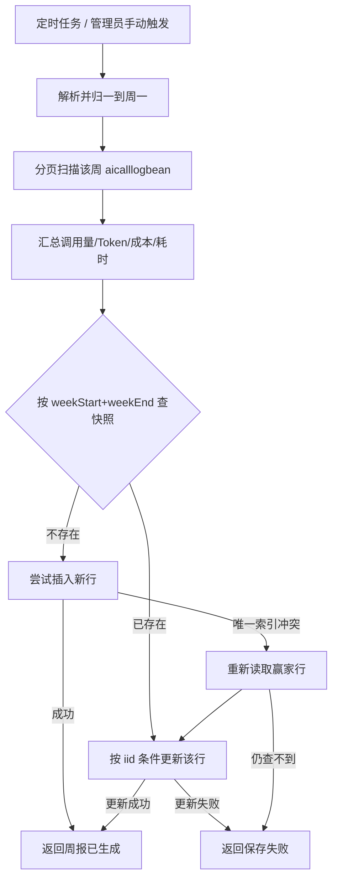

# 学习文档：周报写入原子性与唯一约束（阶段 1 · 子阶段 5E）

## 1. 业务目标与范围

AI 调用周报是治理看板的周期性留档：每周一行，记录调用量、成功率、Token、成本与耗时。
它有两个写入口——周一凌晨的定时任务，以及管理员在后台的手动「生成」。

原实现是「先删本周旧快照，再插入新快照」。这在单实例、低并发时看起来没问题，
但它是两个独立写操作，中间没有任何事务保护（本项目统一不使用 `@Transactional`）：

| 编号 | 缺口 | 后果 |
| --- | --- | --- |
| G1 | 删除与插入之间进程退出 | 这一周的快照永久缺失，直到下次手动补生成 |
| G2 | 插入失败被忽略 | 旧快照已删、新快照没写成，接口却返回「周报已生成」 |
| G3 | 没有唯一约束 | 手动触发与定时任务并发时，两边都查不到旧行，双双插入，同一周出现两行 |
| G4 | 列表按周倒序展示 | 同周两行会让管理员看到重复周报，趋势对比失真 |

本子阶段（5E）实现：

- 写入改为「有则更新、无则插入」，不再删除后重建；
- 插入撞上并发冲突时重新读取赢家行并更新，接口仍返回成功；
- 更新或插入确实失败时如实返回失败，不再假报成功；
- 数据库补 `(weekStart, weekEnd)` 唯一索引，作为并发写入的最后一道闸门；
- 迁移时先保留同周 iid 最大（最新）的一行，再建索引，避免历史脏数据让索引创建失败。

明确不做：

- 不引入 `@Transactional`（项目既有约定，见 4.1）；
- 不改变周报的聚合口径与接口字段；
- 不新增前端页面或接口。

## 2. 业务流程图



关键点：所有路径都不再删除旧行。最坏情况下（更新失败），旧快照仍然完整，
管理员看到的是「稍后重试」，而不是一个消失的周。

## 3. 前端原理

本阶段不修改前端。管理后台「AI 网关治理」页的周报区域有两个动作：

- 点「生成周报」：`POST /api/aiWeeklyReport/generate`，成功后重新拉取列表；
- 打开页面：`POST /api/aiWeeklyReport/list`，按 `weekStart` 倒序展示。

前端只信任接口返回的 `resp_code` 与 `resp_msg`。旧后端在插入失败时也返回成功，
前端无法分辨；改成失败即返回非 0 后，前端现有的错误提示链路会直接把
「周报保存失败，请稍后重试」展示出来，不需要新增判断。

列表排序在前端与 Holder 各做了一次（Holder 返回前排序，前端保持后端顺序），
重复周行消失后，趋势不会被同一周的两行打断。

## 4. 后端原理

### 4.1 为什么不用 `@Transactional`

项目约定不在 Holder 上使用 `@Transactional`（见 `RagEvalDatasetBean` 的注释）。
原因是 HNSP 的 Mapper 封装了自己的连接与 SQL 执行路径，事务边界是否能可靠覆盖
`install` / `update` 取决于框架实现；在没有完整集成测试的情况下贸然加注解，
容易得到「看起来有事务、实际每次自动提交」的假象。

因此这里采用「幂等写 + 唯一约束兜底」：

1. 先查本周快照；
2. 有则按主键更新；
3. 无则插入；
4. 插入因并发冲突失败时，重新查再更新；
5. 唯一索引保证任何时刻最多一行。

这不是严格意义上的 ACID 事务，但对「一周一行快照」这个业务目标足够：
最终状态收敛到一行，且中间状态不会丢失旧数据。

### 4.2 为什么是「更新优先」而不是「插入优先 + 冲突更新」

插入优先也能配合唯一索引，但在「已存在」这个常见路径上会先制造一次冲突异常，
日志里全是可预期的重复键告警，排查真实故障时噪音很大。
先查再更新让常规路径保持安静，只有真正的并发首次生成才会走冲突分支。

### 4.3 为什么更新条件只用 iid

不能用 `weekStart + weekEnd` 作为更新条件：如果历史数据里同一周已经有两行，
条件更新会把两行一起改掉，问题从「重复」变成「重复且内容相同」，
唯一索引仍然建不起来。按 iid 更新只影响选中的那一行，行为可预测。

### 4.4 日期归一

`generate` 接受任意 `yyyy-MM-dd`，先 `with(DayOfWeek.MONDAY)` 对齐到所在周的周一，
再算周日。传入周三、周五都会落到同一个周区间，避免同一自然周因传入日期不同
被当成两份快照。缺省（`null`）取上一自然周，与定时任务口径一致。

### 4.5 聚合口径不变

- `totalCalls`：扫描到的日志行数；
- `successCalls`：`status == "success"`；
- `failedCalls`：其余状态（failed / aborted / blocked 等）；
- `totalTokens` / `costCents`：非空值累加；
- `avgLatencyMs` / `avgFirstTokenMs`：只对有值的行求平均；
- `topUser` / `topModel`：只统计成功调用，按次数取最大。

这些口径与治理看板保持一致，本阶段未改动。

## 5. API 调用链路

```text
POST /api/aiWeeklyReport/generate
  → AiWeeklyReportController.generate(uid, body)
  → 校验 uid 非空且 isAdmin(uid)
  → AiWeeklyReportHolder.generate(body.weekStart)
  → 分页聚合 aicalllogbean
  → saveSnapshot(report)
      → reportMapper.select(null, week)
      → 有行：reportMapper.update(current, where iid)
      → 无行：reportMapper.install(report)
              └─ 冲突：重新 select → update
  → Result<AiWeeklyReportBean>
```

```text
POST /api/aiWeeklyReport/list
  → 校验登录 + isAdmin
  → AiWeeklyReportHolder.list()
  → reportMapper.select(null, new AiWeeklyReportBean())
  → 按 weekStart 倒序
```

权限仍由后端校验，前端不参与授权判断。

## 6. 数据库设计与迁移

表 `aiweeklyreportbean` 结构不变：

| 列 | 类型 | 说明 |
| --- | --- | --- |
| weekStart | varchar(16) | 周一日期 `yyyy-MM-dd` |
| weekEnd | varchar(16) | 周日日期 `yyyy-MM-dd` |
| totalCalls / successCalls / failedCalls | int8 | 调用量快照 |
| totalTokens / costCents | int8 | Token 与成本（毫分） |
| avgLatencyMs / avgFirstTokenMs | int8 | 平均耗时 |
| topUser / topModel | varchar(255) | 调用最多的用户/模型 |
| iid | bigserial | 主键 |

### 6.1 迁移语句（应用启动时自动执行）

`TableSchemaInitializer.ensureWeeklyReportUniqueWeek()` 在周报表创建之后执行：

```sql
-- 1) 历史脏数据去重：同周只保留 iid 最大（最新）的一行
DELETE FROM aiweeklyreportbean a
USING aiweeklyreportbean b
WHERE a."weekStart" = b."weekStart"
  AND a."weekEnd" = b."weekEnd"
  AND a."iid" < b."iid";

-- 2) 唯一约束：一周一行
CREATE UNIQUE INDEX IF NOT EXISTS idx_aiweeklyreport_week
ON aiweeklyreportbean ("weekStart", "weekEnd");
```

两条语句都可重复执行：

- 去重语句第二次执行时没有 `a.iid < b.iid` 的行，删除 0 行；
- 索引使用 `IF NOT EXISTS`，已存在时直接跳过。

`weekStart` 或 `weekEnd` 为 NULL 的行不参与去重，也不会互相冲突
（PostgreSQL 唯一索引允许任意多个 NULL）。这类行只可能来自人工直接写库，
不在生成逻辑的产出范围内。

### 6.2 上线前检查（可选）

```sql
SELECT "weekStart", "weekEnd", count(*)
FROM aiweeklyreportbean
GROUP BY "weekStart", "weekEnd"
HAVING count(*) > 1;
```

查询结果就是迁移会删掉的行；如需保留审计副本，先备份：
`CREATE TABLE aiweeklyreportbean_bak_5e AS SELECT * FROM aiweeklyreportbean;`

### 6.3 回滚方案

- 索引回滚：`DROP INDEX IF EXISTS idx_aiweeklyreport_week;`
- 数据回滚：去重删除的重复行不留副本，需依赖 6.2 的备份表；
- 代码回滚：恢复旧的 delete + insert 即可，字段与接口未变。

去重只删除「同一周、同一区间」的重复快照，保留最新一行，与旧代码注释声明的
「同周重复生成只保留最新一份」语义一致。

## 7. 核心代码与口径

### 7.1 写入入口（AiWeeklyReportHolder）

```java
return saveSnapshot(report);

private Result<AiWeeklyReportBean> saveSnapshot(AiWeeklyReportBean report) {
    AiWeeklyReportBean week = new AiWeeklyReportBean();
    week.setWeekStart(report.getWeekStart());
    week.setWeekEnd(report.getWeekEnd());
    List<AiWeeklyReportBean> existing = reportMapper.select(null, week);
    if (existing != null && !existing.isEmpty()) {
        return updateSnapshot(existing.get(0), report);
    }
    try {
        if (reportMapper.install(report) > 0) {
            logGenerated(report);
            return Result.succeed(report, "周报已生成");
        }
    } catch (Exception e) {
        log.warn("[周报] 插入冲突，转为更新已有快照: {} ~ {}，原因: {}",
                report.getWeekStart(), report.getWeekEnd(), e.getMessage());
    }
    List<AiWeeklyReportBean> winner = reportMapper.select(null, week);
    if (winner == null || winner.isEmpty()) {
        return Result.failed(null, "周报保存失败，请稍后重试");
    }
    return updateSnapshot(winner.get(0), report);
}
```

### 7.2 按主键覆盖

```java
private Result<AiWeeklyReportBean> updateSnapshot(AiWeeklyReportBean current,
                                                  AiWeeklyReportBean report) {
    // 把新快照的指标逐项写回已存在的行，保留 iid/createtime 等审计字段
    current.setWeekStart(report.getWeekStart());
    // ... 其余指标同上 ...
    current.setLastuser("system");
    AiWeeklyReportBean where = new AiWeeklyReportBean();
    where.setIid(current.getIid());
    if (reportMapper.update(current, where) <= 0) {
        return Result.failed(null, "周报保存失败，请稍后重试");
    }
    logGenerated(report);
    return Result.succeed(report, "周报已生成");
}
```

### 7.3 可验证口径

| 场景 | 期望行为 | 对应测试 |
| --- | --- | --- |
| 本周已有快照 | 更新原行，不 delete、不 insert | `regenerateSameWeekUpdatesExistingRowInsteadOfDeletingIt` |
| 本周首次生成 | insert 一行 | `firstGenerationInsertsSingleSnapshot` |
| 并发首次生成 | insert 冲突后更新赢家行 | `concurrentInsertConflictFallsBackToUpdatingWinner` |
| 更新影响 0 行 | 返回失败，不假报成功 | `failedUpdateDoesNotClaimSuccess` |
| 日期格式错误 | 不查库，直接返回格式提示 | `invalidDateIsRejectedBeforeQuery` |

## 8. 异常处理

| 异常/分支 | 处理 | 用户看到 |
| --- | --- | --- |
| 日期格式不是 `yyyy-MM-dd` | 解析前拦截，不查库 | 「日期格式应为 yyyy-MM-dd」 |
| 聚合查询返回 null/空 | 按 0 值生成快照 | 正常生成，指标为 0 |
| 已存在行更新返回 0 | 返回失败 | 「周报保存失败，请稍后重试」 |
| 首次插入返回 0 | 继续走「重查 → 更新」 | 更新成功则正常；否则保存失败 |
| 插入抛唯一键冲突 | 记 warning，重查赢家行后更新 | 正常生成（最终一致） |
| 冲突后仍查不到行 | 返回失败 | 「周报保存失败，请稍后重试」 |
| 定时任务抛异常 | Scheduler 捕获并记日志 | 不影响下一次调度 |

## 9. 验收方法

### 9.1 自动化结果（2026-11-06 实测）

后端完整 reactor（JDK 8，离线 settings）：

| 模块 | 通过数 |
| --- | --- |
| app-common | 7 |
| app-business-permission | 71 |
| app-business-service | 463（5D 为 458，新增 5） |
| app-start | 27 |
| 合计 | 568 |

新增测试 `AiWeeklyReportHolderTest` 5 项全部通过。前端本阶段无改动，
沿用 5D 实测：逻辑 245、组件 256、E2E 21、streaming 14。

门禁：`check:markdown` 10 项、`check:secrets` 117 个产物、`npm run build`、
`check:bundle`（首屏 JS 203.3/260 kB，CSS 58.3/80 kB）均通过。

### 9.2 本阶段没有证明什么

- 本机没有可用的 PostgreSQL 客户端、5432 监听或 Docker 容器，
  迁移 SQL 未在真实数据库执行；它会在下次后端启动时由 `TableSchemaInitializer` 执行。
- 单元测试使用 Mockito 模拟 Mapper，验证的是调用顺序与条件，不是 SQL 方言兼容性。
- 未做真实双实例并发压测；并发路径的正确性由唯一索引语义与冲突回退测试保证。

### 9.3 残余风险

- 聚合分页上限为 100 页 × 500 行 = 50,000 行/周；超出的调用不会被统计。
  这是既有实现的上限，本阶段未改动，后续可改为按 `totalSize` 收敛分页。
- 多实例同时生成时，后提交的快照会覆盖先提交的；两边统计窗口相同，
  差异只来自扫描期间新产生的日志，属于可接受的最终一致。
- 迁移去重会删除同周重复行且不留副本，上线前如需审计应先执行 6.2 的备份。

## 10. 面试问答

### Q1：为什么不用数据库事务保证「删旧 + 插新」？

项目现有的 Mapper 封装没有经过事务边界的集成验证，直接加 `@Transactional`
可能只是「看起来有事务」。更稳的做法是把写操作设计成幂等：更新优先、
插入冲突转更新、唯一索引兜底。这样即使没有事务，也不会出现「旧行没了、新行没写」的中间态。

### Q2：唯一索引和「先查后写」不是重复了吗？

不重复。先查后写解决常规路径的效率和日志噪音；唯一索引解决「两个请求同时查到不存在」
这个检查与写入之间的竞态。数据库的唯一约束是并发下唯一可靠的仲裁者。

### Q3：插入冲突后为什么要重新查一次，而不是直接更新？

唯一索引冲突意味着另一行已经提交，但当前请求手里没有它的 iid。
`update` 需要主键条件，所以必须重新读一次拿到赢家行；直接按周区间更新
在历史脏数据存在时可能误伤多行。

### Q4：去重为什么保留 iid 最大的行？

旧逻辑的语义是「同周重复生成只保留最新一份」，iid 递增，最大的就是最后写入的。
保留最新快照与用户预期一致；保留最旧反而会把刚生成的正确数据丢掉。

### Q5：如果 weekStart 或 weekEnd 是 NULL，唯一索引能兜住吗？

不能，PostgreSQL 唯一索引把 NULL 视为互不相等。生成逻辑永远写入非空日期，
NULL 只可能来自人工直接写库；如果确实要约束 NULL，需要使用
`NULLS NOT DISTINCT`（PostgreSQL 15+）或把列改为 NOT NULL，本项目暂不需要。

### Q6：这个改动对前端有什么影响？

接口路径、字段、成功码都没变。唯一的行为变化是「保存失败时不再假报成功」，
前端现有的错误提示会把 `resp_msg` 展示出来，无需改动。

### Q7：如何证明并发路径真的收敛到一行？

测试层面模拟了「首次查询为空 → 插入抛冲突 → 重新查询拿到赢家行 → 更新成功」；
数据库层面唯一索引保证第二次插入不可能成功。两者合起来即可推出最终只有一行。
真实多实例压测尚未做，见 9.3。
